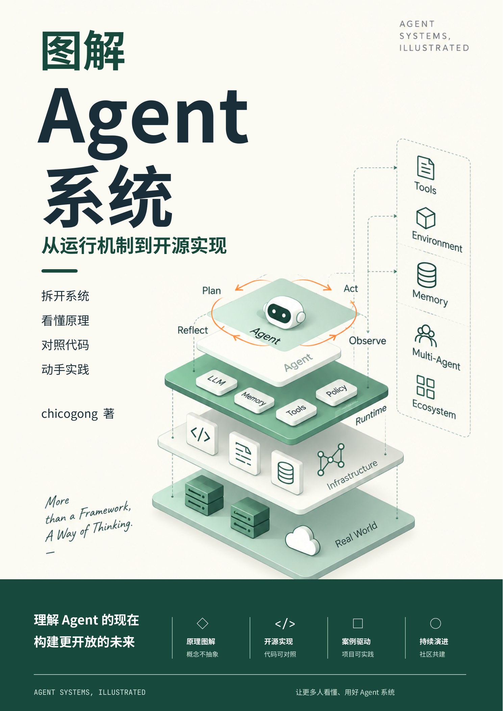
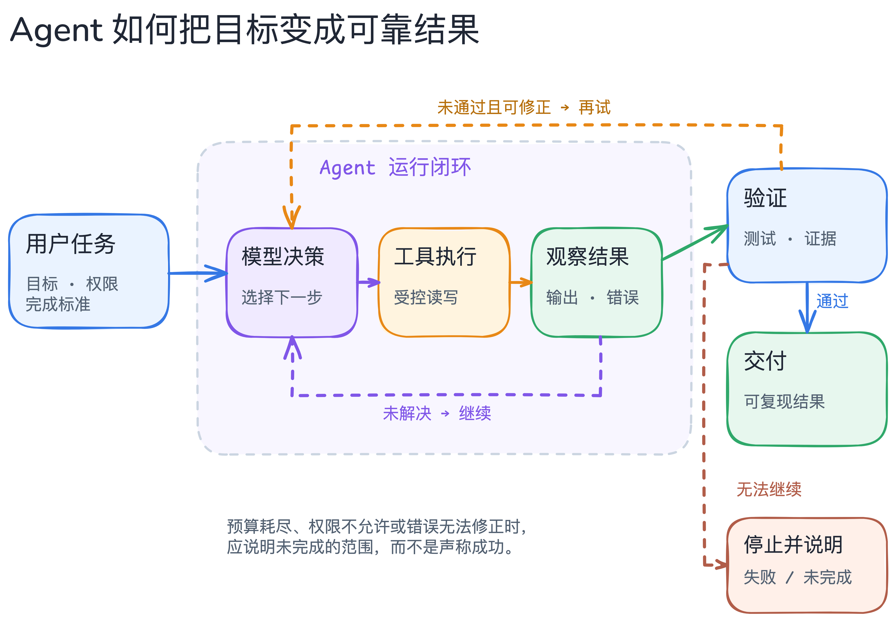
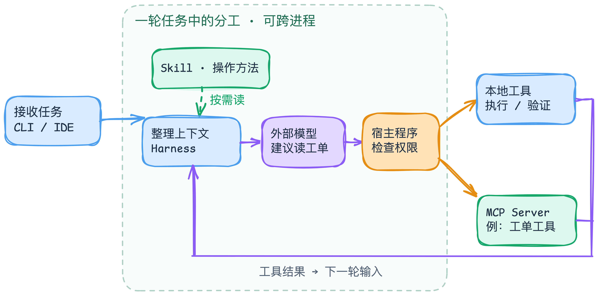
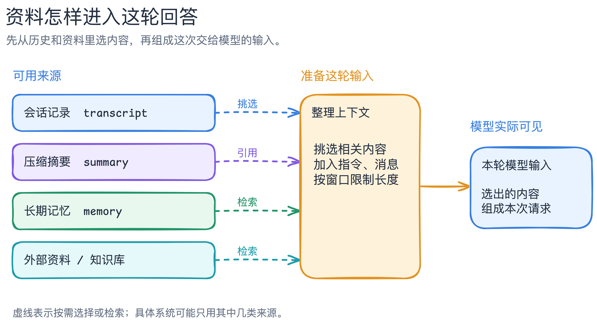
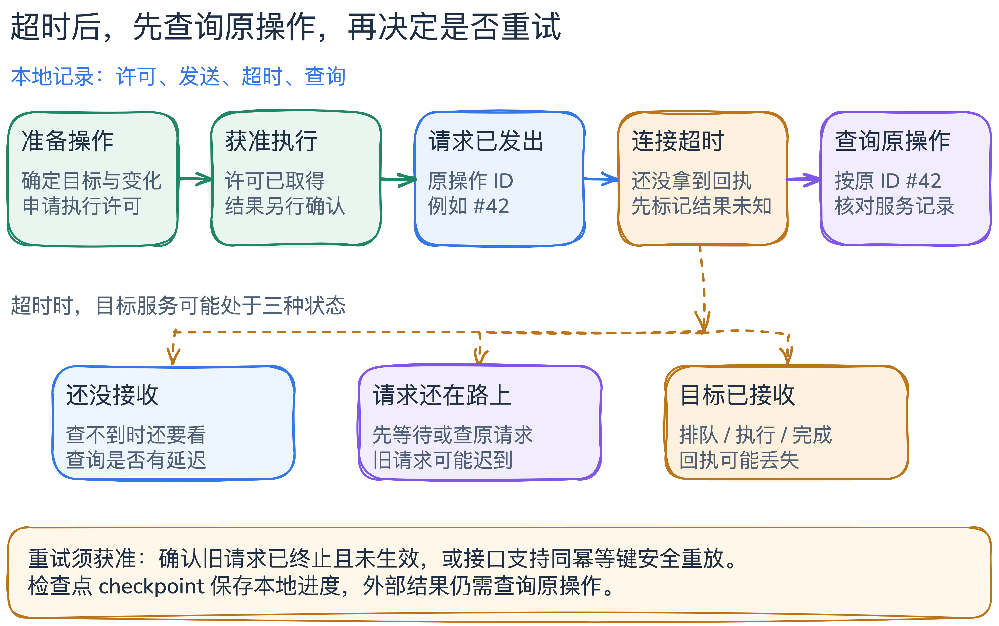
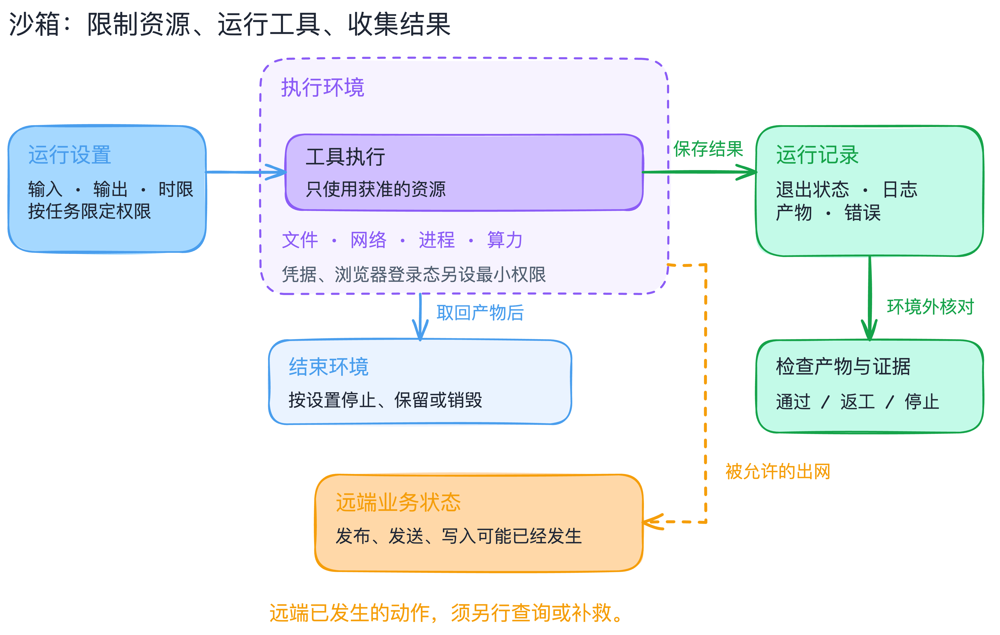
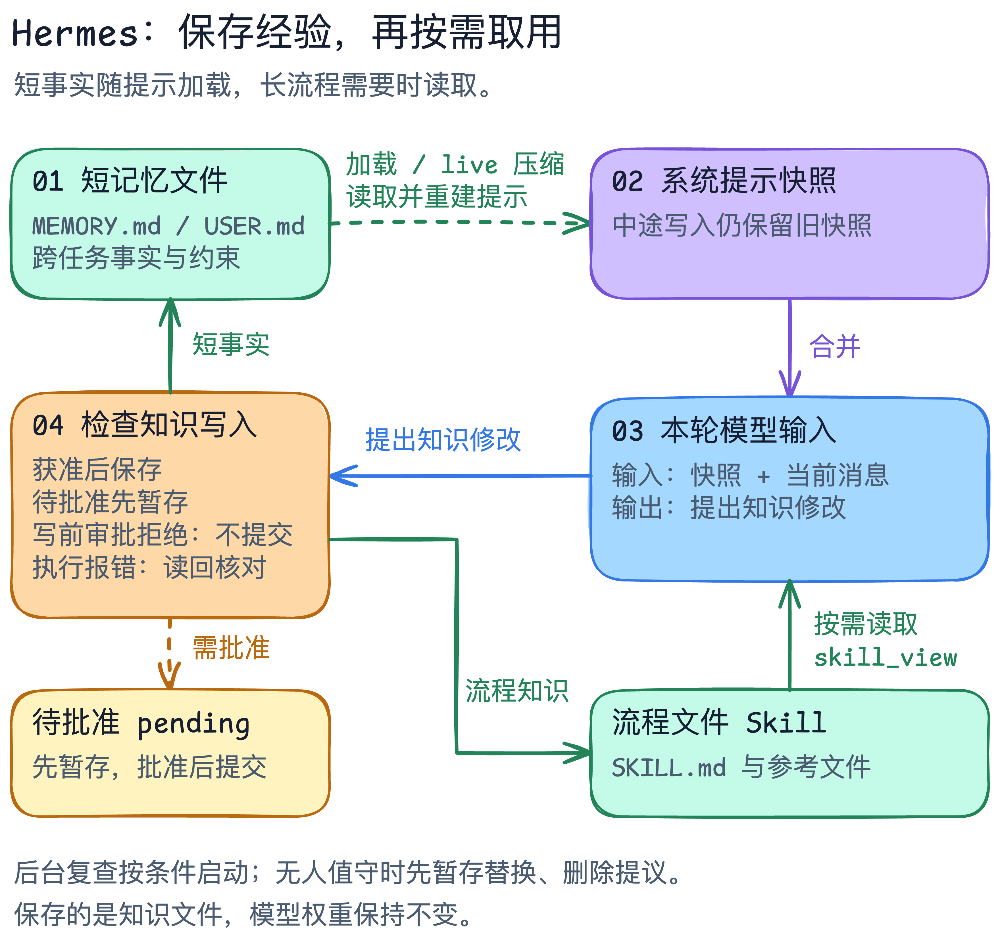
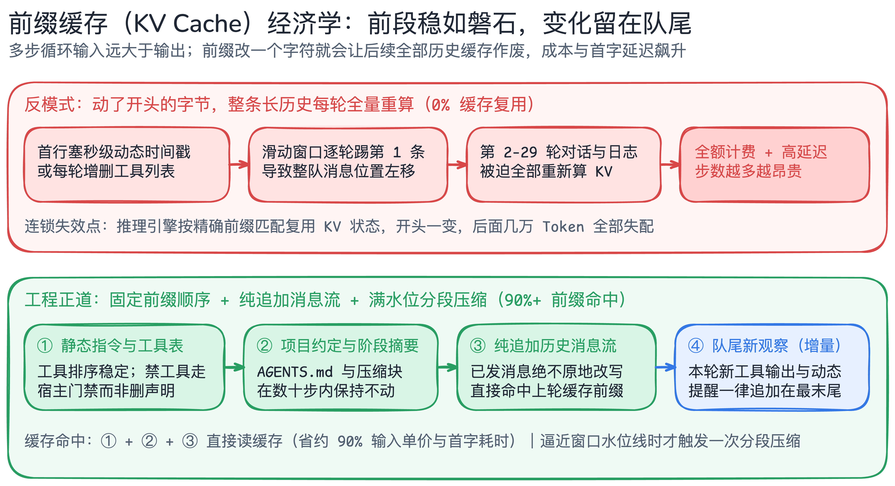
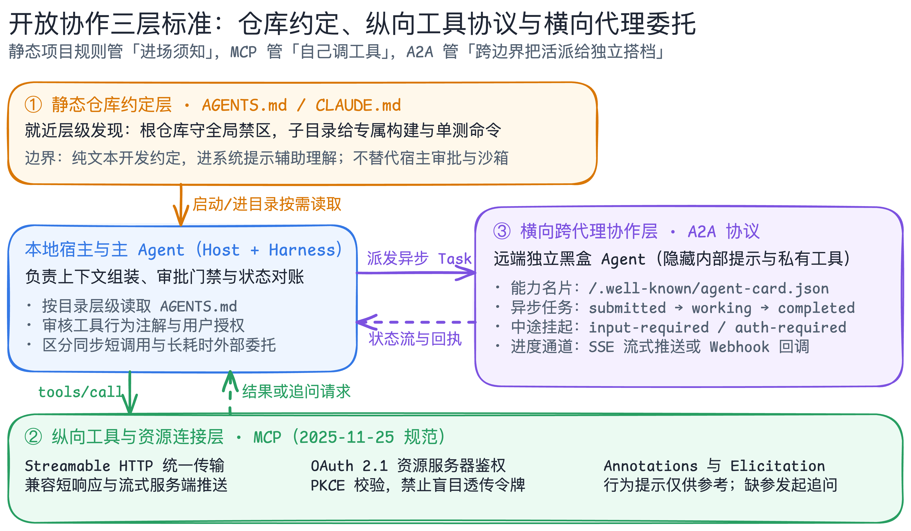

# 图解 Agent 系统

**一本免费开源的中文图解教程：拆开循环、上下文、工具边界与故障恢复，看清 Agent 怎样把事做成**。

[在线阅读](https://books.aimake.cc/) · [学习与应用](docs/learning-and-practice.md) · [选择阅读路线](docs/learning-path.md) · [按书序阅读](book/CONTENTS.md) · [PDF 电子校样](https://books.aimake.cc/pdf)

聊到第 30 轮突然忘掉最开始定下的硬约束；资料明明存进了知识库，回答时却漏掉截止时间；让 AI 改一行超时配置，测试跑绿了，重试次数却被顺手改成了 `0`；外部请求超时未响应，贸然重试又怕把同一笔操作执行两遍——无论日常用 AI 整理材料，还是亲手搭建自动化系统，几乎每个人都会撞上这些棘手时刻。

这些问题单靠“换句提示词”解决不了，因为症结往往出在模型之外的工程链路：**循环靠什么条件推进与停机、上下文怎样筛选装入、工具权限与沙箱怎样拦截爆炸半径、异常中断后靠什么证据恢复**。本书用一张张职责分明的图解与真实流转的数据把黑盒拆开：零基础读者用纸笔跟着日常资料例子就能走通全过程；想深究实现的读者，可以顺着固定 commit 直达 Pi、Codex、OpenCode、LangGraph 等开源项目的关键代码路径。

## 翻几张图，看看书里怎么讲

每张图聚焦一个核心工程问题，正文配齐正反案例与数据流转，代码导读供需要深入实现的读者按需翻阅。点击缩略图可查看高清矢量 SVG，每组图均附文字版说明与可编辑 `.excalidraw` 源文件。

| 从目标到一份有出处的回答 | 一项任务中，谁负责什么 |
| --- | --- |
|  |  |
| [读 Agent loop](docs/concepts/agent-loop.md) | [读一项任务里的分工](docs/concepts/model-harness-cli-mcp-skill.md) |
| **资料怎样进入这次回答** | **超时后，先查询原操作** |
|  |  |
| [读上下文与记忆](docs/concepts/context-vs-memory.md) | [读审批、恢复与回执丢失实验](docs/comparisons/permission-and-recovery.md) |
| **给代码安排合适的执行环境** | **Hermes 怎样保存和使用记忆** |
|  |  |
| [读沙箱与生命周期](docs/concepts/sandbox-execution.md) | [读 Hermes 的知识维护路径](docs/systems/hermes/README.md) |
| **前缀缓存：为什么改开头会让账单翻十倍** | **AGENTS.md、MCP 与 A2A 开放协议栈** |
|  |  |
| [读前缀缓存与上下文经济学](docs/concepts/cache-and-cost-economics.md) | [读开放协作协议栈](docs/concepts/open-agent-protocols.md) |

全部 **40 组**插图目录与无障碍文字说明见[图稿索引](figures/README.md)。

## 你可以怎样读

- **学生、老师与零基础读者**：从[学习与应用导读](docs/learning-and-practice.md)开始，看几份零散通知怎样变成句句有出处、缺项单列待查的可靠说明，再顺读 [Agent 循环](docs/concepts/agent-loop.md)。学生可用来梳理课程重点，老师可直接改成课堂讨论活动，全程无需写代码。
- **已经在用 AI、想告别幻觉与返工**：用[学习与应用](docs/learning-and-practice.md#把方法带到你的场景)中的任务卡练习拆解目标、核对证据与划清操作边界；再读[上下文与记忆](docs/concepts/context-vs-memory.md)，看清为什么“存了资料”不等于“模型这轮看见了”。遇到卡点可搭配[AI 陪读](book/frontmatter/reading-guide.md#和-ai-一起读)对练。
- **想探索 AI 相关产品或技术方向**：先挑一件具体小事（整理多源简报、拆解概念或设计一张工具说明卡），保留从初稿翻车到修正验收的完整记录，再沿[阅读路线](docs/learning-path.md)按阶深入你最感兴趣的环节。
- **想读懂一个真实开源项目**：从分层清晰的 [Pi 的运行核心与外壳](docs/systems/pi/README.md)或 [Codex 的命令审批与执行](docs/systems/codex/README.md)切入。每篇锚定单一版本的入口函数、核心回路与失败分支，无需从头通读整座仓库。
- **正在设计或调优自己的系统**：带着具体问题直查[核心机制](docs/concepts/README.md)、[跨系统对照](docs/comparisons/README.md)和[术语表](docs/glossary.md)，横向比较不同项目在循环终止、状态持久化、权限审批与超时恢复上的架构取舍。

读到陌生的图或代码段时，随时可以用[AI 陪读](book/frontmatter/reading-guide.md#和-ai-一起读)里的苏格拉底提示词：先说出自己的理解，让助手追问卡点，再回到原文与源码逐条核对。

## 内容地图

| 章节类型 | 解决什么问题 | 推荐试看 |
| --- | --- | --- |
| **学习与应用** | 把“明确约束、锚定出处、单列待查”落回学习、备课与日常工作交接 | [把所学用起来](docs/learning-and-practice.md) · [阅读路线](docs/learning-path.md) · [AI 陪读](book/frontmatter/reading-guide.md#和-ai-一起读) |
| **机制图解（16 篇）** | 拆清循环、上下文、前缀缓存、开放协议（AGENTS.md / MCP / A2A）、沙箱与 `pass^k` 评测各自守哪道边界 | [Agent loop](docs/concepts/agent-loop.md) · [前缀缓存经济学](docs/concepts/cache-and-cost-economics.md) · [开放协作协议栈](docs/concepts/open-agent-protocols.md) · [观察与评测](docs/concepts/observation-evaluation.md) |
| **开源项目讲解（16 套）** | 追踪固定 commit 里的真实调用链，看一线项目如何把概念写成可维护代码 | [Pi](docs/systems/pi/README.md) · [OpenCode](docs/systems/opencode/README.md) · [LangGraph](docs/systems/langgraph/README.md) |
| **横向对照（6 篇）** | 同一工程难题放在一起比，看清不同架构方案的收益与代价 | [循环与停止](docs/comparisons/loop-and-stop.md) · [持久与可见漏斗](docs/comparisons/persisted-vs-visible.md) · [四种状态](docs/comparisons/four-kinds-of-state.md) · [权限与恢复](docs/comparisons/permission-and-recovery.md) |
| **交互实验（5 组）** | 网页端直接单步回放状态机，或用零依赖 Python 标准库脚本在本地复现裁剪、越权与幂等查账 | [第一轮 Agent](docs/labs/first-agent-loop.md) · [上下文预算](docs/labs/context-budget.md) · [证据契约](docs/labs/evidence-contract.md) · [本地 HTTP 回执](docs/labs/http-receipt.md) |

开源系统篇覆盖 Pi、DSH（DeepSeek Harness）、Codex、OpenCode、mini-SWE-agent、OpenHands、Browser Use、Qwen Code、Kimi Code、MiMo Code、Letta Code、Hermes Agent、Mem0、LangGraph、OpenClaw 与 GPT Researcher，横跨编码助手、编排运行时与记忆组件。每篇聚焦项目最具代表性的一条实现主干，完整清单见[系统索引](docs/systems/README.md)，整体规划见[选题地图](docs/program.md)与[扩写计划](docs/curriculum-expansion.md)。

围绕高风险执行边界，书中还专门拆解了隔离文件与网络爆炸半径的[沙箱](docs/concepts/sandbox-execution.md)、观察页面并守住提交边界的[Computer／Browser Use](docs/concepts/computer-and-browser-use.md)，以及核对引用真伪与越权调用的[资料与工具权限小实验](docs/labs/evidence-contract.md)。

## 选择顺手的阅读方式

| 入口 | 适合什么场景 |
| --- | --- |
| [在线阅读站](https://books.aimake.cc/) | 手机与桌面端沉浸阅读、毫秒级分词检索、**零安装状态机单步回放器**、大图读图步进指南与一键复制 AI 苏格拉底陪读包。 |
| [GitHub 书序目录](book/CONTENTS.md) | 直接浏览唯一 Markdown 源稿、源码行号链接、图源与修订记录。 |
| [可携带 Markdown 阅读包](https://books.aimake.cc/downloads) | 打包下载固定版本 ZIP，离线导入 Obsidian 或任意阅读器，附图与实验脚本完整保留，也支持[自行构建](book/README.md#markdown-阅读包)。 |
| [PDF 电子校样](https://books.aimake.cc/pdf) | 适合平板连续翻阅与划线批注的电子校样版。 |

全书只维护一份 Markdown 源稿，由 `book/manifest.txt` 统一驱动网站、目录、阅读包与 PDF 的章节顺序；最新完稿进度与待补事项以[当前状态](docs/roadmap.md)为准。

## 证据、图源与参与

本书是一部持续迭代的公开书稿。系统篇结论严格区分**静态源码、官方文档与本地确定性实验**，章末统一列出核对过的上游固定 commit（汇总于[来源台账](sources/README.md)）及未覆盖边界；图稿与校对标准详见[图稿规范](figures/STYLE.md)、[写作与校稿方法](docs/editorial-plan.md)与[出版验收单](docs/publication-checklist.md)。

读到拗口的句子、看不清的箭头，或发现源码解读有偏差，欢迎随时指出章节与位置：[网站反馈入口](https://books.aimake.cc/feedback) · [贡献指南](CONTRIBUTING.md) · 作者邮箱 [ghr7719@gmail.com](mailto:ghr7719@gmail.com)。也诚邀你参与[三道看图破案试读](docs/reader-trial.md)，检验书里的图解是否真正把问题讲透。

本书原创正文与插图采用 [CC BY 4.0](LICENSE-CONTENT.md) 许可，构建与实验脚本采用 [MIT](LICENSE-CODE) 许可；所引用的上游开源项目、商标及第三方资料遵循各自原有许可，[封面与书脊设计参考](book/assets/README.md)仅供数字预览与排版示意。
