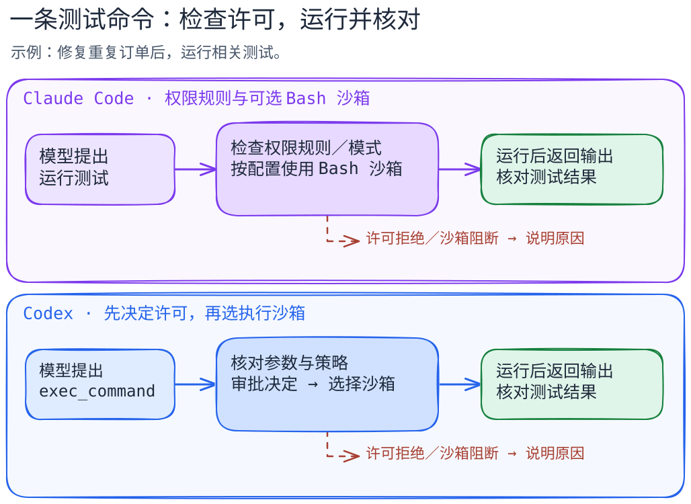

# Claude Code 与 Codex：同一修复任务如何执行与受控？

[返回横向对照](README.md) · [先读五层职责](../concepts/model-harness-cli-mcp-skill.md) · [Codex 命令路径](../systems/codex/README.md)

很多开发者的终端里同时装着 `claude` 和 `codex`。日常修 Bug 时，你很容易遇到两桩让人困惑的事：

1. 明明在仓库根目录的 `CLAUDE.md` 或 `AGENTS.md` 里白纸黑字写着“可以随便跑单测，严禁运行 `git push`”，为什么跑 `npm test` 时有时还会弹窗求批准，而一旦放开自动批准，单靠那行 Markdown 又拦不住高危命令？
2. 明明开启了本地命令沙箱（Sandbox），以为一切写入都被关进了笼子，结果 Agent 调起工单系统的 MCP 工具时，一个请求就直接改掉了远端线上工单的状态。

问题出在我们把**提示词约定**、**工具审批**、**OS 进程沙箱**和**外部服务权限**混成了一道墙。实际上，无论是 Claude Code 还是 Codex，一次代码修复动作从“模型动念头”到“真正落到机器上”，都要穿过四道职责截然不同的控制关口。



[可编辑图源](../../figures/claude-code-codex/scene.excalidraw) · [PNG 预览](../../figures/claude-code-codex/preview.png) · [图的文字版](../../figures/claude-code-codex/README.md)

## 用同一个真实修复场景对齐两边的工作流

拿一个典型的后端缺陷来做切片：订单服务在高并发网络抖动下，客户端重发了带相同幂等键（Idempotency Key）的下单请求，服务没有返回原订单，而是重复创建了两笔订单。

你在终端给助手下达同一条任务指令：

```text
先读项目规范和工单 #731，补一个能稳定失败的幂等回归测试，再修复实现并只跑 orders 模块测试；
不要 git commit 或 git push，最后给我改动摘要和测试输出。
```

假设本地已经配好了读取工单系统的 MCP 服务，以及一份约束“测试驱动修复（先红后绿）”步骤的 Skill。顺着这条工作流走一遍，就能看清两套工具在五个关键节点上的异同：

1. **启动入口与读取项目指令**：交互式终端直接用 `claude` 或 `codex` 启动；写进 CI 脚本或批处理流水线时，两边分别提供非交互入口 [`claude -p`](https://code.claude.com/docs/en/headless) 与 [`codex exec`](https://developers.openai.com/codex/noninteractive)。启动后，Claude Code 将工作目录、Git 状态与 `CLAUDE.md` 纳入上下文，Codex 则按目录层级读取 `AGENTS.md`。**关键体感差异不在文件名，而在边界认知**：这两份文件本质上都是喂给模型的“行事指南（软约束）”，它们能引导模型先写测试、少走弯路，但**绝不会自动赋予或剥夺底层工具的执行权限**。[Claude Code 工作方式](https://code.claude.com/docs/en/how-claude-code-works) · [Codex `AGENTS.md` 指南](https://developers.openai.com/codex/guides/agents-md)
2. **拉取外部工单与按需加载做法**（MCP 与 Skill）：模型通过 MCP 工具拉取 `#731` 工单详情，同时按需读取 TDD Skill 里的测试编写规范。为什么要把 Skill 与 `CLAUDE.md` / `AGENTS.md` 分开？因为项目主指令每轮常驻窗口，塞太多专项流程会白白烧掉上下文预算；Skill 则是“用到这类任务时才翻开的专项手册”。至于 MCP，它能读到哪张工单、能不能改工单状态，完全取决于你给该 MCP Server 配置的凭据与工具许可；如果连接失败，正确的处理是把“工单正文待核对”明确记入交付缺口，而不是靠猜需求硬写代码。[Claude Code MCP](https://code.claude.com/docs/en/mcp) · [Claude Code Skills](https://code.claude.com/docs/en/skills) · [Codex MCP](https://developers.openai.com/codex/mcp) · [Codex Skills](https://developers.openai.com/codex/skills)
3. **模型提出工具动作提案**：拿到复现条件后，模型依次提议搜索代码、修改测试文件、执行 `npm test -- orders`。在 Claude Code 官方文档中，这一闭环被归纳为“收集上下文 → 采取行动 → 验证结果”；而在 Codex 的开源 Rust 核心里，一条 Shell 命令提案会精确进入 `exec_command` 通道：先由 Handler 解析参数，再交给 Unified Exec 查询策略判定，最后由 `ToolOrchestrator`（执行编排器）串联审批与沙箱运行。[Claude Code 循环](https://code.claude.com/docs/en/how-claude-code-works) · [Codex 代码导读](../systems/codex/code-walkthrough.md)
4. **过审批闸口与进 OS 沙箱执行**：这是日常实操体感差异最明显的一步！
   - 在 **Claude Code** 中，当前权限模式、`allow / ask / deny` 规则、可选 Hook 与沙箱开关共同决定命令命运。为什么很多人开了沙箱后觉得弹窗变少了？因为启用沙箱且 `autoAllowBashIfSandboxed` 生效时，系统用“OS 级文件系统与网络隔离”兜住了爆炸半径，从而省掉一部分笼统的整工具 Bash 询问；但针对特定高危命令内容的 `ask` 规则和显式 `deny` 黑名单依然生效，绝不会被沙箱开关绕过。**特别需要注意的是：Claude Code 沙箱默认的文件只读权限（read permissions）仍包含用户主目录下的敏感凭据，包括 `~/.ssh` 与 `~/.aws/credentials`**；沙箱主要拦截未放行的写操作和网络外联，若要阻断敏感文件读取，必须在权限配置中显式添加 deny 规则。
   - 在 **Codex** 的固定源码路径中，策略层先对普通命令给出三选一裁决：`Skip`（免除常规人工询问）、`NeedsApproval`（挂起请求你拍板）或 `Forbidden`（直接拦截拒绝）。**注意 `Skip` 的精细行为差异**：常规 `Skip` 跳过的只是人工弹窗，而不是沙箱隔离——获准放行后，`ToolOrchestrator` 依然会为进程挑选首次执行沙箱；**但当 `ExecPolicy` 规则显式将所有命令段均裁决为 `Allow` 时，`bypass_sandbox` 计算为 true，此时 Codex 在首次尝试时将直接绕过沙箱执行，除非策略中另外配置了 `deny-read`（此时仍受沙箱约束以保护读安全）**。若首次运行因沙箱限制失败且满足严格重试条件，才会进入受控的升级询问或二次尝试分支。[Claude Code 权限与沙箱交互](https://code.claude.com/docs/en/permissions#how-permissions-interact-with-sandboxing) · [Codex 策略映射](https://github.com/openai/codex/blob/c44deff7b1083e9660ac55d02122481f1cdf139b/codex-rs/core/src/exec_policy.rs#L394-L460) · [Codex 首次沙箱约束](https://github.com/openai/codex/blob/c44deff7b1083e9660ac55d02122481f1cdf139b/codex-rs/core/src/tools/sandboxing.rs#L239-L279) · [Codex 编排器执行](https://github.com/openai/codex/blob/c44deff7b1083e9660ac55d02122481f1cdf139b/codex-rs/core/src/tools/orchestrator.rs#L151-L309)
5. **依据测试回执迭代并收口交付**：第一次跑 `npm test -- orders` 应当如期失败（证明回归测试真能抓到重复建单 Bug），改完幂等校验逻辑后再跑一次应当变绿。最终交付物不是一句“修好了”，而是工作区真实 diff、测试命令原始输出，以及“未执行 `commit` / `push`、远端工单未改动”的边界确认。

## 多级子 Agent 编排：探索、规划与执行的上下文分水岭

在大型工程代码库（成百上千个文件、数万行逻辑）中，若让单一 Agent 在单条长会话中包办一切，很快会遭遇三大崩溃瓶颈：
1. **注意力稀释与上下文腐化（Context Rot）**：前序 20 轮产生的 `grep` 粗排垃圾与冗长构建日志迅速吞噬十几万 Token，导致最初强调的“严禁修改公共 API 签名”等核心红线被模型淡忘；
2. **KV 前缀缓存频繁击穿（Prefix Cache Bust）**：单会话中每一次工具输出的细微变动都会导致后续推理的 KV 缓存全部作废，产生数倍的 Token 账单与首字延迟惩罚；
3. **单点失效与重试代价过高**：一旦 Agent 在某个局部模块陷入死循环，整条主会话必须经历昂贵的上下文压缩（Compaction）甚至重置。

为了克服单会话瓶颈，现代命令行编程助手广泛演进出分层子 Agent 协作拓扑：

```text
用户任务 ──► [Coordinator 主协调者] (常驻长会话，系统提示与核心红线永久固顶)
                 │
                 ├── 委派探索 (只读权限) ──► [Explorer 子 Agent] (独立上下文，搜完即销毁)
                 │                             └─► 仅交回结构化证据包（目标文件与关键行号）
                 │
                 ├── 委派修改 (局部领地) ──► [Coder 子 Agent] (写权限或 Diff Proposal 补丁)
                 │                             └─► 仅交回工作区补丁与修改摘要
                 │
                 └── 委派验证 (沙箱测试) ──► [Verifier 子 Agent] (执行构建与单测)
                                               └─► 仅交回测试退出码与未覆盖断言
```

这种多级编排带来了两大核心工程确定性：
- **上下文预算与 KV 缓存保护**：以一个教学用假想示例切片说明（注：此处 50,000 Token 与 95% 命中率仅为阐释架构机制的**教学假想示例**，非端到端实测跑分基准）：Explorer 在排查 Bug 时执行 30 次文件读取，产生约 50,000 Token 的过程垃圾。子 Agent 任务结束后，这 50,000 Token **随子会话直接销毁**，只给 Coordinator 交回一份两百字的结构化 JSON 证据包。Coordinator 的历史前缀得以保持纯净递增，在假想的理想稳定前缀下可维持高达 **95% 以上的前缀缓存命中率**。
- **工具权限降级与防踩踏**：在派发子 Agent 时，宿主从协议层实施权限裁剪——给 Explorer 注册的工具集彻底剔除 `Bash` 和 `Write`，杜绝其在搜索过程中意外改动文件；多个 Coder 并发时，通过工作区目录前缀进行领地切分，或统一以 `git diff` 补丁提议交由 Coordinator 汇总结算，从根源消除并发写入覆盖冲突。

## 一张表对齐两边的控制边界

| 核心控制问题 | Claude Code（基于官方文档公开行为） | Codex（基于固定 Rust 源码与官方文档） |
| --- | --- | --- |
| **项目级指令写在哪** | `CLAUDE.md`；随工作目录与会话加载为指令上下文 | `AGENTS.md`；按目录规则加载为指令上下文，同样不自动授予底层工具权限 |
| **命令什么时候弹窗或被拦** | 由权限模式、`allow / ask / deny` 规则、Hook 与沙箱配置联合裁决；沙箱模式下可减少常规 Bash 整工具询问，显式 `deny` 始终兜底 | 普通 `exec_command` 经 `exec_policy` 判出 `Forbidden`（拒止）、`NeedsApproval`（求批）或 `Skip`（免询）。常规 `Skip` 仅免除弹窗仍进沙箱；但当策略显式 `Allow` 全部命令时 `bypass_sandbox` 为 true，首次尝试直接绕过沙箱（除非配置了 `deny-read`） |
| **沙箱到底关住了谁** | Sandboxed Bash 对本地 Shell 命令及其子进程施加写入与网络访问限制（**默认只读权限仍包含 `~/.ssh` 与 `~/.aws/credentials`**，需显式规则拦截敏感读取），**不覆盖非 Bash 的外部工具通道** | 审批与沙箱分步决策：获准后先在选定沙箱内执行首次尝试（显式 Allow 且无 deny-read 时可直出）；受限失败后按条件决定是否升级或重试 |
| **Skill 与 MCP 如何分工** | Skill 提供按需读取的任务做法说明；MCP 接入外部服务工具，受连接身份与工具权限控制 | 同样在产品层分别支持 Skills 与 MCP（独立于上述 `exec_command` 本地命令调用栈） |
| **长任务怎么防丢约束** | 会话支持保存续接，长上下文会自动压缩（compaction），早期口头细节可能被概括稀释 | 官方提供[长周期任务实践说明](https://developers.openai.com/blog/run-long-horizon-tasks-with-codex)；高危红线同样不能只靠早期对话口头叮嘱 |

## 开发者最容易踩的三个实战误区

### 误区一：把“开了本地沙箱”当成“所有工具都安全了”

审批和沙箱回答的是两个正交问题：**审批管这次调用准不准发出去，沙箱管拉起来的本地子进程能碰哪些目录和端口**。来看下面两条动作在宿主里的真实流向：

```text
动作 A: bash("npm test -- orders")
  ──► 经过审批规则 ──► 拉起本地子进程 ──► 受 OS 文件读写围栏与禁网沙箱约束

动作 B: mcp__tickets__close_issue(id=731)
  ──► 经过 MCP 工具权限检查 ──► 由宿主向远端 API 发起请求 ──► 绕开本地 Bash 沙箱直接改写线上数据！
```

无论是 Claude Code 文档对工具权限与 Bash 沙箱的区分，还是 Codex 在策略放行后单独为 `exec_command` 选择首次沙箱，都印证了同一条铁律：**本地 Shell 沙箱防不住拥有写权限的远端 MCP 连接**。外部写工具必须单独配置 ask 确认或只读 Token；同时需留意本地沙箱的读权限边界——例如在 Claude Code 中，沙箱默认读取权限覆盖了用户主目录下的敏感凭据（如 `~/.ssh` 与 `~/.aws/credentials`），防范读取泄漏必须配合显式 deny 规则收口。[Claude Code 权限边界](https://code.claude.com/docs/en/permissions#how-permissions-interact-with-sandboxing) · [Codex 首次沙箱选择](https://github.com/openai/codex/blob/c44deff7b1083e9660ac55d02122481f1cdf139b/codex-rs/core/src/tools/orchestrator.rs#L222-L309)

### 误区二：命令跑失败了，分不清是“代码 Bug”还是“沙箱拦路”

测试命令返回非零退出码时，最忌讳不看原因盲目重试。如果是断言失败，说明业务逻辑没修对，应该把报错喂回模型接着改代码；如果是沙箱禁网或只读目录拦截（例如测试试图连接外部测试库或写临时锁文件），改业务代码毫无意义。在 Codex 源码里，编排器专门在首次执行后检查失败是否源于沙箱限制，并按策略决定是直接返回错误、弹窗请求无沙箱重试，还是终止尝试。[Codex 重试分支](https://github.com/openai/codex/blob/c44deff7b1083e9660ac55d02122481f1cdf139b/codex-rs/core/src/tools/orchestrator.rs#L310-L506)

### 误区三：长会话聊久了，把“禁止推送”只写在第一轮提问里

修一个复杂幂等 Bug 往往要来回跑十几轮搜索和单测。正如 [Claude Code 工作方式文档](https://code.claude.com/docs/en/how-claude-code-works)所说明的，长上下文触发自动压缩后，第一轮顺口提过的附加条件很可能在摘要里被弱化。真正稳妥的工程习惯是两手抓：**把长期规范写进 `CLAUDE.md` / `AGENTS.md`，同时把 `git push` 或生产写操作写进权限配置的 `ask` / `deny` 硬规则里**。

## 源码与文档深读入口

想顺着[五层职责模型](../concepts/model-harness-cli-mcp-skill.md)继续深挖源码与官方接口，可以沿两条主线对照阅读：

- **Codex Rust 核心主线**：从 [`ExecCommandHandler::handle_call`](https://github.com/openai/codex/blob/c44deff7b1083e9660ac55d02122481f1cdf139b/codex-rs/core/src/tools/handlers/unified_exec/exec_command.rs#L170-L245) 切入，依次追踪 [`UnifiedExecProcessManager::open_session_with_sandbox`](https://github.com/openai/codex/blob/c44deff7b1083e9660ac55d02122481f1cdf139b/codex-rs/core/src/unified_exec/process_manager.rs#L1435-L1535)、[`exec_policy` 策略求值](https://github.com/openai/codex/blob/c44deff7b1083e9660ac55d02122481f1cdf139b/codex-rs/core/src/exec_policy.rs#L394-L460)与 [`ToolOrchestrator::run`](https://github.com/openai/codex/blob/c44deff7b1083e9660ac55d02122481f1cdf139b/codex-rs/core/src/tools/orchestrator.rs#L116-L220)，完整串联可配读 [Codex 逐步代码导读](../systems/codex/code-walkthrough.md)。
- **Claude Code 官方文档主线**：依次对照[工作方式](https://code.claude.com/docs/en/how-claude-code-works)，[权限规则](https://code.claude.com/docs/en/permissions)、[沙箱机制](https://code.claude.com/docs/en/sandboxing)、[MCP 集成](https://code.claude.com/docs/en/mcp)与 [Skills 配置](https://code.claude.com/docs/en/skills)，重点核对当前配置下“哪类动作免询、哪类动作弹窗、哪类子进程受沙箱隔离”。

## 来源与边界

本文于 2026-09-23 核对，两边证据粒度不同，阅读时需注意各自边界：

- **Codex**：命令执行、审批与沙箱编排依据官方开源仓库固定提交 [`openai/codex@c44deff7b1083e9660ac55d02122481f1cdf139b`](https://github.com/openai/codex/tree/c44deff7b1083e9660ac55d02122481f1cdf139b) 的 Rust `core` 源码（`apply_patch` 专用补丁通道及各操作系统底层沙箱原语需另行查阅），CLI、Skills 与 MCP 用法结合官方文档。
- **Claude Code**：因其核心 Harness 未以同等粒度开源，本文严格依据官方公开产品文档描述外部可配置与可观察行为，不反推或猜测未公开的内部函数与提示词结构。两边未做同一缺陷仓库下的耗时或修复成功率跑分对比；文中多级子 Agent 讨论中的 50k Token 与 95% 缓存命中率为阐释机制的教学假想参数，并非特定真实代码库上的实证基准测试。
