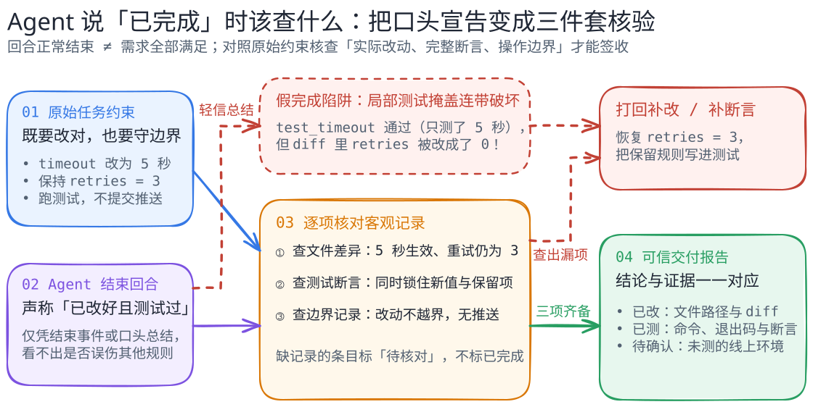

# Agent 说“完成”时，哪些证据够用？

[返回横向对照](README.md) · [观察、测试与评测](../concepts/observation-evaluation.md) · [循环为何停止](loop-and-stop.md)

在日常协作里，Agent 最具迷惑性的时刻，往往就是它语气笃定地吐出最后一段总结的那一刻：“已完成全部修改！服务超时已按要求调为 5 秒，相关单元测试全部运行通过，未执行任何远端推送。”

如果你只看这句漂亮的自然语言汇报就点下合并，线上事故往往已经在路上了：打开 `git diff` 一看，它在把 `timeout: 30` 改成 `timeout: 5` 的同时，顺手把下一行的 `retries: 3` 覆盖成了 `retries: 0`；而跑绿的那条单测只写了 `assert config.timeout == 5`，压根没检查重试次数，一路绿灯放行。更极端的时候，[运行循环](../concepts/agent-loop.md)其实是因为撞上步数上限被迫停机，或者模型压根没调过测试工具，纯粹顺着上下文惯性“脑补”了一句测试通过。

在[《一轮工具调用后，谁决定下一步？》](loop-and-stop.md)里我们看清了程序怎样停下来；本篇专门解决停下来之后的灵魂追问：**为什么“循环正常结束”和“工具返回成功”都不等于“任务真做对了”？到底拿到哪几样硬证据，才能放心签收 Agent 的交付物**？

## 一个最典型的“假完成”陷阱：改对了目标值，改坏了不变量

来看一条再常见不过的配置修改需求：

```text
把服务请求超时从 30 秒改成 5 秒，保持现有的重试规则（retries=3）不变；
只修改相关配置文件并运行测试，不要执行 git commit 或 git push；
最后汇报改了什么、测了什么、还有哪些环境没验证。
```

面对这条需求，**模型的口头总结只是“自我辩护词”，绝不是呈堂证供**。要把一句轻飘飘的“已完成”变成经得起工程审计的交付，必须核验由**工作区实际改动、可复现测试断言、过程与边界记录**组成的三件套证据链：



[图的文字版](../../figures/completion-and-evidence/README.md) · [可编辑图源](../../figures/completion-and-evidence/scene.excalidraw) · [PNG 预览](../../figures/completion-and-evidence/preview.png)

对比一下“只听口头汇报”与“查验三件套底账”的巨大反差：

```text
[模型口头宣告]  "已将 timeout 改为 5s，测试 exit_code=0 全部通过！"
                        │
        ┌───────────────┼───────────────┐
        ▼               ▼               ▼
  1. 查工作区 Diff   2. 查测试断言覆盖  3. 查执行与边界记录
  - timeout: 30->5   - 测了 timeout==5  - 真的调过 bash 跑测试吗？
  - retries: 3->0 ❌ - 漏测 retries==3! - git status / 远端真的干净吗？
```

只要少看其中任何一件，上述“改对 `timeout` 却把 `retries` 清零”的静默回归就会大摇大摆混过关口。

## 从“循环停了”到“用户签收”：七级结论各查哪份证据？

你在交付报告里每往前迈一步下结论，背后依赖的证据位置就必须往上升一级：

| 你想在报告里写下的结论 | 必须核对的硬证据位置 | 光有它还不够，接下来还要查什么 |
| --- | --- | --- |
| **1. Agent 这一轮停下来了** | 运行 ID、循环结束事件、退出状态枚举及停止原因 | 它是主动收工，还是撞上步数限额、用户取消或连续报错被迫停机？ |
| **2. 测试命令确实跑过了** | 同一工作区版本下的工具调用回执、完整命令参数、退出码与原始标准输出 | 退出码为 `0` 只代表进程没崩，那个测试到底断言了哪几个字段？ |
| **3. 交付物已经落盘生成** | 目标文件的实际内容、`git diff`、基线提交号与当前工作树状态 | 改完的值对不对？有没有顺手污染无关文件或格式化整份配置？ |
| **4. 要求的行为通过了测试** | 测试用例源码与断言条件（本例须**同时断言** `timeout == 5` 且 `retries == 3`） | 本地单测之外的真实上下游依赖、超时等待体感与集成环境表现 |
| **5. 严守了任务禁区边界** | 完整改动文件清单、本地提交历史与远端分支状态、相关工具调用审计日志 | 日志采集本身有没有盲区（例如绕过受控工具的子进程操作）？ |
| **6. 候选成果可提交验收** | 逐条对齐原始需求的核对表、已通过证据链接、诚实列出的未验证缺口 | 最终责任人（Code Reviewer 或业务方）的独立审阅判断 |
| **7. 用户正式签收通过** | 验收人确认的范围、对应代码版本与上线后监控反馈 | 后续真实流量下的长尾表现与回归守护 |

做系统可观测性与评测设计时，把**过程追踪信号**（Tracing / Logs）与**结果断言评测**（Evaluations）分开看待会格外清晰：前者帮你还原“当时到底跑了哪些步骤”，后者帮你判定“产出的东西到底合不合格”。进一步阅读可对照[观察、测试与评测篇](../concepts/observation-evaluation.md)，以及 [OpenTelemetry 的信号分类](https://opentelemetry.io/docs/concepts/signals/)与 [LangSmith 的评测类型说明](https://docs.langchain.com/langsmith/evaluation-types)。

## 四套开源系统各自给你留下了什么“查账线索”？

当你在排查一次交付时，Pi、mini-SWE-agent、OpenCode 和 Kimi Code 的底层循环会留下结构各异的过程记录。读懂这些字段的真实含义，才不会被字面上的 `completed` 误导：

| 固定源码切面 | 系统留下的过程记录 | 验收查账时的正确用法与防坑边界 |
| --- | --- | --- |
| [Pi 核心与 coding-agent](../systems/pi/code-walkthrough.md) | `runLoop` 发出回合结束事件；失败或被拒工具生成带 `isError` 标记的结果；外层 `coding-agent` 把常规消息持久化进会话树 | 用会话树记录锁定本次实际跑过哪些读写与测试命令，再去核对磁盘 `diff` 与测试输出原文 |
| [mini-SWE-agent 基类／本地环境](../systems/mini-swe-agent/code-walkthrough.md) | 消息末尾出现 `exit` 角色即结束基类循环；正常提交 `Submitted`、费用／步数超限、连续格式错误均走各自出口；配置路径后 `save()` 落盘完整轨迹 | **千万别看到循环返回就当成功**！先看 `exit` 到底是 `Submitted` 还是超限强退，再独立检查 `timeout=5` 与 `retries=3`（交互式 CLI 子类另有确认分支） |
| [OpenCode 会话处理器](../systems/opencode/code-walkthrough.md) | 每个 `ToolPart` 独立记录单次调用的 `completed / error` 状态与输出内容；`Session` 层记录 `busy / retry / idle` | 会话回到 `idle` 只代表不忙了；顺着 `ToolPart` 找到那次测试命令的真实 `completed` 输出，再结合工作区文件核对需求清单 |
| [Kimi Code 单 turn](../systems/kimi-code/code-walkthrough.md) | `turn.ended` 事件明确区分 `completed / cancelled / failed`；`maxSteps` 上限、取消信号与 `steer` 共同影响何时收口 | `turn.ended = completed` 仅证明当前回合按控制流正常收束；文件改没改对、外层大目标完没完成仍须去工作区与测试报告里验明正身 |

想深入核对这四套系统的源码记录位置，可直接跳转：

- **Pi**（`898ab804`）：[回合结束事件与工具结果收束](https://github.com/earendil-works/pi/blob/898ab804050730e9dcefb4443875d5a932aa6a32/packages/agent/src/agent-loop.ts#L279-L320)、[工具抛错与 `isError` 包装](https://github.com/earendil-works/pi/blob/898ab804050730e9dcefb4443875d5a932aa6a32/packages/agent/src/agent-loop.ts#L773-L861)
- **mini-SWE-agent**（`04d809ce`）：[基类循环与多种异常退出分支](https://github.com/SWE-agent/mini-swe-agent/blob/04d809ceab9df28f9adaed044884180159172930/src/minisweagent/agents/default.py#L88-L124)、[本地环境提交哨兵识别](https://github.com/SWE-agent/mini-swe-agent/blob/04d809ceab9df28f9adaed044884180159172930/src/minisweagent/environments/local.py#L24-L56)
- **OpenCode**（`18ef3cc7`）：[`ToolPart` 调用结果状态更新](https://github.com/anomalyco/opencode/blob/18ef3cc7c5a25b82114c953a80ccc09f4988f74e/packages/opencode/src/session/processor.ts#L383-L420)、[Session 会话忙闲状态定义](https://github.com/anomalyco/opencode/blob/18ef3cc7c5a25b82114c953a80ccc09f4988f74e/packages/opencode/src/session/status.ts#L30-L48)
- **Kimi Code**（`75a894e9`）：[`turn.ended` 终态枚举映射](https://github.com/MoonshotAI/kimi-code/blob/75a894e9ad5e8d49509664b3daaa1bbc9bb39432/packages/agent-core/src/agent/turn/index.ts#L441-L510)

## 解剖两个最容易蒙混过关的“伪完成”样本

### 样本一：单测全绿，却悄悄破坏了不变量（漏写守护断言）

Agent 提交的测试结果退出码是 `0`，`test_timeout_value` 绿得发亮，但配置文件实际发生了如下变化：

```diff
 service:
-  timeout: 30
-  retries: 3
+  timeout: 5
+  retries: 0
```

为什么测试没拦住？因为测试只写了“新需求要改什么（`timeout == 5`）”，漏写了“老规矩什么不能变（`retries == 3`）”。Agent 修改结构化配置或重写整个函数块时极易顺手抹掉相邻字段——只要核验时坚持**既看完整 `diff`、又把保留条件写进测试断言**，这种暗伤当场就会原形毕露。更多断言设计细节见[观察与评测篇的同题反例](../concepts/observation-evaluation.md#把检查条件写完整)。

### 样本二：总结里写得头头是道，工具轨迹里却查无此证（无证自夸）

另一种高频翻车是“幻觉式汇报”：最终回复里写着“已跑完全部相关测试且未推送远端”，但翻遍会话的 `ToolPart` 或 `tool_result` 记录，发现最后一次修改配置之后根本没有任何测试命令调用——它参考的是修改**之前**跑过的那次旧测试结果！或者当某份必读参考资料拉取失败时，它没有坦诚标出“该项待核对”，而是顺嘴编了一个默认结论。

对付这类问题的办法简单而刚性：**交付报告里的每一句肯定判断，都必须绑定最后一次写入之后的真实工具回执编号、工作区 `diff` 行号与本地／远端 Git 状态检查输出；凡是没拿到回执或环境受限没测到的项目，一律光明正大地单列在「待确认缺口」里**。坦诚标出哪 10% 还没测，远比假装 100% 搞定更有工程价值。

## 拿来即用的三栏交付模板

下次无论让哪款编码助手干活，都可以在系统提示或任务末尾要求它按这三栏交账：

- **实际改动**（附文件与 `diff` 证据）：改了哪几个文件、目标项变成了什么、要求保持不变的相邻配置是否完好无损。
- **已跑验证**（附命令与回执证据）：在最后一次改动后实际执行了什么命令、退出码是多少、断言覆盖了哪些正向改动与守护条件。
- **边界与待核对项**（附缺口说明）：本地 `git status` / `git log` 是否确认未越界提交或推送；哪些联调环境、性能表现或未读取到的外部信息仍需人工补验。

## 来源与边界

本文于 2026-09-24 基于 Pi（`898ab804`）、mini-SWE-agent（`04d809ce`）、OpenCode（`18ef3cc7`）与 Kimi Code（`75a894e9`）的固定源码提交及公开可观测性文档核对，重点拆解循环终态记录与工程交付证据链之间的层次关系，未对四套系统在特定基准集上的任务通过率或幻觉率做横向实测对比。
