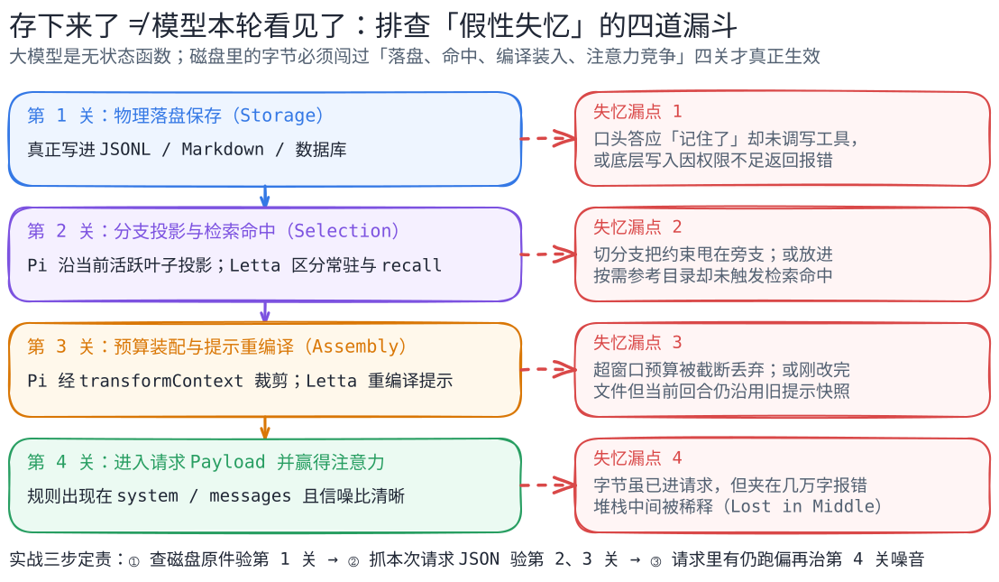

# 存下来了，下一轮就一定能看见吗？

[返回横向对照](README.md) · [概念篇：上下文与记忆](../concepts/context-vs-memory.md)

几乎每个深度使用过 Agent 的开发者，都经历过这种抓狂时刻：你在会话开头千叮万嘱“所有数据库建索引必须加 `CONCURRENTLY`，绝不允许锁表”，或者让助手把“回答一律只给结论和命令，不要寒暄”写进了它的记忆文件。你甚至专门打开本地的 `.jsonl` 会话文件或 `.md` 记忆目录看了一眼——那行字千真万确地躺在磁盘上。可偏偏到了下一轮（或者聊到第 30 轮），Agent 还是像失忆了一样，面不改色地给你生成了一条裸 `CREATE INDEX`。

**明明已经存下来了，为什么下一轮回答还是像失忆一样**？

根源在于一个极易被界面掩盖的事实：**大语言模型本身没有任何记忆，它只是一个无状态函数——你以为它“记得”某件事，唯一的前提是这件事对应的字节，在本次 HTTP 请求发出去的那一刻，真真切切地装进了 `system` 或 `messages` 载荷里**。

“持久保存（Persisted on Disk）”只保证了应用以后**有机会**把数据找回来；“本轮可见（Visible in Context）”才决定模型这一次**到底看见了什么**。两者之间隔着一整条筛选、投影与编译流水线，任何一环掉链子，表现出来都是同一种症状——“失忆”。



[可编辑图源](../../figures/persisted-vs-visible/scene.excalidraw) · [PNG 预览](../../figures/persisted-vs-visible/preview.png) · [图的文字版](../../figures/persisted-vs-visible/README.md)

## 从“四道关卡”到源码现场

关于从持久化介质到本轮请求窗口的完整理论模型，我们在 [概念篇：上下文与记忆](../concepts/context-vs-memory.md) 中已经系统推导过“保存（Storage）→ 查找（Projection/Selection）→ 筛选装入（Assembly/Recompile）→ 模型使用（Attention/Adherence）”四道排查漏斗。

```text
[第 1 关：落盘保存]  写进持久存储了吗？（文件写入是否报错、是否仅留于内存缓存）
        ↓
[第 2 关：分支与命中] 切对当前分支了吗？（Pi：活跃叶子节点追溯；Letta：system 常驻 vs 按需 recall）
        ↓
[第 3 关：装配与编译] 塞进本次 Token 预算了吗？系统提示重编译了吗？（Letta：回合内旧快照滞后）
        ↓
[第 4 关：注意力竞争] 字节进请求了，但被几万字工具日志淹没或被新指令覆盖了吗？
```

在工程排查中，第 1 关（查磁盘原件）和第 4 关（长窗口注意力稀释）通常容易排查，而最隐蔽、最容易让开发者陷入怀疑人生的，恰恰是中间两道关卡：
- **第 2 关：分支隔离（Branch Isolation）**——明明写进文件了，但会话树切了活跃分支，约束留在了被剪掉的分支上；
- **第 3 关：编译滞后（Stale Compile Prompt）**——文件确实改写了，但系统提示（System Prompt）采用离线或异步编译，当前正在跑的回合依然拿着旧快照。

下面我们直接深入 [Pi](../systems/pi/README.md) 与 [Letta Code](../systems/letta/README.md) 两套开源代码，聚焦它们在这两个核心现场上的具体实现。

## 两条源码路径对比：Pi 与 Letta Code 怎样跨越这道鸿沟？

把 [Pi](../systems/pi/README.md) 的会话树路径与 [Letta Code](../systems/letta/README.md) 的本地文件记忆（local MemFS v1）路径放在一起对比，能极其鲜明地看出第 2 关和第 3 关的机制差异：

| 对照维度 | Pi（会话树投影 + 调用前转换） | Letta Code（local MemFS v1 分层文件 + 提示重编译） |
| --- | --- | --- |
| **第 1 关：物理存在哪** | 聊天消息与分支事件以追加方式存为 JSONL 文件（每行一条带节点关系的 JSON 记录）。 | 本地记忆目录按职责分层：核心高频信息存放在 `system/` 目录下的 Markdown 文件中；其余参考文件、Skills 与历史对话分开存放。 |
| **第 2 关：怎样筛出候选** | `SessionManager` 从完整 JSONL 树中，只沿**当前活跃分支**投影出一条线性消息链；旁支记录虽在文件里，但本轮不入选。 | **分流处理**：`system/` 目录下的文件默认入选常驻提示；非 `system/` 参考文件需模型按需读取正文；更早的对话历史需调用 `recall` 工具检索补查。 |
| **第 3 关：何时真正进请求** | 每次发起模型调用前，实时跑完 `transformContext`（上下文整理／裁剪）→ `convertToLlm`（转换为模型接口消息结构）两步流水线。 | **有严格先后时序**：修改记忆文件 → 提交同步 → 重编译系统提示（System Prompt）。**当前正在执行的回合继续使用已编译的旧提示快照**，重编译完成后后续请求才看见新内容。 |
| **最典型的“失忆”踩坑点** | 切了会话分支导致某次约定留在旧叉上；或长对话经过 `transformContext` 整理时早期细节被裁剪折叠。 | 把本该常驻的铁律放进了非 `system/` 目录却没触发读取；或刚在回合内改完记忆文件，误以为同一回合紧接着的下一步就能读到新系统提示。 |

### 在数据层面看清两个关键现场：分支隔离与编译滞后

#### 现场一：Pi 的会话树分支隔离（CONCURRENTLY 为什么凭空消失？）

在 Pi 的设计中，外层 `coding-agent` 的 `SessionManager` 将所有聊天消息、工具调用与分支切换事件以追加方式记录在同一个 JSONL 文件中，每个记录都带着 `id` 与 `parentId`。

假设开发者在调试数据库慢查询，在会话中明确交代了一条硬规则：

```json
{"id": "m1", "parentId": null, "role": "user", "content": "帮我排查慢查询"}
{"id": "m2", "parentId": "m1", "role": "assistant", "content": "先看索引结构"}
{"id": "m3", "parentId": "m2", "role": "user", "content": "记住：建索引一律加 CONCURRENTLY，绝不允许锁表！"}
{"id": "m4", "parentId": "m2", "role": "user", "content": "换个思路，先直接给迁移脚本"}
```

- **磁盘视角**：用文本编辑器打开磁盘上的 `.jsonl` 文件，第四行 `m3` 里的 `CONCURRENTLY` 字符千真万确地躺在磁盘上。
- **分支投影视角**：当用户在终端回退到 `m2` 重新输入 `m4` 时，活跃叶子节点指针（`leafId`）切换到了 `m4`。`SessionManager` 的 `buildSessionContext` 在提取消息时，从 `m4` 沿着 `parentId` 向上回溯：`m4 → m2 → m1`。
- **调用前转换视角**：这条被抽出的线性消息链随后进入 `agent-loop`，通过 `transformContext` 做上下文修剪，并通过 `convertToLlm` 转换为标准 LLM 格式发给模型。

**结果**：`m3`（建索引必须加 `CONCURRENTLY`）被永久隔离在未被选中的孤立分支上！发给模型的 Payload 数组里从头到尾只有 `m1`、`m2`、`m4`。模型依据当前上下文生成了一条裸 `CREATE INDEX`，完全符合无状态函数的预期——规则在磁盘上 100% 持久化，但在本轮上下文中 0% 可见。

#### 现场二：Letta Code 的旧快照编译滞后（写完记忆文件为什么同一回合不生效？）

在 Letta Code（local MemFS v1）的分层记忆体系中，核心偏好与系统规范存放在 `system/` 目录下的 Markdown 文件中（如 `system/preferences.md`），并通过编译器动态组装成发给模型的 System Prompt。

很多开发者踩坑的场景是：让 Agent 将“建索引加 CONCURRENTLY”或“只输出精简结论”写入偏好，并期待当前回合接下来的步骤立即遵守。然而实际运行的时序如下：

```text
Turn N 开始 ──► 宿主拉取 System Prompt 快照（编译自当时的 system/preferences.md）
  │
  ├─► Agent 执行工具：成功改写 system/preferences.md（磁盘文件已更新！）
  ├─► 后台 memory-worker 接收变更通知，触发异步同步与系统提示重编译（Recompile）
  │
  ├─► Agent 紧接着执行下一步工具或回复（致命时序差：当前 Turn N 内存中仍沿用开头已编译的旧快照！）
  └─► Turn N 结束（重编译工作在后台完成并落库）

Turn N+1 开始 ──► 宿主重新加载最新编译结果（新 System Prompt 正式进入上下文，新规则开始生效）
```

**结果**：磁盘文件确实已在毫秒级更新，但**系统提示的编译时序差**（Stale Compile Prompt）导致当前正在运行的 Turn N 根本看不到新提示。如果此时开发者误以为“记忆写入失效”而反复修改文件或提示词，就会引发混乱的脏状态。只有等到下一个 Turn 重新加载编译产物，新规则才真正推送到模型的眼前。

## 三步实战自检法

无论你手头用的是自研框架还是开源产品，下次遇到“上下文或记忆不生效”，拿同一条测试规则按下面三处抓现场即可精准定责：

1. **查磁盘原件**：打开底层 JSONL、SQLite 或 Markdown 文件搜原文——确认过没过**第 1 关**。
2. **抓模型请求 Payload**：直接看发往 LLM 接口的原始 JSON（重点看 `system` 字段和 `messages` 数组末尾）——如果磁盘有而 Payload 里没有，100% 卡在**第 2 关**（分支投影／检索未命中）或**第 3 关**（预算裁剪／提示尚未重编译）。
3. **对比 Payload 与输出**：如果 Payload 里明明白白带着那句话，输出还是跑偏，再去治**第 4 关**（精简工具噪音、把硬性红线从提示词抽出来改成宿主代码层的权限拦截）。

## 来源与边界

本文对照的固定源码依据如下：

- **Pi** · `earendil-works/pi@898ab804050730e9dcefb4443875d5a932aa6a32`：[会话树当前分支投影](https://github.com/earendil-works/pi/blob/898ab804050730e9dcefb4443875d5a932aa6a32/packages/coding-agent/src/core/session-manager.ts#L543-L582)、[调用前 `transformContext → convertToLlm` 上下文转换](https://github.com/earendil-works/pi/blob/898ab804050730e9dcefb4443875d5a932aa6a32/packages/agent/src/agent-loop.ts#L380-L406)。完整系统边界见 [Pi 章节](../systems/pi/README.md)。
- **Letta Code** · `letta-ai/letta-code@1f55d3dc66e238d203757fae288bb53f3adc7cd3`：[local MemFS 目录与提示说明](https://github.com/letta-ai/letta-code/blob/1f55d3dc66e238d203757fae288bb53f3adc7cd3/src/agent/prompts/letta_local_memfs.md#L8-L55)、[记忆格式判定](https://github.com/letta-ai/letta-code/blob/1f55d3dc66e238d203757fae288bb53f3adc7cd3/src/agent/memory-format.ts#L6-L29)、[`memory-worker` 同步与提示重编译路径](https://github.com/letta-ai/letta-code/blob/1f55d3dc66e238d203757fae288bb53f3adc7cd3/src/agent/subagents/memory-worker.ts#L95-L139)。完整系统边界见 [Letta Code 章节](../systems/letta/README.md)。

本文于 2026-09-23 基于上述固定提交做静态源码核对，聚焦本地当前分支投影与 local MemFS v1 路径；跨端云同步、历史 `recall` 检索召回率及不同模型在长窗口下的指令遵循表现需结合具体环境实测。
