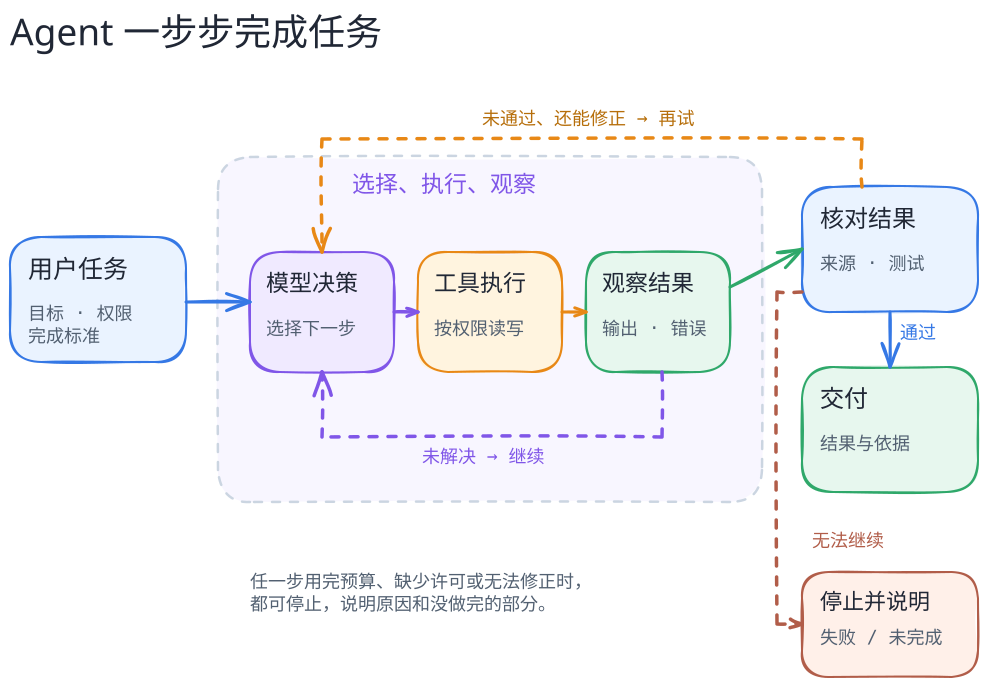

# Agent loop：从读资料到给出回答

[返回机制目录](README.md) · [图的文字版](../../figures/agent-loop/README.md) · [本地小实验](../labs/first-agent-loop.md)

向普通聊天窗口提问“为什么我的支付接口报错 500”，模型只能靠训练记忆或你贴上去的片段盲猜；一旦猜错，它也不会自己去翻日志验证。反过来，如果你给它接上终端却忘了设退出条件，它又可能在同一个报错上死循环连改十次测试，直到把额度烧光。

从“单次问答”跨入“Agent”的本质分水岭，不在于换了一颗更聪明的模型，而在于引入了一条**受控的反馈循环**（Agent loop），并把职责一刀切成两半：**大模型只负责提议下一步想做什么；外层的宿主程序（Harness）负责真正调用工具、拿回真实世界的反馈，并决定何时踩下刹车**。

> [!TIP] **10 秒心智模型（Mental Model）**
> - **一句话直觉**：模型就像坐在无菌室里的军师，只能写纸条提议“派谁去侦察”；外壳（Harness）是传令兵，负责真正跑腿探路，并决定什么时候该鸣金收兵。
> - **核心守则**：$\text{Agent Loop} = \text{Proposal (LLM)} \to \text{Execution (Harness)} \to \text{Observation} \to \text{Termination Check}$。提议权在模型，决策与刹车权在宿主。
> - **致命反模式**：把模型当成全能神，不设最大步数或没有结果验收断言，导致死循环烧穿 Token。



沿着上图看清这条分工边界就抓住了核心：模型本身既摸不到硬盘，也敲不了命令；它输出的所谓“工具调用”，本质上只是一段格式化文本提议。只有当宿主校验通过、真正执行工具并把返回结果（哪怕是一段报错堆栈）重新塞回下一轮输入时，推理才第一次撞上了真实世界。

## 先看一次正常完成

假设客服团队交给助手一项核对任务：**查清订单 `#8842` 当前能否全额原路退款，每条结论必须标明依据出处**。此时相关证据散落在三份尚未读入的外部记录里：

- `order-8842.json`：实付 299 元，支付方式为原路担保交易；
- `shipping-8842.json`：仓库状态为 `pending_pickup`（待揽收，尚未发出）；
- `refund-policy.md`：揽收前取消订单支持全额原路退回，已发出订单需扣除拦截运费。

如果把整套往返拆到字节层面，宿主与模型之间流转的真实消息长这样：

```json
[
  {"role": "user", "content": "核对订单 #8842 能否全额退款，每项结论注明出处。"},
  {
    "role": "assistant",
    "tool_calls": [
      {"id": "call_1", "name": "read_file", "arguments": {"path": "order-8842.json"}},
      {"id": "call_2", "name": "read_file", "arguments": {"path": "shipping-8842.json"}},
      {"id": "call_3", "name": "read_file", "arguments": {"path": "refund-policy.md"}}
    ]
  },
  {"role": "tool", "tool_call_id": "call_1", "content": "{\"order_id\": 8842, \"paid\": 299}"},
  {"role": "tool", "tool_call_id": "call_2", "content": "{\"status\": \"pending_pickup\"}"},
  {"role": "tool", "tool_call_id": "call_3", "content": "揽收前支持 100% 原路退款；已发出需扣运费。"}
]
```

这短短几行消息背后，恰好走完了循环的三个关键节拍：

1. **只提议，不越权动手**：第一轮里，模型看到工具清单后并没有编造退款结论，而是发出三条 `read_file` 提议（`tool_calls`）。此时文件内容仍在磁盘上，模型一个字都还没看见。
2. **宿主执行并回填真实观察**：宿主检查路径是否在允许目录内，真正读取磁盘文件，把拿回的 JSON 与规则正文包装成 `role: "tool"` 消息追加进对话历史，再发起第二轮模型请求。
3. **证据闭环后停止并核对**：第二轮里，模型发现三项证据已经齐备，不再请求任何工具，直接给出带出处的结论：“订单 `#8842` 实付 299 元（`order-8842.json`），当前处于待揽收未发出状态（`shipping-8842.json`），按揽收前退改规则可全额原路退款（`refund-policy.md`）。”宿主检测到没有新的工具调用，核对输出完整后正常结束循环。

现在给现场加两个真实扰动，立刻就能看出为什么它不是死板脚本：

- **缺材料时自动补查**：假如第一次忘了读 `refund-policy.md`，模型在第二轮看到金额和物流状态后，仍缺判责依据，就会再提议补读规则文件，多转一圈才收尾。
- **线索嵌套时顺藤摸瓜**：假如 `shipping-8842.json` 里没有现成状态，只存了一条运单查询链接，模型就必须根据这轮观察改提议调用物流查询工具；查不到时则如实报告“物流状态待确认”，而不是硬猜“未发货”。

## 拆解一轮循环：读源码先抓哪三件事

不管开源项目的代码目录多复杂，任何 Agent 循环在工程上都在回答三个问题：

```text
收到目标 ──▶ [1. 宿主组装本轮输入] ──▶ 模型推理并提议动作
                 ▲                              │
                 │                              ▼
         回填观察继续下一轮 ◀── [3. 宿主判断刹车条件] ◀── [2. 宿主拦截并执行工具]
```

- **谁组装本轮输入**：系统提示词、可用工具签名、历史消息与上一轮工具输出怎样拼成这次请求？全量硬塞很快就会撑爆窗口，裁剪不当又会弄丢早期约束。
- **谁拦截并执行动作**：为什么要把“提议”和“执行”拆开？因为概率模型随时可能传错参数、越过项目目录甚至误删关键文件。宿主卡在中间，才能做参数 Schema 校验、路径白名单检查、人工审批与沙箱隔离。
- **谁决定踩下刹车**：不能指望模型永远自觉停手。宿主必须同时维护四类退出条件：**正常完成**（模型给出最终答复且验收通过）、**预算耗尽**（达到最大轮数或费用上限）、**外部中断**（用户按下取消键触发 `AbortSignal`）以及**连续故障熔断**。

想先在无风险环境里亲手摸一遍这三步，可以跑一次[本地小实验](../labs/first-agent-loop.md)——它用确定性脚本模拟模型提议，把文件读取、人工批准、落盘修改与结果核对完整打印出来；也可以配合[陪读方法](../../book/frontmatter/reading-guide.md#和-ai-一起读)，试着抽掉上面例子里的一份证据，推演下一轮消息会怎样变化。

## 三个开源项目怎样写这条循环

同样一条循环，不同定位的系统会在代码结构上做出截然不同的取舍：

### Pi：把循环内核与外层应用彻底解耦

如果把终端渲染、磁盘会话保存和循环调度全揉进同一个大类里，每次换界面或改存储格式都得重写核心逻辑。因此 Pi 在架构上做了严格分层：`packages/agent` 只保留纯粹的运行内核，由 `Agent.prompt()` 拉起 [`runLoop`](https://github.com/earendil-works/pi/blob/898ab804050730e9dcefb4443875d5a932aa6a32/packages/agent/src/agent-loop.ts#L162-L320)，专注调度“模型流式响应 → 工具执行 → 转向与追问消息队列（steering / follow-up）”；至于把对话写成磁盘会话树还是做上下文压缩，全部交给外层的 `coding-agent` 应用处理。想先看清干净的内核边界，从[Pi 导读](../systems/pi/README.md)入手最直观。

### mini-SWE-agent：用几十行同步循环压平控制流

做代码修复评测基准时，过度封装的事件总线反而会掩盖真实的提示词与环境交互。mini-SWE-agent 走了极简路线：外层 `DefaultAgent.run()` 跑一个直白的 `while` 循环，每一步 `step()` 顺序执行 `query()` 请求模型、`execute_actions()` 在终端环境跑命令、再把命令输出追加回 `messages` 列表，由外层根据退出信号与步数/费用上限决定是否继续。没有花哨中间件，单步跟踪就能看穿全链路。[项目讲解](../systems/mini-swe-agent/README.md) · [循环源码](https://github.com/SWE-agent/mini-swe-agent/blob/04d809ceab9df28f9adaed044884180159172930/src/minisweagent/agents/default.py#L88-L157)

### OpenCode：用双层状态机拆开工具进度与会话生命期

很多初学者写 Agent 时只设一个布尔变量 `isRunning`，一旦遇到“某个命令执行失败，但系统准备自动退避重试”，界面和恢复逻辑立刻就会陷入混乱——究竟是单个工具报错，还是整场任务已经挂了？OpenCode 把状态拆成上下两层：单次工具调用沿 `pending → running → completed / error` 四态流转，而外层会话独立维护 `busy / retry / idle` 三态。这样某个工具落入 `error` 时，会话依然可以保持 `busy`（把报错喂回模型自修）或进入 `retry`（等待重试窗口），排障时先查工具卡在哪一态、再看会话停在哪一态，一目了然。[项目讲解](../systems/opencode/README.md) · [工具状态](https://github.com/anomalyco/opencode/blob/18ef3cc7c5a25b82114c953a80ccc09f4988f74e/packages/opencode/src/session/processor.ts#L216-L253) · [会话状态](https://github.com/anomalyco/opencode/blob/18ef3cc7c5a25b82114c953a80ccc09f4988f74e/packages/opencode/src/session/status.ts#L30-L48)

## 出错时，为什么不直接崩溃也不无限重试

在单次脚本里，命令返回非零退出码往往意味着程序直接报错退出；但在 Agent loop 里，**可恢复的报错本身就是极其宝贵的下一轮观察信号**——前提是宿主分得清“哪类错该喂回去自修，哪类错必须立刻停车”：

- **参数或格式错误**（喂回模型，限次自修）：模型偶尔会漏写代码块闭合符或传错命令行标志。mini-SWE-agent 捕获格式错误等可恢复异常后，不会直接炸掉进程，而是把报错原因作为消息塞回下一轮让模型修正；一旦连续出错触及上限或触发退出阈值，才果断终止；而对未预期的底层异常则记录 `exit` 状态并原样抛出，绝不静默吞错（见[错误处理源码](https://github.com/SWE-agent/mini-swe-agent/blob/04d809ceab9df28f9adaed044884180159172930/src/minisweagent/agents/default.py#L100-L124)）。
- **权限拒绝**（明确受阻，停止硬闯）：当用户或沙箱拒绝某项高危操作时，正确动作不是诱导模型换个偏门命令绕过去，而是把受阻边界清晰交还给用户定夺。
- **执行超时**（先查副作用，忌盲目重发）：超时是最容易酿成事故的灰色状态——本地等待虽然断开了，远端接口可能已经扣完款或建好了工单。此时下一轮的首要动作不是原样重调一次写接口，而是先调用只读查询确认外部状态到底变了没有。

看懂了循环怎样转起来、怎样停下来，下一步自然会追问：每一轮塞给模型的上下文究竟是怎么挑出来的？模型声称“修好了”又凭什么算数？接下来可以继续读[上下文与记忆](context-vs-memory.md)与[完成与证据](../comparisons/completion-and-evidence.md)。

## 来源与边界

- **固定版本源码锚点**：本章代码分析基于 `earendil-works/pi`（commit `898ab804050730e9dcefb4443875d5a932aa6a32`）、`SWE-agent/mini-swe-agent`（commit `04d809ceab9df28f9adaed044884180159172930`）与 `anomalyco/opencode`（commit `18ef3cc7c5a25b82114c953a80ccc09f4988f74e`）的静态源码审阅。
- **适用边界**：订单退款案例与 JSON 消息片段用于演示模型与宿主的通用协议分工；三个开源项目的讨论聚焦于循环调度与状态机结构，不构成完整基准任务上的运行表现对比。
