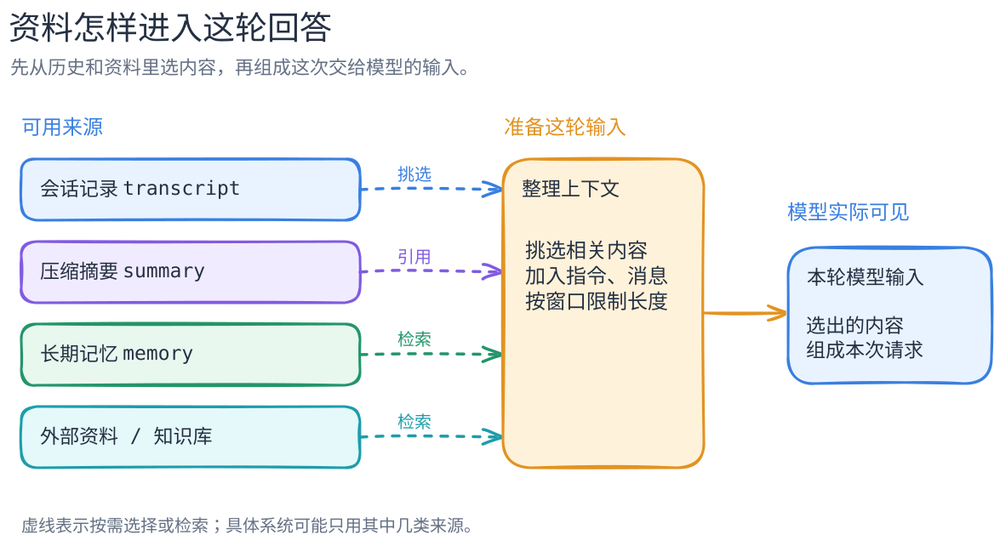

# 上下文与记忆：资料怎样进入这次回答

[返回机制目录](README.md) · [可编辑图源](../../figures/context-vs-memory/scene.excalidraw) · [PNG 预览](../../figures/context-vs-memory/preview.png)

你大概遇到过这种让人血压飙升的瞬间：第 1 轮对话刚叮嘱过“这次只改前端预览组件，绝不碰 `migrations/` 下的数据库迁移脚本”，结果聊到第 30 轮调样式时，助手顺手就把迁移文件给改了。你往上翻聊天窗口，第 1 轮那句话明明还赫然留在屏幕上——既然记录没丢，它为什么像突然失忆了一样？

解开这个困惑，需要立住两条底层事实：

第一，“**磁盘或界面里存着**”绝不等于“**这一轮请求发给了模型**”。大模型推理接口本身是无状态的：每一轮调用，模型只能看见宿主（Harness）当场打包进请求体里的那批文本片段（token）。哪怕数据库里存着十万条历史，只要没被挑进这次请求，对本轮推理而言就等于不存在。

第二，**上下文窗口不是无限垃圾桶，而是有限的注意力工作台**。就算模型标称支持几十万甚至上百万 token，把所有陈年对话、长篇报错堆栈和无关文档一股脑全塞进去，不仅每一轮都在重复烧钱，更会引发**上下文腐化（Context Rot）与注意力稀释**——关键约束被淹没在海量中间噪音里，模型看漏硬性规则的概率反而急剧上升。

> [!TIP] 10 秒心智模型（Mental Model）
> - **一句话直觉**：持久化记忆是“档案馆地下室”，上下文是“课桌桌面”。无论地下室藏了多少书，只有搬到桌面上的那两页，考试时模型才看得见。
> - **核心守则**：$\text{Attention Density} = \frac{\text{Task-Critical Tokens}}{\text{Total Window Tokens}}$。高模型智商靠的是注意力密度，而不是无脑塞满无界大窗口。
> - **致命反模式**：以为“把对话历史从头到尾一股脑发给模型”就是记忆，结果导致上下文腐化（Context Rot），越聊越容易顾此失彼。



这张图把“静态仓库”和“当场工作台”彻底画开了：左侧是散落在各处的持久化资料，中间是宿主的检索、筛选与拼装，最右侧才是模型这一轮真正拿到的**当前上下文**（Current Context）。图中虚线代表按需触发的读取路径，逐步说明可对照[图的文字版](../../figures/context-vs-memory/README.md)。

## 把五个常混在一起的词放到同一张桌面上

回到[上一篇的订单退款核对](agent-loop.md#先看一次正常完成)：退改规则文件 `refund-policy.md` 一直好好躺在知识库目录里；但如果第一轮工具只读回了订单金额 `order-8842.json` 和物流状态 `shipping-8842.json`，模型眼前的工作台上依然缺少判责标准，下一步必须补读 `refund-policy.md` 才能给出可靠答复。

外部业务文档如此，系统里的聊天历史、摘要和用户偏好也是同一个道理——它们只是不同形态的“库房存档”，进入工作台的姿势各有分工：

| 概念 | 存在哪里 | 它的本质是什么 | 怎样进入本轮上下文 | 乱塞或漏塞的典型故障 |
| --- | --- | --- | --- | --- |
| **当前上下文** | 本轮模型请求体 | 这次真正摊在工作台上的系统指令、消息与工具输出 | 已经在本次 API 输入中 | 塞太多导致注意力稀释；超限直接报错失败 |
| **会话记录** | 本地文件或数据库 | 完整的原始聊天、工具调用与界面事件流水 | 宿主挑出当前分支或近期片段放入请求 | 只截最近几轮会弄丢开头的全局约束 |
| **压缩摘要** | 会话节点或缓存 | 把早期几十轮长对话浓缩成的结构化进展说明 | 替代早期冗长原文，与近期消息拼接发送 | 摘要有损，可能漏掉精确行号或错误码 |
| **长期记忆** | 记忆文件或向量库 | 跨会话保留的用户偏好、项目规范与核心事实 | 核心规范常驻系统提示，低频事实按需检索注入 | 过期旧约定未更新，持续污染新任务 |
| **外部知识** | 代码库、文档、网页 | 体量庞大的业务参考资料与实时数据 | 由模型发起搜索或读取工具，拿回命中片段 | 检索词偏差导致拿错材料、答非所问 |

一次真实的模型调用，往往是上面几路材料的拼盘：系统提示词里钉着一条常驻代码规范，前面垫着一段前 20 轮的压缩摘要，中间附上刚刚搜出来的两段接口文档，末尾跟着最近 4 轮鲜活对话。**模型看到的永远只是这份拼盘，而不是背后的整座资料库**。

## 排查“失忆”的四道关卡：保存 → 查找 → 筛选装入 → 模型使用

以后再遇到助手“明明说过却没照做”，别急着笼统抱怨“模型记性差”。顺着下面四道关卡逐一排查，十分钟就能定位到底是哪一环掉了链子：

```text
原始信息 ──▶ [1. 保存] 落盘了吗？
               │
               ▼
             [2. 查找] 检索/遍历捞出来了吗？
               │
               ▼
             [3. 筛选装入] 预算裁剪时挤出窗口了吗？
               │
               ▼
             [4. 模型使用] 被海量噪音淹没注意力了吗？
```

还拿开头“第 30 轮误改 `migrations/`”的事故举例，对比两种截然不同的上下文拼装策略（假设窗口预算只够放 4000 token）：

```text
❌ 策略 A（只按时间截断最近 8 条消息）：
[系统默认提示] + [第 23~30 轮：冗长的 CSS 报错与按钮对齐讨论 (3900 tokens)]
→ 结果：第 1 轮“禁改 migrations/”虽然保存在磁盘里，但在第 3 关【筛选装入】被直接裁掉！

✅ 策略 B（置顶核心约束 + 压缩中期历史 + 保留近期对话）：
[系统提示 + 置顶任务约束："只改预览组件，严禁修改 migrations/"] (300 tokens)
+ [第 2~25 轮滚动摘要："已完成预览卡片布局，修复两处类型报错"] (400 tokens)
+ [第 26~30 轮近期原始消息与当前工具输出] (2100 tokens)
→ 结果：花了更少的 token，却让关键禁令稳稳留在工作台最显眼的位置。
```

由此可见，四步里任何一步失守都会表现为“失忆”：

1. **有没有保存**（Save）：跨会话重启后规则丢了，先看它究竟只存在上一次的临时聊天里，还是写进了持久化记忆文件。
2. **有没有找到**（Retrieve）：如果依赖关键词或向量搜索取回历史，当你第 30 轮在聊“按钮边距”时，纯语义相似度检索很可能根本捞不出第 1 轮关于“数据库迁移”的禁令。
3. **有没有装入**（Select & Pack）：找到了材料，但组装器遇到预算上限时如果只会无脑丢弃早期消息，老规矩照样进不了请求体。[上下文预算小实验](../labs/context-budget.md)用无需模型账号的本地脚本把这四步完整打印了出来——同样大小的预算框，“优先保最近消息”和“优先保置顶约束”拼出来的请求体天差地别（实验里用字符数直观演示，真实生产系统则按分词后的 token 计量预算）。
4. **模型有没有用对**（Attend & Ground）：就算那句禁令真的装进了请求体，如果你同时往里面倒了五万行未过滤的调试日志，关键信息也会在中间段被严重稀释。**少装废话，往往比换更大的窗口更管用**。

## 在 Pi 源码里看“磁盘存档”怎样变成“本轮请求”

读开源实现时，最值得学习的正是它怎样把“应用层保存的全量记录”与“发给大模型的精简请求”解耦开来。在 Pi 中，这一转换明确分成前后两步：

1. **先从会话树抽出当前有效分支**：外层 `coding-agent` 的 `SessionManager` 在磁盘里保存完整的会话历史与分支节点；准备上下文时，`buildSessionContext` 并不是把整份日志文件原样上传，而是沿着当前活跃分支提取消息，并把压缩摘要与保留的近期条目拼接成当前会话视图（见[会话分支源码](https://github.com/earendil-works/pi/blob/898ab804050730e9dcefb4443875d5a932aa6a32/packages/coding-agent/src/core/session-manager.ts#L543-L582)）。
2. **发请求前再做上下文裁剪与协议净化**：进入 `agent-core` 的运行循环后，系统在真正调用大模型 API 前还会依次执行 `transformContext` 与 `convertToLlm`（见[请求前的处理](https://github.com/earendil-works/pi/blob/898ab804050730e9dcefb4443875d5a932aa6a32/packages/agent/src/agent-loop.ts#L380-L406)）。为什么要多设计这两道钩子？因为应用历史里往往存着仅供界面展示的状态通知、费用统计或内部扩展标记（`AgentMessage`）——`transformContext` 允许宿主在最后关头按预算修剪或注入上下文，而 `convertToLlm` 则把内部富消息干净利落地过滤转换成底层模型接口只认的标准角色消息（完整数据流可延伸阅读[Pi 代码导读](../systems/pi/code-walkthrough.md)）。

把“存什么给人类和应用看”与“发什么给模型推理用”拆成两套结构，正是保持工作台清爽的核心工程技巧。

理解了单次请求怎样挑材料，下一个硬骨头立刻就来了：当一场复杂任务连续跑上百轮、或者跨越好几天时，旧历史怎么压缩才不断片？常驻规范和零散事实又该怎样分工存储？请接着看下一篇[会话变长以后：保存记录、压缩内容、取回记忆](session-compaction-and-memory.md)，也可按需选读[Mem0 的写入与检索](../systems/mem0/README.md)与[Letta 的记忆管理](../systems/letta/README.md)。

## 来源与边界

- **固定版本源码锚点**：本章源码路径基于 `earendil-works/pi`（commit `898ab804050730e9dcefb4443875d5a932aa6a32`）中 `packages/coding-agent` 与 `packages/agent` 的静态源码审阅。
- **适用边界**：不同框架可能采用关系型数据库、向量索引或 Markdown 文件保存持久化状态，并搭配各自的 token 估算器与截断策略；排查问题时均可沿本章“保存 → 查找 → 筛选装入 → 模型使用”四步核对实际数据流。
