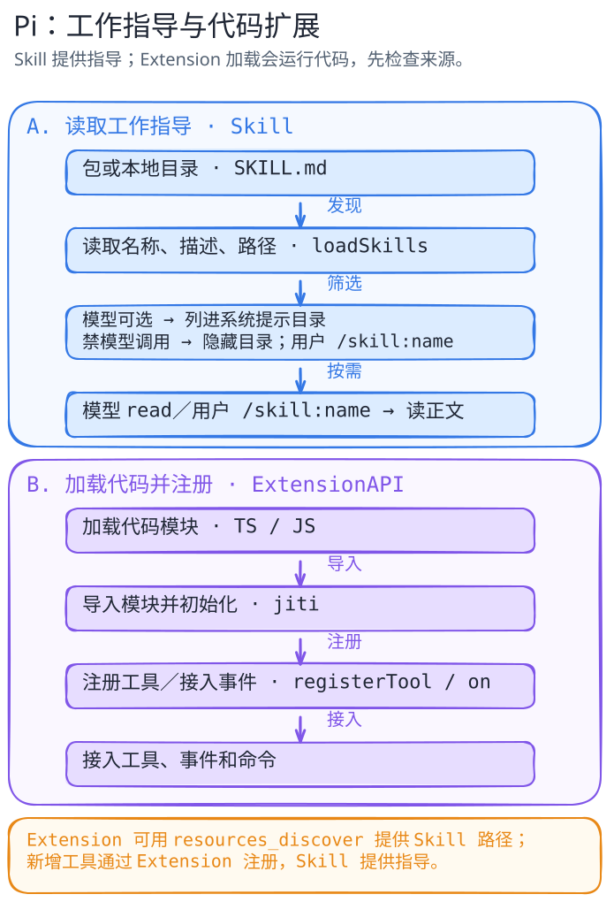

# 扩展能力的四个层次：从提示词约定到宿主代码钩子

[返回机制目录](README.md) · [Pi 的代码示例](../systems/pi/extensions-and-skills.md) · [Skill、MCP 与工具权限](mcp-skill-tool-lifecycle.md)

刚给团队搭好编码 Agent 时，最省事的做法是把所有规矩往一份系统提示词里塞：代码规范、数据库迁移口诀、发版核对单、内部工单查询写法……不到两周，这份提示词膨胀到两万多 Token，每轮对话还没开始干活先烧掉一大截上下文预算，模型还顾头不顾尾；有人干脆走向另一个极端，随手把社区找来的扩展脚本装进宿主进程，结果脚本在后台顺手读走了终端环境变量里的云账号密钥。

这两个坑本质上是一回事：**没有看清扩展机制的能力层级与信任代价**。给 Agent 增加本领，沿着一条“控制力越强，权限与隔离负担也越重”的阶梯展开——依次是**提示词约定**、**Skill 文件包**、**协议级 MCP 服务**与**宿主进程内 Extension 代码钩子**。理解这四层阶梯，再加上原子执行单元 **Tool** 与分发载体 **Package**，面对任何新需求都能一秒选对位置。

> [!TIP] **10 秒心智模型（Mental Model）**
> - **一句话直觉**：扩展能力就像装备外挂：Prompt 是贴在显示器旁的便签，Skill 是按需翻阅的操作手册，MCP 是外接拓展坞，Extension 是直接插进主板的芯片。越深入底层，威力越大，爆炸风险越高。
> - **核心守则**：按最小特权阶梯提升：$\text{Prompt} \to \text{Skill (On-Demand SOP)} \to \text{MCP (Isolated Protocol)} \to \text{Extension (In-Process Hook)}$。
> - **致命反模式**：把可以用 Skill 说明书解决的活，随便写成 Extension 加载进宿主进程，造成内存脏写与密钥被窃。



## 四个能力层次与两类基础载体

在动手写任何扩展之前，先分清你要给系统注入的是“做事规矩”、“外部连接”还是“宿主级拦截逻辑”：

| 层次 / 载体 | 运行位置与注入时机 | 核心能力 | 信任与权限边界 |
| --- | --- | --- | --- |
| **1. 提示词约定**（Prompt / `AGENTS.md`） | 会话启动时常驻模型上下文 | 声明全局边界、目录结构与高频守则 | 纯文本，无直接执行力；写太长会持续挤占每轮上下文窗口 |
| **2. Skill 文件包**（按需任务指导） | 启动只挂简短索引，命中时按需读入正文 | 封装特定领域 SOP、参考模板与辅助脚本 | 正文仍是指导文本；随包脚本必须借道宿主 Tool 与沙箱才能运行 |
| **3. MCP 服务**（模型上下文协议） | 独立本地子进程或远端网络服务 | 按标准协议向宿主暴露外部工具、资源与提示模板 | 进程级/网络级隔离；宿主控调用审批，服务端控数据账户鉴权 |
| **4. Extension 代码钩子**（宿主扩展） | 直接加载进宿主（Harness）同一进程 | 监听生命周期事件、拦截改写工具调用、注册新 Tool 或定制 UI | **最高信任等级**：与宿主共享进程内存、文件系统与环境变量 |
| **基础原语 Tool**（工具） | 由宿主内建、Extension 注册或 MCP 映射 | 接收结构化参数，执行一次确定的读写/计算并返回结果 | 每次调用均须经过宿主参数校验、审批策略与沙箱约束 |
| **分发单元 Package**（资源包） | 安装与版本管理阶段 | 把一组相关的 Skill、Extension、模板打包供团队复用 | 风险取决于包内最高权限组件（含 Extension 的包等同可执行程序） |

沿着这张表往下看，核心工程权衡一目了然：**上面两层改的是模型脑子里的参考材料，下面两层动的是运行器手里的真实连接与控制流**。

如果你只是想让 Agent 写数据库迁移文件时遵守三步命名规范，写成 **Skill** 就够了——平时不占上下文，用到时才翻开看；如果你需要它查询公司内部的工单系统，就该走 **MCP**，让工单服务待在独立进程或远端网关后面，不必把数据库驱动和凭证塞进 Agent 宿主；只有当你要求“凡是命中生产配置文件的 `write_file` 调用，必须在宿主层面硬性拦截并做 AST 语法校验”时，提示词和 Skill 都做不到百分百强制，这才轮到 **Extension** 代码钩子上场。

## Pi 源码拆解：Skill 负责省上下文，Extension 负责控流程

开源编码代理 Pi（`earendil-works/pi`）把第二层（Skill）、第四层（Extension）与分发层（Package）的边界切得非常干净，正好对应上图的架构分工。

先看 **Skill 怎样解决上下文爆炸**。在 `skills.ts` 中，Pi 启动扫描技能目录时，并不会把几十份 Markdown 长文一股脑塞进系统提示词，而是只解析文件头部的元数据（名称、简短描述与文件路径），拼成一张极轻量的目录清单；直到模型判断当前任务匹配某项技能时，才调用文件读取工具按需装载正文：

```text
[会话启动时注入上下文的轻量索引 — 仅数十 Token]
- db-migration: 编写并校验 Postgres 增量迁移脚本的标准步骤 (/skills/db-migration/SKILL.md)
- release-note: 从变更记录汇总发版说明与破坏性变更提示 (/skills/release-note/SKILL.md)

[仅当用户要求“给 orders 表加索引”时，按需读入上下文]
──► 读取 /skills/db-migration/SKILL.md 完整正文与配套检查脚本路径
```

再看 **Extension 为什么拥有宿主级控制力**。在 `extensions/loader.ts` 中，Pi 的加载器会直接在宿主 Node/TypeScript 运行时里动态载入扩展模块，并把宿主的核心 `ExtensionAPI` 实例传给扩展入口函数。拿到这个句柄后，Extension 不仅可以调用 `registerTool` 新增原生工具，还能挂载事件监听器——在模型发请求前裁剪消息，或在工具真正落盘前拦截参数。

正因如此，Pi 把两者合入 **Package** 分发时，安全审查的颗粒度截然不同：纯 Skill 包本质上是一组文档与待审脚本（脚本还得过宿主工具门禁才能跑）；而带有 Extension 的 Package 一旦加载，代码就已经跑在你的宿主进程里了，必须像审计 `npm` 生产依赖一样核查源码来源与锁定版本。

源码参考：
- [Skill 发现与描述](https://github.com/earendil-works/pi/blob/898ab804050730e9dcefb4443875d5a932aa6a32/packages/coding-agent/src/core/skills.ts#L277-L382)
- [Extension API](https://github.com/earendil-works/pi/blob/898ab804050730e9dcefb4443875d5a932aa6a32/packages/coding-agent/src/core/extensions/loader.ts#L254-L294)
- [Package 文档](https://github.com/earendil-works/pi/blob/898ab804050730e9dcefb4443875d5a932aa6a32/packages/coding-agent/docs/packages.md)

## 跨出宿主进程：MCP 为什么用标准协议解耦外部服务

如果每接一个外部系统（GitHub、Sentry、企业知识库、Postgres）都要给不同 Agent 宿主各写一套进程内 Extension，不仅每个生态要重复造轮子，任何一个第三方 SDK 崩溃或依赖冲突还会直接拖垮宿主进程。

**MCP**（Model Context Protocol）正是为了把第三层能力从宿主进程里彻底解耦出来。按照 [2025-11-25 版协议架构](https://modelcontextprotocol.io/specification/2025-11-25/architecture)，整个连接分成三方职责：

- **Host**（宿主应用，如 IDE 或 CLI 运行器）：管理整体会话生命周期、聚合多路连接，并握住最终的用户授权与审批门禁。
- **MCP Client**（宿主内部的协议连接器）：与单个服务端维持一对一连接，负责能力协商与消息收发。
- **MCP Server**（独立进程或远端服务）：封装具体的外部数据源或 API，按统一格式向客户端声明并交付三类原语——可执行工具（`tools`）、结构化上下文资料（`resources`）与提示模板（`prompts`）。

这样一来，MCP Server 崩溃不会搞挂宿主，数据库密码也只留在服务端进程或远端网关内，无需暴露给模型或宿主的其他插件。至于一次任务里 Skill 的方法指导、MCP 的远端调用与宿主的权限门禁究竟如何一步步咬合，下一篇[Skill、MCP 与工具权限](mcp-skill-tool-lifecycle.md)将顺着完整调用链拆解到底。

## 选型法则：永远优先用低权限层解决问题

给团队设计 Agent 扩展体系时，遵循“能用上层文本或隔离协议解决，就绝不下沉到宿主进程内代码”的最小权限梯度：

1. **不超过一屏的全局红线**（构建命令、目录禁区）：直接写进仓库根目录的提示词约定文件。
2. **步骤繁琐但低频触发的专业流程**（排障手册、特定框架脚手架规范）：封装成 **Skill**，用渐进式披露保住日常上下文信噪比。
3. **跨系统读写外部数据或 SaaS 接口**：封装为独立 **MCP Server**，用协议边界隔离依赖与凭据。
4. **必须确定性阻断动作、统计全局指标或改造宿主交互界面**：才动用 **Extension**，并纳入内部代码审查与版本锁定清单。

## 来源与边界

本章基于固定版本源码与协议规范编写：Pi 仓库固定在提交 [`898ab804`](https://github.com/earendil-works/pi/blob/898ab804050730e9dcefb4443875d5a932aa6a32/packages/coding-agent/src/core/skills.ts#L277-L382)（注：Pi 核心架构图聚焦其原生 Skill、Extension 与 Package 机制，未内置画入 MCP 层），MCP 架构说明固定在 `2025-11-25` 版官方规范。不同宿主产品对扩展钩子与协议特性的支持范围存在差异，落地时需核对目标宿主的当前版本文档。
