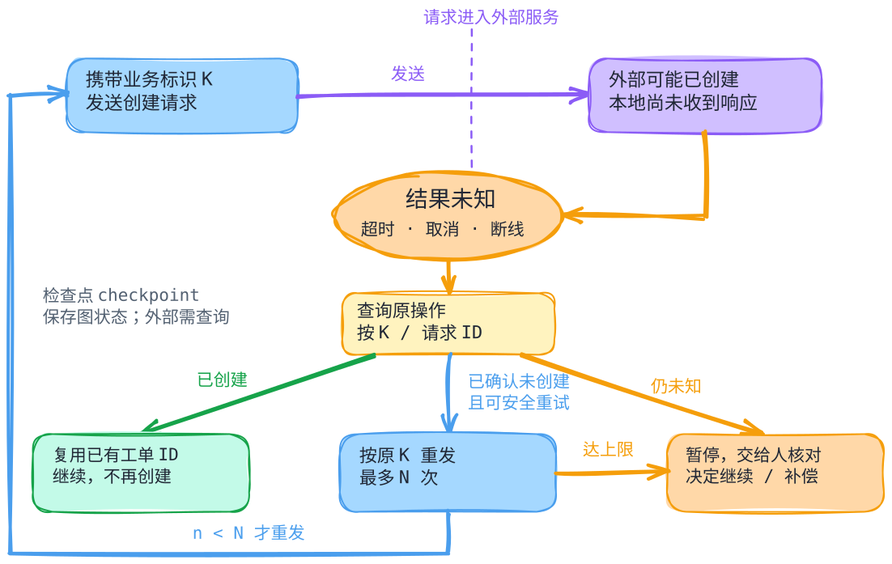

# 中断、重试与恢复：先对账外部世界，再决定怎么续跑

[返回机制目录](README.md) · [Pi 代码导读](../systems/pi/code-walkthrough.md) · [LangGraph 检查点导读](../systems/langgraph/code-walkthrough.md)

Agent 调用外部接口创建故障工单或发起客户退款时，第 10 秒突然抛出网络超时（`ReadTimeout`），或者用户在终端按下了 `Ctrl+C`。最省事的容错写法是一行 `retry(3)`，或者从上一轮检查点（Checkpoint）直接重跑这个工具节点——结果五分钟后，客户收到三笔重复退款，值班群里炸出三张一模一样的紧急工单。

为什么“回滚本地检查点重跑”会闯下大祸？因为分布式系统里有一条绕不过去的物理铁律：**网络超时不等于操作失败，只代表结果未知**。请求可能死在去程半路，也可能远端服务器早已落库扣款，仅仅是回执报文断在了归途。**本地进程的内存与状态机可以随时回滚或续跑，但已经飞出宿主的外部副作用无法时光倒流——恢复之前，必须先凭幂等键或原业务单号向外部系统对账**。



[单独打开 SVG](../../figures/interruption-recovery/diagram.svg) · [可编辑图源](../../figures/interruption-recovery/scene.excalidraw) · [PNG 预览](../../figures/interruption-recovery/preview.png) · [图的文字版](../../figures/interruption-recovery/README.md)

## 先拆清五个动作：重问模型不等于重调写接口

设计恢复链路前，必须把本地控制流动作与远端业务语义彻底分开：

| 机制 | 实际发生了什么 | 外部副作用边界 |
| --- | --- | --- |
| **取消**（Cancel / Abort） | 向当前 Agent 循环与本地工具发出停止信号，等待进程回到空闲态 | 本地停下了，但已发上网络的 HTTP 写请求仍可能在远端继续落地 |
| **重试**（Retry） | 对失败步骤再次发起调用 | 重试无状态模型推理或纯只读查询通常安全；盲目重试写接口则会造成重复写入 |
| **幂等键**（Idempotency Key） | 客户端为同一次业务意图绑定唯一标识 `K` 随请求发送 | 支持幂等的服务端认出同一 `K` 与相同参数时，直接返回首次结果而不重复执行 |
| **检查点**（Checkpoint） | 将 Agent 执行到某一步的消息历史与图状态快照持久化落盘 | **只备份本地记忆，不备份外部世界**——回退检查点绝不会撤回已发出的工单 |
| **人工接管**（Escalation） | 冻结当前任务并完整保留请求指纹与已知线索，交由人工裁决 | 当远端既不可查又无幂等保证、或对账结果前后矛盾时的唯一安全出口 |

## 预写意图账本：为什么发出请求后才记日志就已经晚了

如果等外部接口返回工单号才写本地记录，一旦等待响应途中宿主断电或超时，重启后你连“刚才到底发没发过请求、带的是什么参数”都无从查起。

工程上可靠的处理方式是在真正发包**之前**先落一条**预写意图记录**（Write-Ahead Intent Ledger），把状态拆成明确的跃迁闭环：

```json
// 第 1 步：发包前落盘预写记录（此时尚未产生网络副作用）
{
  "intent_id": "inc-20261118-0042",
  "tool": "create_incident_ticket",
  "idempotency_key": "idem_9f81c2a0",
  "params_hash": "sha256:4b91e7...",
  "status": "IN_FLIGHT"
}

// 第 2 步：遭遇 ReadTimeout，恢复程序醒来看到 IN_FLIGHT，绝不盲目生成新单号！
// ──► 先用 idempotency_key / intent_id 调查询接口对账：
//     分支 A（远端已存在 ticket_8819）──► 补填单号，状态改为 COMMITTED，继续下游步骤
//     分支 B（确认未生效，且在幂等有效期内）──► 携带原 idem_9f81c2a0 与原参数安全重放
//     分支 C（无查询手段且无幂等承诺）──► 状态置为 UNKNOWN_NEEDS_HUMAN，停机告警待人工核实
```

落地这套五步对账协议时，还有两个分布式细节需要格外当心：

1. **第一次没查到，不代表旧请求一定死了**：在异步落库或读写分离架构下，在途慢请求可能还在远端队列里排队，或者从库尚未同步。只有在确认旧请求已彻底终止未生效、或者远端接口原生支持用同一幂等键原子去重时，才能自动重放。
2. **严守幂等键的参数指纹与过期窗口**：以 [Stripe 的幂等说明](https://docs.stripe.com/api/idempotent_requests)为例，服务端会校验同一幂等键附带的请求参数是否一致（参数变了会直接报错拦截），且幂等键在超过保留期（如 24 小时）清理后再次发送会被当成全新交易。[AWS 对迟到请求与幂等重试的说明](https://aws.amazon.com/builders-library/making-retries-safe-with-idempotent-APIs/)同样深入剖析了超时重发与迟到请求交错时的防护设计。因此自动重试必须严格限制最大次数与截止时间窗，过期一律转人工。

## Pi 源码拆解：干净的取消收敛与模型层退避重试

在单机编码 Agent 里，最频繁的中断来自两处：用户主动按快捷键叫停，以及上游大模型 API 偶发限流报错。开源项目 Pi（`earendil-works/pi`）把这两条路径处理得非常克制。

先看**取消如何干净收尾**。底层 `Agent.abort()` 负责拉响当前运行轮次的取消信号（`AbortController`）；而外层应用级的 `AgentSession.abort()` 还会一并打断正在倒计时的重试等待定时器，并阻塞等待内部循环真正收敛回空闲态。这样用户在取消后立刻输入下一句指令时，新旧两轮事件流绝不会混在一起抢状态。

再看**什么错误才由宿主自动重试**。在 `AgentSession` 中，当一轮运行因可重试的模型服务错误（如速率限制 `429` 或服务端过载）中断时，会话层会检查重试开关与上限次数，先睡眠一段可随时被用户取消的**指数退避**（Exponential Backoff）窗口，再调用 `Agent.continue()` 续跑。失败那次尝试仍保留在底层完整记录中备查，但重新组装发给模型的上下文消息时会剔除半截失败残片。

注意这里的清晰边界：Pi 内置的自动重试**只针对无外部业务副作用的模型推理请求**；至于第三方工具执行失败能不能重试、怎么取消，必须由具体工具结合外部系统语义单独实现。

源码参考：
- [核心取消](https://github.com/earendil-works/pi/blob/898ab804050730e9dcefb4443875d5a932aa6a32/packages/agent/src/agent.ts#L332-L349) · [应用层取消](https://github.com/earendil-works/pi/blob/898ab804050730e9dcefb4443875d5a932aa6a32/packages/coding-agent/src/core/agent-session.ts#L2072-L2092)
- [运行后的重试判断](https://github.com/earendil-works/pi/blob/898ab804050730e9dcefb4443875d5a932aa6a32/packages/coding-agent/src/core/agent-session.ts#L1468-L1529) · [退避等待](https://github.com/earendil-works/pi/blob/898ab804050730e9dcefb4443875d5a932aa6a32/packages/coding-agent/src/core/agent-session.ts#L3375-L3419)

## LangGraph 源码拆解：检查点续跑、分叉修正与刷盘时机

对于跨步骤、长周期的工作流，LangGraph 通过 **Checkpoint**（检查点）机制让状态图具备了暂停、崩溃恢复与历史分叉（Time Travel）能力：

- **定点恢复与分叉修改**：运行器可以按指定的 `checkpoint_id` 精确加载某一步的历史快照；如果人工排查发现某一步状态有误，还可以调用 `update_state(old_config, values)`（必要时显式指定 `as_node` 声明以哪个节点的身份写入更新），在旧快照基础上派生出一个新的状态分支配置，接着往后运行。
- **刷盘持久性（`durability`）权衡**：检查点什么时候落盘直接决定崩溃丢多少进度。在本书核对的版本中，`durability` 默认为 `async`（后台异步写检查点，兼顾吞吐）；设为 `sync` 时，每一步推进前必须等待检查点同步落盘完毕（最稳妥，容忍进程随时硬崩）；设为 `exit` 则只在整趟运行退出时才保存一次（中途崩溃将丢失中间步状态）。
- **存储后端选型**：源码自带的 `InMemorySaver` 仅将状态存在进程字典中，明确标定用于本地调试与测试；生产环境跨进程重启恢复必须挂载数据库级持久化存储。

把 LangGraph 检查点与前面的外部对账铁律合起来看，就能避开最隐蔽的深坑：**假设节点在发完建单请求后、尚未完成检查点落盘前宿主进程崩溃，重启后图状态会回退到建单节点执行之前——但远端系统里的那张工单很可能已经建好了**！因此凡是包含外部写操作的图节点，都应把预先生成的 `idempotency_key` 先存入前序检查点状态里，这样无论重启重跑多少次，节点拿到的都是同一个幂等键，配合预写对账就能稳稳幂等收敛。

源码与文档参考：
- [加载指定版本](https://github.com/langchain-ai/langgraph/blob/bdb85b5aa87a21de68371d2e534b81aeed398f57/libs/langgraph/langgraph/pregel/_loop.py#L1629-L1654) · [读取旧状态](https://github.com/langchain-ai/langgraph/blob/bdb85b5aa87a21de68371d2e534b81aeed398f57/libs/langgraph/langgraph/pregel/main.py#L1640-L1675) · [检查与保存新版本](https://github.com/langchain-ai/langgraph/blob/bdb85b5aa87a21de68371d2e534b81aeed398f57/libs/langgraph/langgraph/pregel/main.py#L1905-L2047) · [上游分叉测试](https://github.com/langchain-ai/langgraph/blob/bdb85b5aa87a21de68371d2e534b81aeed398f57/libs/langgraph/tests/test_time_travel.py#L143-L218)
- [参数说明](https://github.com/langchain-ai/langgraph/blob/bdb85b5aa87a21de68371d2e534b81aeed398f57/libs/langgraph/langgraph/pregel/main.py#L2705-L2711) · [示例存储说明](https://github.com/langchain-ai/langgraph/blob/bdb85b5aa87a21de68371d2e534b81aeed398f57/libs/checkpoint/langgraph/checkpoint/memory/__init__.py#L33-L44) · [持久化文档](https://docs.langchain.com/oss/python/langgraph/persistence)

## 来源与边界

本章基于固定版本静态源码与官方文档编写：Pi 固定在提交 [`898ab804`](https://github.com/earendil-works/pi/blob/898ab804050730e9dcefb4443875d5a932aa6a32/packages/agent/src/agent.ts#L332-L349)，LangGraph 固定在提交 [`bdb85b5a`](https://github.com/langchain-ai/langgraph/blob/bdb85b5aa87a21de68371d2e534b81aeed398f57/libs/langgraph/langgraph/pregel/_loop.py#L1629-L1654)。文中的预写意图账本与五步对账流转属于面向应用层的通用分布式工程设计，并非 Pi 或 LangGraph 内置的开箱工单组件；本书未对上述框架做断网或进程强杀的混沌故障注入测试。
