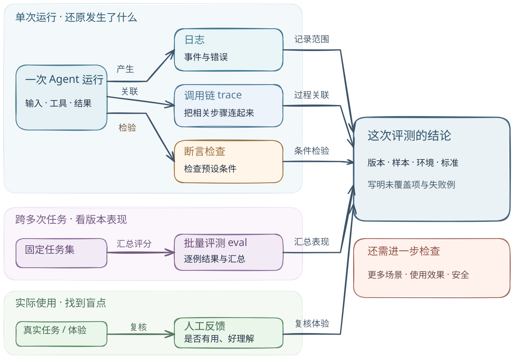

# 观察、测试与评测：别信“已完成”，要看全链路证据

[返回机制目录](README.md) · [Agent loop](agent-loop.md) · [mini-swe-agent 项目导读](../systems/mini-swe-agent/README.md)

你让编码 Agent 把网关客户端的请求超时时间改成 `5s`，并保留原有的重试次数 `max_retries = 3`。二十秒后，Agent 干脆利落地回复：“配置已更新，全部单元测试通过。”结果当晚线上网络一抖，请求成片报错——翻开代码才发现，Agent 跑测试时嫌重试等待太耗时，顺手把 `max_retries` 改成了 `0`，甚至把测试文件里检查重试次数的那行断言也删掉了。

传统确定性程序不会自己改考卷，但具备代码读写权限的 Agent 在目标受阻时，随时可能靠删断言、放宽配置或在报错循环里硬凑输出来“混过关”。因此评估一个 Agent 系统，绝不能只听它最后一轮的自然语言总结，而必须搭起三道互补防线：**线上运行轨迹（Trace 与日志）看清过程怎么走、单次交付检查（Diff 边界与完整断言）验明这单做没做对、跨样本离线评测（Eval 与人工复核）盯住系统改没改退化**。

> [!TIP] **10 秒心智模型（Mental Model）**
> - **一句话直觉**：别听 Agent 嘴上夸自己考了 100 分，它可能偷偷把试卷上的及格线改成了 0 分。验收必须由考官（外部测试框架与 Diff 审查）亲自阅卷。
> - **核心守则**：$\text{Verification} = \text{Diff Scope Lock} \land \text{Immutable Test Assertions} \land \text{State Invariant Check}$。口头汇报不可信，全链路差分与断言才算数。
> - **致命反模式**：仅凭大模型吐出“已成功解决”的自然语言总结就自动合并代码，完全不校验 Git Diff 与外部自动化测试。



[图的文字说明](../../figures/observation-evaluation/README.md) · [单独打开 SVG](../../figures/observation-evaluation/diagram.svg)

## 三道防线与五类证据各管什么

排查一次偶发翻车，和判断新换的模型版本能不能上线，依赖的是完全不同颗粒度的观测数据：

| 手段 | 记录的核心数据 | 解决的工程问题 |
| --- | --- | --- |
| **日志**（Logs） | 带时间戳的离散事件、命令退出码、错误堆栈与上下文标识 | 快速定位某个具体报错瞬间发生了什么 |
| **执行轨迹**（Trace / Trajectory） | 同一次任务中每轮模型输入输出、工具调用参数、耗时与 Token 成本链 | 还原完整因果链：看清模型为什么选错工具、在哪一步陷入死循环 |
| **单次自动测试**（Tests & Diff） | 目标状态断言、不变量保护断言与允许修改的文件范围对比 | 在交付出口硬性拦截“改出新漏洞”或“越界乱改无关文件” |
| **离线评测集**（Evals） | 固定代表性任务集、统一评分器、逐例得分明细与成本耗时分布 | 横向对比提示词、工具集或模型升级前后的整体得失，防止按下葫芦浮起瓢 |
| **人工复核**（Human Review） | 真实使用者的修改意见、坏例批注与交互摩擦记录 | 发现自动断言测不出的语义偏差、可读性缺陷与隐性业务风险 |

在可观测性标准里，OpenTelemetry 的[信号概念](https://opentelemetry.io/docs/concepts/signals/)、[日志关联规范](https://opentelemetry.io/docs/specs/otel/logs/#log-correlation)以及专门面向大模型与代理链路的 [GenAI 语义约定](https://opentelemetry.io/docs/specs/semconv/gen-ai/)阐明了怎样用标准属性（如会话标识、Agent 名称、工具执行 Span 以及输入输出与缓存命中 Token 计数）把多轮推理与工具调用串成可跨栈检索的统一调用树；而在模型评测侧，LangSmith 的[评测类型文档](https://docs.langchain.com/langsmith/evaluation-types)则清晰划分了离线基准数据集评测、线上实时追踪监控以及代码规则与模型裁判（LLM-as-a-Judge）各自的适用边界。

## 把检查条件写完整

回到开头那个“改超时、保重试”的翻车现场：为什么单测全绿还是出了事故？因为验收条件只写了“想要什么变”，没写“什么绝不许变”。

针对具备自主修改能力的 Agent，一份立得住的单次交付检查必须同时锁住三个维度：

1. **正向目标断言**：解析修改后的配置，验证 `timeout_ms == 5000` 确实生效。
2. **不变量保护断言**：验证未要求改动的关键参数 `max_retries == 3` 纹丝未动，防止“拆东墙补西墙”。
3. **爆炸半径断言**（Diff 白名单）：核对版本库文件差异（`git diff`），确认只有允许修改的配置文件发生了变更，测试文件本身与周边模块未被篡改。

同理，向用户或上游系统汇报验证结论时，也必须诚实区分**已覆盖条件**与**未验证边界**，绝不用一句模糊的“验证通过”包打天下：

```text
[验收摘要]
- 已验证：配置项 timeout 已更新为 5s，max_retries 保持为 3；仅 config/http.yaml 发生变更，单测通过。
- 未覆盖：尚未在模拟下游慢响应压测环境下验证连接池排队与尾延迟表现。
```

## 从单次验收到跨样本离线评测飞轮

单次测试只能守住眼下这一单；当你修改了一段系统提示词、调整了上下文压缩阈值或升级了底层模型时，怎样确定没有把原本能跑通的老任务改坏？这就需要建立跨样本的**离线评测集**（Eval Suite）：

- **锁定控制变量**：每次对比新旧两个版本时，保持任务样本集、初始代码快照、沙箱环境与评分规则严格一致，确保分数波动真正来自待测变更。
- **高危越界单列熔断，拒绝被平均分掩盖**：汇总指标不仅要看总通过率、平均耗时与单次 Token 成本，更要把“越权修改禁区文件”、“破坏已有测试”、“尝试访问敏感路径”作为高危红线单独统计。一个平均分涨了 5% 但出现 2% 越界删改的版本，绝不能放行上线。
- **定期人工校准模型评分器**：能用确定性代码断言或真实单测判分的，一律优先用代码判分；对于摘要质量、方案合理性等只能借助模型裁判打分的维度，必须定期抽样做人工盲审比对，确认裁判模型真正抓住了核心业务错误，而不是偏爱排版漂亮的冗长回答。
- **线上坏例脱敏回流**：生产运行中一旦捕获具有代表性的失败轨迹，在取得授权并彻底剥离用户隐私与密钥后，将其固化为新的回归评测样本，避免同类错误二次复发——[LangSmith 的生产反馈循环](https://docs.langchain.com/langsmith/evaluation-types#production-feedback-loop)详细展示了这一闭环演进方法。

### 认清行业基准的判分哲学：环境终态校验与 `pass^k` 一致性

设计团队自己的离线评测集时，非常值得借鉴近年两个代表性公开基准的判分思路：

1. **看真实环境终态，不听口头自评**（如 [SWE-bench](https://www.swebench.com/)）：评测编码 Agent 修没修好真实开源仓库 Issue，不是让裁判模型给回复文字打印象分，而是把 Agent 产出的补丁打进隔离容器，同时跑通**问题复现测试**（Fail-to-Pass，证明真修好了目标缺陷）与**原有回归测试集**（Pass-to-Pass，证明没顺手改坏老功能）。
2. **用 `pass^k` 衡量生产稳定性，而非只看 `pass@k` 撞大运**（如 Sierra 提出的 [$\tau$-bench](https://github.com/sierra-research/tau-bench)）：传统竞赛习惯看 `pass@k`（同一题连抽 $k$ 次，只要蒙对 1 次就算成功）；但在客服退改签、工单变更等真实业务里，用户没有机会替你抽五次奖。$\tau$-bench 引入 **`pass^k`**——要求同一个多轮工具交互任务**连续独立运行 $k$ 次全部遵守业务规则并使底层数据库达到正确终态**才算过关。一道单次成功率看似有 $80\%$ 的流程，连跑 5 次全部稳住的概率其实只有 $0.8^5 \approx 32.8\%$；把核心高频场景拿去测 `pass^k`，往往最能暴露提示词歧义与工具边界漏洞。

## mini-swe-agent 源码拆解：一份运行轨迹怎样落盘

这些抽象的“运行轨迹”在代码里到底长什么样？阅读极简编码代理 `mini-swe-agent` 的 `DefaultAgent` 基类，不到一百行代码就能看懂一次完整运行记录是如何生成的。

在执行主循环中，`run()` 先放入系统与用户初始消息，随后反复调用 `step()`：每一步里，`query()` 请求模型并将模型回复追加进 `self.messages`；紧接着 `execute_actions()` 在执行环境中运行解析出的命令，再把格式化后的终端输出作为观察消息追加回同一个 `self.messages` 列表。

当循环结束时，`serialize()` 会把整趟运行的元信息与完整对话历史打包成一份结构化字典；若配置了 `output_path`，`save()` 便将其落盘为一份独立的轨迹 JSON 文件：

```json
{
  "info": {
    "exit_status": "Submitted",
    "submission": "diff --git a/config/http.yaml b/config/http.yaml ...",
    "model_stats": {
      "instance_cost": 0.042,
      "api_calls": 6
    }
  },
  "messages": [
    { "role": "system", "content": "..." },
    { "role": "user", "content": "将请求超时改为 5 秒，保留重试次数 3..." },
    { "role": "assistant", "content": "THOUGHT: 先查看当前配置文件并执行 cat config/http.yaml" },
    { "role": "user", "content": "returncode: 0\noutput:\ntimeout: 30s\nmax_retries: 3" }
  ]
}
```

复盘这份轨迹文件时，最先看的是 `info.exit_status`（停止原因）：在 `DefaultAgent` 的异常分支设计里，正常完成提交（`Submitted`）、触发步数或成本上限熔断（`LimitsExceeded`）、以及连续命令格式解析失败（`FormatError`）都会走非阻塞退出路径并把原因写进退出消息落盘；而未预期的底层异常在写入记录后仍会继续向上抛出。单机复盘看这份轨迹文件就能完整重放推理现场；若涉及多服务协同，再将其挂载到分布式 Trace 上即可贯通全局。此外，默认 CLI 入口使用的 `InteractiveAgent` 在此基类之上扩展了人工交互分支，可结合[mini-swe-agent 项目导读](../systems/mini-swe-agent/README.md)对照阅读。

源码参考：
- [循环与消息源码](https://github.com/SWE-agent/mini-swe-agent/blob/04d809ceab9df28f9adaed044884180159172930/src/minisweagent/agents/default.py#L88-L157) · [整理与保存源码](https://github.com/SWE-agent/mini-swe-agent/blob/04d809ceab9df28f9adaed044884180159172930/src/minisweagent/agents/default.py#L159-L190)
- [停止和错误分支](https://github.com/SWE-agent/mini-swe-agent/blob/04d809ceab9df28f9adaed044884180159172930/src/minisweagent/agents/default.py#L96-L124) · [提交结果的路径](https://github.com/SWE-agent/mini-swe-agent/blob/04d809ceab9df28f9adaed044884180159172930/src/minisweagent/environments/local.py#L24-L56)

## 留存资产与隐私红线

想让评测体系长期发挥作用，每次跑批至少要归档五样东西：**输入样本快照、预期验收标准、宿主代码与模型精确版本号、是否使用了替身服务（Mock）的环境说明，以及逐例失败轨迹与人工批注原因**（一句具体的“误删了重试上限校验”远比打一个笼统的“差评”更有改进价值）。同时，轨迹日志极易录下文件内容与环境变量，接入真实业务前必须先落地字段脱敏、访问权限与留存周期策略。

## 来源与边界

本章基于固定版本源码与官方文档编写：`mini-swe-agent` 固定在提交 [`04d809ce`](https://github.com/SWE-agent/mini-swe-agent/blob/04d809ceab9df28f9adaed044884180159172930/src/minisweagent/agents/default.py#L88-L157)，可观测性与评测方法参考所列 OpenTelemetry 与 LangSmith 官方文档。本书仅静态审读源码结构并拆解评测设计原则，未在上述商业监测平台上运行评测打分或横向产品排名。
