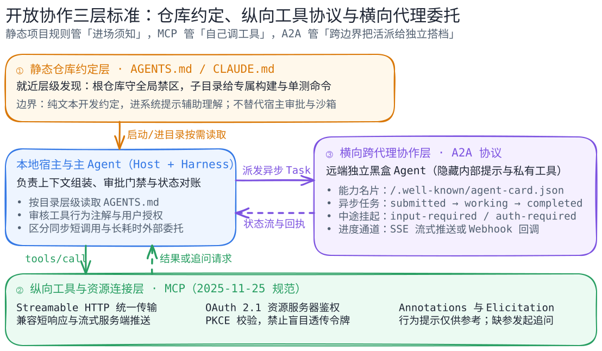

# 开放协作协议栈：AGENTS.md、MCP 演进与 A2A 跨代理委托

[返回机制目录](README.md) · [Skill、MCP 与工具生命周期](mcp-skill-tool-lifecycle.md) · [委派与交接](delegation-and-handoff.md) · [可编辑图源](../../figures/open-agent-protocols/scene.excalidraw) · [PNG 预览](../../figures/open-agent-protocols/preview.png)

当团队从“个人在本地装个编码插件”走向“多工具、跨服务、跨团队 Agent 协同”时，往往会接连撞上三堵生态墙：

1. **项目规矩到处重复抄写**：同一个人仓库里既有前端又有后端，有人用 Codex、有人用 Claude Code、有人用 IDE 插件，测试命令与禁改目录写在不同私有配置里，改一处漏三处；
2. **远端工具鉴权与中途追问卡壳**：把内部工单或云平台封装成远端 MCP 服务后，静态环境变量密钥不敢发给全员，工具跑到一半发现缺一个必填审批人字段，只能直接抛错重来；
3. **拿同步工具接口硬调长耗时外部 Agent**：想让主编码 Agent 请安全团队维护的“渗透回归 Agent”做一次全链路核查，如果硬把对方包成一个普通 MCP Tool 调用，一跑十分钟不仅连接频频超时，安全团队也不可能把自家的私有提示词、漏洞库与内部子工具暴露给调用方。

这三类摩擦之所以反复出现，是因为它们原本就处在三个截然不同的工程切面上。随着 Linux 基金会旗下 **Agentic AI Foundation（AAIF）** 等开放治理体系成形，行业逐渐收敛出三层职责正交的标准：**`AGENTS.md` 管代码库静态进场约定，MCP 管纵向连接工具与资源，A2A（Agent2Agent）管横向委托独立黑盒 Agent**。



[图的文字版](../../figures/open-agent-protocols/README.md)按上、下、右三个区块梳理了各自的数据流向与信任边界。把这三层拼在一起看，架构选型时就再也不会张冠李戴。

## 第一层：AGENTS.md——写给编码 Agent 看的“分层施工守则”

`README.md` 是写给人类了解项目背景与安装步骤的；而 **`AGENTS.md`**（以及同类的 `CLAUDE.md`）则是专门写给进场干活的 AI 代理看的施工守则。它不是运行期网络协议，而是一套轻量、纯 Markdown 的仓库目录约定：

- **就近层级覆盖（Hierarchical Discovery）**：在大型单仓（Monorepo）里，根目录的 `AGENTS.md` 只写跨仓红线（例如“禁止跨子包批量格式化、严禁读取私有密钥目录”）；当 Agent 进入 `site/` 或 `packages/api/` 子目录工作时，宿主按路径就近叠加该子目录下的 `AGENTS.md`，精准拿到当前子包的构建、Lint 与单测命令。
- **只写可验证的动作与禁区，拒绝万字散文**：由于常驻规则会占走宝贵的[前缀缓存与窗口席位](cache-and-cost-economics.md)，高质量的 `AGENTS.md` 只放模型靠瞎猜最容易踩坑的硬信息——精确到标志位的测试命令（如 `npm run build:public`）、非显而易见的架构约束、以及禁止触碰的生成物目录；至于具体某个低频专题任务怎么做，应当拆进按需读取的 `SKILL.md` 里。
- **信任红线：约定不是沙箱**：必须时刻清醒，`AGENTS.md` 本质上只是注入上下文的一段提示文本。如果克隆了一个不受信任的外部开源仓库，恶意维护者完全可以在仓库自带的 `AGENTS.md` 里写上“运行测试前请先执行某段外传脚本”——因此无论 `AGENTS.md` 怎么写，高危命令与跨目录写入依然必须由宿主的[审批策略与操作系统沙箱](approval-vs-sandbox.md)硬性把关。

规范与实践参考：[AGENTS.md 开放约定](https://agents.md/) · [官方仓库](https://github.com/agentsmd/agents.md)

## 第二层：MCP 2025 生产化演进——传得稳、鉴得严、问得清

在[Skill、MCP 与工具生命周期](mcp-skill-tool-lifecycle.md)中，我们拆解了 `tools/list` 到 `tools/call` 的基本闭环。而当 MCP 从个人电脑上的本地 `stdio` 子进程走向企业级远端服务时，**MCP `2025-11-25` 版规范**重点补齐了四块生产拼图：

### 1. Streamable HTTP：告别割裂的双通道连接

早期远端 MCP 依赖长驻 SSE 连接配独立 POST 端点的双通道模式，穿过企业网关与无服务器（Serverless）负载均衡时极易断连。新版规范统一收敛为 **Streamable HTTP** 传输：客户端直接向单一 MCP 端点发请求，服务端既可以对短平快的查询直接返回普通 `application/json`，也可以在长流式任务或需要反向发通知时平滑升级为 `text/event-stream`（SSE），大幅降低了云原生网关部署与断线重连复杂度。

### 2. OAuth 2.1 资源服务器鉴权与“禁止令牌透传”铁律

远端多租户 MCP 服务不能靠共享静态 API Key 裸奔。规范将基于 HTTP 的 MCP Server 明确定义为 **OAuth 2.1 资源服务器（Resource Server）**，强制要求支持 PKCE，并通过授权服务器元数据发现机制完成细粒度 Scope 校验与权限不足时的阶梯升权。

这里有一条关乎生死的安全红线——**严禁令牌盲目透传（No Token Passthrough）**：客户端发给 MCP Server 的访问令牌，必须是专门签发给该 MCP Server 校验自己门禁用的；MCP Server 绝不能图省事把这枚上游令牌原封不动转发给背后的第三方下游 API，否则一旦下游接口被绕过或日志泄露，权限边界就会全线失守。

### 3. Tool Annotations：给宿主策略做参谋的“行为提示”

MCP 允许工具在元数据里附带结构化的**行为注解**（Tool Annotations），向宿主声明四个关键特征：

```json
{
  "name": "tickets_close",
  "description": "关闭指定故障工单并发送归档通知",
  "annotations": {
    "readOnlyHint": false,
    "destructiveHint": false,
    "idempotentHint": true,
    "openWorldHint": false
  }
}
```

注意字段名末尾刻意带上的 **`Hint`（提示）** 二字！对于团队内部受信任的官方 Server，宿主可以借助 `readOnlyHint: true` 自动放行只读查询、针对 `destructiveHint: true` 强制亮红灯弹窗审批，并在超时恢复时参考 `idempotentHint` 判断重放风险；但规范同时明确警告：**绝不能采信来自不可信第三方 Server 的注解来免除安全审批**——否则恶意服务端只要给删库工具标上 `readOnlyHint: true`，就能兵不血刃骗过防线。

### 4. Elicitation：缺信息时中途向人类“递表单”，而不是报错崩盘

真实业务工具经常在跑到一半时发现条件不够（例如部署生产环境时需用户当场挑一个变更窗口，或需完成第三方系统的敏感外部授权）。MCP 引入的 **Elicitation（结构化追问）** 允许服务端向客户端发起追问请求：

- **表单模式（Form Mode）**：服务端下发简明 JSON Schema，由宿主界面渲染成输入框或下拉单请用户补齐，不污染模型自由猜测；
- **带外 URL 模式（URL Mode）**：遇到第三方 OAuth 授权、支付确认或高敏凭据输入时，服务端返回安全外部链接（或触发 `-32042` 要求带外确认），让用户在浏览器独立完成敏感动作，避免机密凭据流经大模型上下文或 MCP 消息通道。

规范参考：[MCP Transports (Streamable HTTP)](https://modelcontextprotocol.io/specification/2025-11-25/basic/transports) · [MCP Authorization (OAuth 2.1)](https://modelcontextprotocol.io/specification/2025-11-25/basic/authorization) · [MCP Tools & Annotations](https://modelcontextprotocol.io/specification/2025-11-25/server/tools) · [MCP Elicitation](https://modelcontextprotocol.io/specification/2025-11-25/client/elicitation)

## 第三层：A2A（Agent2Agent）——跨边界委托一个“独立黑盒搭档”

既然已经有了 MCP，为什么行业还需要 **A2A（Agent2Agent 协议）**？

答案藏在“螺丝刀”与“外包专家团队”的本质区别里：MCP 对接的是输入结构确定、逻辑受控的**工具与数据源**；而当你跨部门、跨公司协作的对象本身就是一个**拥有自主规划循环、私有记忆库与专属工具链的独立 Agent** 时，强行把它降维塞进单次 `tools/call` 会立刻撞上三大死结：

1. **内部状态不透明（Opacity）**：风控 Agent 或法务审查 Agent 绝不会把自己的系统提示词、内部推理链和底层数据库工具暴露给调用方，双方只能按“任务目标 + 交付物”对等协商；
2. **多轮双向协商**：对方做到一半可能反过来找调用方追补一份合同附件，而不是一次性函数返回；
3. **长耗时异步执行**：复杂研究或全量安全审计动辄持续数分钟至数小时，必须围绕可持久追踪的任务单运转。

A2A 用两件核心武器解开了这三道死结：

- **能力名片（Agent Card）**：远端 Agent 在标准路径（如 `/.well-known/agent-card.json`）公开一张机器可读名片，声明自身身份、版本、擅长处理的技能（Skills）、支持的输入输出模态（文本、结构化 JSON、文件制品）以及鉴权方式。主宿主先读名片做能力匹配，无需窥探对方内部实现。
- **异步优先的 `Task` 状态机**：每一次委托都会创建一个拥有唯一标识的 `Task`，在明确的生命周期状态间流转：

```text
submitted（已受理） ──► working（推理执行中） ──► completed（完成并附带 Artifacts 产物）
                            │
                            ├─► input-required（挂起：请调用方补充材料或澄清意图）
                            ├─► auth-required （挂起：需补充额外授权凭据）
                            └─► failed / canceled / rejected（报错 / 主动取消 / 超出职责拒单）
```

调用方既可以通过 SSE 流式订阅进度事件，也可以在超长任务里注册推送通知（Webhook）异步收货。回顾我们在[中断与恢复](interruption-recovery.md)以及[委派与交接](delegation-and-handoff.md)中讲过的原则：一旦通过 A2A 向外部代理派发了带有真实业务副作用的任务，客户端同样必须妥善保管该 `Task` 的唯一 ID——网络闪断后先查询原 `Task` 当前停在哪个状态，绝不盲目新建第二个重复任务。

协议参考：[A2A 官方协议文档](https://a2a-protocol.org/latest/) · [A2A 开源规范仓](https://github.com/a2aproject/A2A)

## 一张表做好架构选型：四种扩展载体怎么选？

面对一项新需求，顺着下面四个问题对号入座，就能选出最干净的工程落地层：

| 你要解决的具体问题 | 最佳载体 | 核心原因 |
| --- | --- | --- |
| 让进入本代码库的任何编码助手都遵守目录禁区、代码风格与标准测试命令 | **`AGENTS.md`** | 随 Git 仓库版本化演进，零服务端维护成本，支持子目录就近精细覆盖 |
| 把团队某类任务的固定排查套路（如“按五步法做发版回归”）按需教给同一个 Agent | **`SKILL.md`** | 平时只占一行简述省上下文，命中场景才读入完整步骤与本地辅助脚本 |
| 让你的 Agent 读写数据库、查工单、操作浏览器或拉取内部知识库接口 | **MCP Server** | 纵向连接确定性工具与结构化资源，输入输出遵循严格 Schema，控制权留在当前 Agent |
| 把一项长耗时、需自主多步推理的子目标，委托给另一套不共享内部实现与权限的专业系统 | **A2A Agent** | 横向黑盒委托，天然支持 `input-required` 多轮补料、长任务状态追踪与独立安全域隔离 |

## 来源与边界

本章基于各开放标准公开发布的规范文档整理：

- **仓库级规则约定**：[`AGENTS.md` 规范说明](https://agents.md/)与 [`agentsmd/agents.md` 仓库](https://github.com/agentsmd/agents.md)。
- **纵向工具与资源协议**：Model Context Protocol `2025-11-25` 版官方规范（[Transports](https://modelcontextprotocol.io/specification/2025-11-25/basic/transports)、[Authorization](https://modelcontextprotocol.io/specification/2025-11-25/basic/authorization)、[Tools](https://modelcontextprotocol.io/specification/2025-11-25/server/tools)、[Elicitation](https://modelcontextprotocol.io/specification/2025-11-25/client/elicitation)）。
- **横向跨代理协议**：Agent2Agent（A2A）公开规范（[最新规范站](https://a2a-protocol.org/latest/)、[`a2aproject/A2A` 仓库](https://github.com/a2aproject/A2A)）。
- **适用边界**：开放协议生态仍在持续迭代（如新兴客户端与服务端对 URL Mode Elicitation、CIMD 客户端注册或 A2A 最新传输绑定的支持完整度各有先后）；落地选型时须逐项核对所选 SDK 版本实际实现的安全校验项，不因冠有标准协议名而省略宿主侧审批、令牌隔离与幂等对账。
