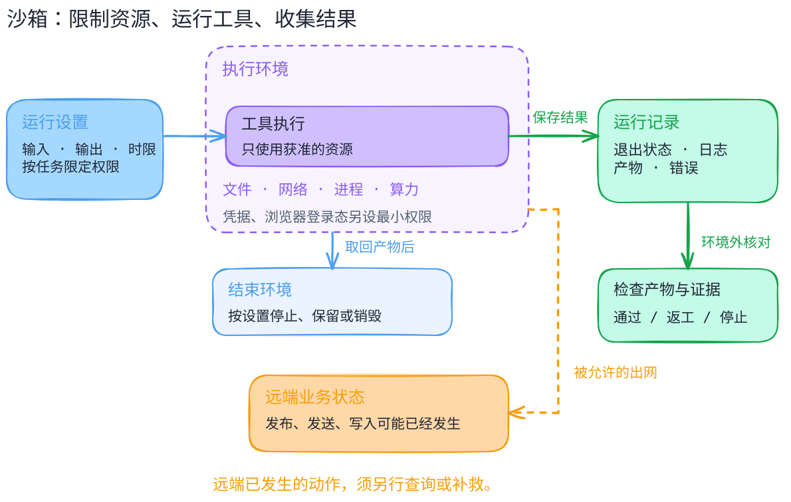

# 代码执行沙箱：算清文件、网络与生命周期三笔账

[返回机制目录](README.md) · [审批与隔离](approval-vs-sandbox.md) · [外部动作与恢复](../comparisons/permission-and-recovery.md)

赋予 Agent“写脚本并直接运行”的能力，本质上是把“任意代码执行”做成了在线功能。很多团队随手拉起一个默认配置的容器，顺手挂上目录 `-v $HOME:/workspace` 就以为进了保险箱——直到 Agent 解析一份外部报表时触发恶意依赖或间接提示注入，脚本不仅顺着挂载目录读光了本地云凭据，还借道默认放行的容器外网把数据传了出去，甚至在任务超时后留下后台孤儿进程继续空转耗尽内存。

真正兜得住风险的**沙箱**（Sandbox），绝不只是套一层容器外壳，而必须在创建之初就算清三笔硬账：**文件系统边界、网络与凭据出入口控制、进程生命周期与状态清理**；同时还要看清容器、gVisor 与 microVM 各自挡在操作系统内核的哪一层，以及为什么**销毁本地沙箱永远撤不回已经发往远端的外部 API 请求**。

> [!TIP] **10 秒心智模型（Mental Model）**
> - **一句话直觉**：沙箱就像医院的“传染病负压隔离室”，不仅要锁住进出大门（只读挂载），还要封死排气管道（默认禁连外网），任务结束立刻全室消毒焚烧（强杀回收）。
> - **核心守则**：算清三笔账：$\text{Sandbox Contract} = \text{Read-Only Mounts} + \text{Egress Network Deny} + \text{Strict Lifecycle Hard-Kill}$。
> - **致命反模式**：直接 `-v $HOME:/workspace` 把整机根目录挂进容器，还放开公网访问，导致恶意依赖窃取密钥并外传。



[可编辑图源](../../figures/sandbox-execution/scene.excalidraw) · [PNG 预览](../../figures/sandbox-execution/preview.png) · [图的文字版](../../figures/sandbox-execution/README.md)

图中实线代表主执行闭环，外圈虚线标出沙箱隔离围栏，橙色虚线则标出了最需要重点设防的突破口——获准跨出沙箱访问外部网络与远端服务的通道。

## 搭沙箱必算的三笔核心账

假设你让 Agent 修复并运行一段 CSV 清洗脚本，把宿主环境和任务隔开的标准做法，是在拉起执行环境前先锁死一份最小资源契约：

```text
文件系统账：/in 只读挂载样例数据；/out 限额可写输出；宿主机 $HOME、~/.ssh、生产配置一律不挂载
网络与凭据账：默认禁连公网（deny-all）；不注入长效生产密钥，不挂载个人日常浏览器登录态
进程生命周期账：非特权 UID 运行；限制 CPU / 内存 / 最大子进程数；超时按整个进程组强杀回收
```

拆开来看，这三笔账里每一处都有容易踩空的默认陷阱：

### 第一笔账：文件系统挂载与产物回收

工作目录（`cwd`）只管解析相对路径，真正挡住越界读写的靠的是挂载隔离与文件权限。输入材料应当以只读方式放入专用目录，脚本产出的新文件写入独立输出区；任务跑完把输出 CSV 或代码补丁取回宿主时，**宿主程序必须将其视作待校验的外部数据解析检验**，绝不能不经审查就在宿主机直接执行沙箱吐出来的二进制或脚本。

### 第二笔账：网络出入口与身份凭据

只隔离本地磁盘却敞开公网出口，等于允许失控脚本把读到的任何工作区代码或环境变量直接 `POST` 到外部服务器。尤其要注意，**许多云端沙箱平台出于易用性考虑，默认是放行公网访问的**：例如 E2B 文档明确指出新建沙箱默认允许连接互联网，需通过创建参数显式收紧出网规则；Daytona 的网络访问同样取决于组织策略与环境网络限制配置。

凭据与登录态也是网络边界的一部分：只向沙箱注入当前任务必需的短效受限 Token，且避免打入明文日志；若沙箱内需要驱动浏览器，务必核查是否带入了包含登录 Cookie 与认证 Header 的状态文件（如 Playwright 的认证状态 JSON），严禁将个人日常账号登录态塞进不可信任务或误提交到仓库。

网络与凭据参考：[E2B 网络配置](https://docs.e2b.dev/network/internet-access) · [Daytona 网络限制](https://www.daytona.io/docs/en/network-limits/) · [Playwright 认证说明](https://playwright.dev/docs/auth)

### 第三笔账：进程生命周期、休眠持久化与会话解耦

脚本跑完或卡死后，环境怎么收尾直接影响资源账单与残留风险。除了用控制组限制 CPU、内存与超时整组终止子进程外，多轮交互式 Agent 还要分清托管沙箱中三种截然不同的生命周期操作：

- **停止**（Stop）：例如 Daytona 的停止操作会终止进程、清空内存，但保留沙箱文件系统，下次恢复相当于保留磁盘重启机器。
- **暂停快照**（Pause / Persistence）：把当前内存运行态与文件系统一并冻结保存。例如 E2B 的持久化暂停可在恢复时还原文件与内存状态（也支持仅保留文件重启），Daytona 的 Linux VM 与 Windows 环境同样支持保留内存的暂停，而普通容器架构则不支持这种内存级暂停。
- **终止销毁**（Kill / Delete）：彻底销毁环境与临时磁盘，释放全部算力配额。

更要分清的是：**保存了沙箱磁盘与内存，不代表保存了 Agent 的对话记忆**。下次唤醒沙箱后，模型上下文里该保留哪些历史消息、摘要了哪些旧输出，依然由宿主运行器的会话层单独编排，详见[会话与记忆](session-compaction-and-memory.md)。

生命周期参考：[Daytona 停止与暂停](https://www.daytona.io/docs/en/sandboxes/#stop-sandboxes) · [E2B 持久化](https://docs.e2b.dev/sandbox/persistence)

## 隔离技术栈拆解：容器、gVisor 与 microVM 各挡哪一层

同样叫“沙箱”，不同底层技术的隔离水位与性能兼容性代价相差极大。核心分水岭只有一个：**沙箱里的不可信代码发起系统调用（Syscall）时，是不是直接打在宿主机自己的操作系统内核上**？

| 技术层次 | 核心隔离机制 | 工程权衡与设防重点 |
| --- | --- | --- |
| **宿主进程级策略**（Seatbelt / Landlock） | 用宿主操作系统安全模块直接限制进程的文件、网络与子进程权限 | 启动零开销，适合本地 CLI 高频工具；规则必须严密覆盖派生子进程 |
| **Linux 容器**（Docker 等） | 用 `namespaces` 隔离资源视图，用 `cgroups` 限制算力配额 | 轻量快速，但**与宿主共享同一颗 Linux 内核**；严禁滥挂敏感目录与守护进程句柄 |
| **用户态应用内核**（gVisor） | 用用户态内核 `Sentry` 拦截并代办工作负载的绝大多数系统调用 | 大幅缩减打向宿主内核的系统调用暴露面；需为系统调用拦截承担一定兼容性与性能折衷 |
| **轻量虚拟机**（Firecracker microVM） | 基于硬件虚拟化（KVM）启动带独立客体内核的极简虚拟机 | 内核级硬隔离，适合多租户运行不可信代码；需在宿主侧自行配套网络过滤与管理进程降权 |
| **托管沙箱服务**（E2B / Daytona 等） | 通过云端 API 按需调度管理底层 microVM 或容器生命周期 | 免自建虚拟化底座；需重点核查默认出网开关、数据驻留地与账户配额 |

### Linux 容器：切开视图与配额，但守住内核与守护进程红线

Linux 容器依靠 `namespaces` 让进程只看见分给它的目录树与进程号，依靠 `cgroups` 锁死内存与 CPU 上限，再配合 `seccomp` 过滤高危系统调用。但容器内的进程本质上仍是宿主机内核直接调度的普通进程——一旦挂载配置过宽（比如挂入了整个个人主目录），隔离就形同虚设；更致命的禁忌是把 Docker 守护进程控制套接字（`docker.sock`）挂进容器：**谁能控制 Docker daemon，谁就能反手拉起一个挂载宿主根目录的特权容器，瞬间拿到宿主机最高控制权**。

文档参考：[Docker 安全说明](https://docs.docker.com/engine/security/) · [系统调用过滤](https://docs.docker.com/engine/security/seccomp/) · [daemon 的权限风险](https://docs.docker.com/engine/security/#docker-daemon-attack-surface)

### gVisor：在工作负载与宿主内核之间加装缓冲层

既然直接向宿主内核发系统调用暴露面太大，gVisor 的思路是在中间垫一层用内存安全语言编写的用户态应用内核 **Sentry**。容器内程序请求读写文件或建连时，先由 Sentry 拦截处理，Sentry 自身只通过极窄的一组受限接口与宿主操作系统打交道。代价则是部分冷门或底层系统调用存在兼容性差异，上生产前需拿业务真实依赖链实测验证。

文档参考：[架构说明](https://gvisor.dev/docs/architecture_guide/intro/) · [兼容性说明](https://gvisor.dev/docs/user_guide/compatibility/)

### Firecracker microVM：用硬件虚拟化跑独立客体内核

当平台需要同时运行成千上万个多租户不可信 Agent 脚本时，行业普遍下沉到 **Firecracker** 这类 microVM 架构：利用 Linux KVM 硬件虚拟化，在百毫秒级拉起拥有独立客体内核的轻量虚拟机。阅读其官方设计文档时，有两个生产落地细节绝不能漏看：第一，官方强烈建议在生产环境配合 `jailer` 启动器把 Firecracker 管理进程自身关进受限目录并剥离特权；第二，**Firecracker 虚拟机管理器本身不负责网络流量内容过滤**，限制沙箱访问哪些外部 IP 或域名必须在宿主机网络层另行配置。

文档参考：[固定版本设计文档](https://github.com/firecracker-microvm/firecracker/blob/edb60617c31ebd610c530f67706ec5c79d4c2725/docs/design.md)

### OpenShell：把静态与动态资源策略接进运行环境

除了底层内核怎么切，上层策略怎么管同样关键。以 NVIDIA OpenShell 的架构设计为例，它将沙箱策略拆成动静两类：**文件系统与进程控制策略在沙箱创建时一次性锁定不可篡改**，防止运行途中被提权改写；而**出网规则与模型推理路由配置则支持在运行期动态下发更新**。评估这类策略框架时，将它的策略表达层与所选底层容器或虚拟机隔离底座结合起来看，就能拼出完整安全视图。

文档参考：[官方项目](https://github.com/NVIDIA/OpenShell) · [配置建议](https://docs.nvidia.com/openshell/security/best-practices.md)

## 致命盲区：销毁本地沙箱，撤不回已飞出的远端副作用

最后必须点破一个高频架构误区：有人以为“只要每次任务跑完立刻 `kill` 销毁整台 microVM，哪怕脚本失控也干不坏任何事”。

这个假设**只在纯离线沙箱里成立**。一旦你给沙箱开了外网，允许里面的 Agent 登录内容后台点发布、发邮件或调用外部业务 API，那么副作用就已经落在了远端服务器上——此时把本地沙箱炸得粉碎，远端发出去的文章或扣掉的款项也绝不会自动回滚；反过来，如果脚本在等远端接口回执时被沙箱超时强杀，宿主恢复时还必须先去远端查明刚才那步到底成没成功，绝不能拉起一个新沙箱盲目重发。读者可通过配套的[回执丢失小实验](../labs/remote-effect.md)（基于本地模拟服务端构造回执丢失场景）直观体验这一边界。

## 来源与边界

本章基于各运行时官方文档与固定版本设计说明编写，其中 Firecracker 设计文档固定在提交 [`edb60617`](https://github.com/firecracker-microvm/firecracker/blob/edb60617c31ebd610c530f67706ec5c79d4c2725/docs/design.md)。本章聚焦沙箱边界划分与隔离层次对比，未在本地部署上述虚拟化内核进行逃逸渗透测试或启动延迟横向跑分；落地选型时请使用脱敏假数据与专用测试凭据逐项核验越界拦截效果。
