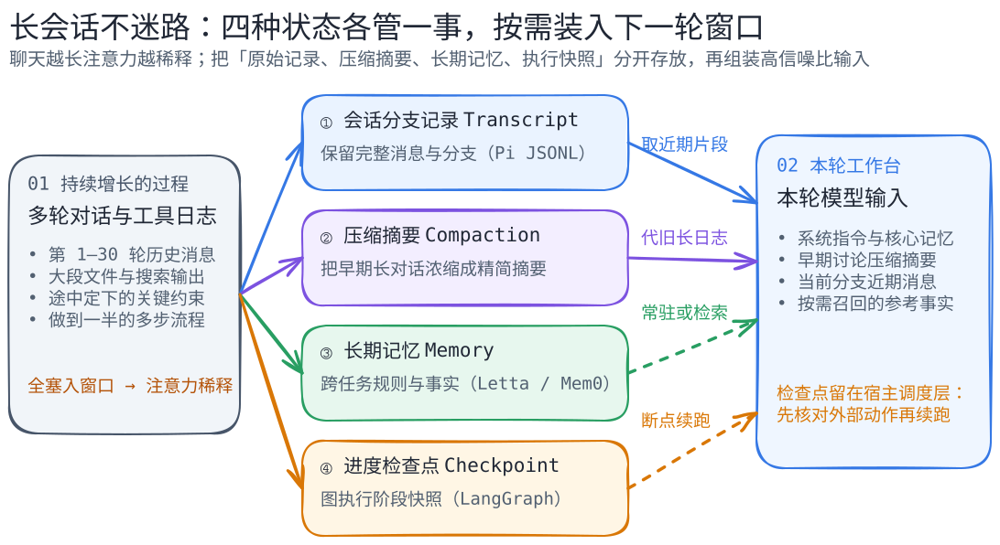

# 会话变长以后：保存记录、压缩内容、取回记忆

[返回机制目录](README.md) · [先读：上下文与记忆](context-vs-memory.md) · [四类状态对照](../comparisons/four-kinds-of-state.md)

跟一个编码助手连续奋战三小时重构鉴权模块，到第 80 轮时，四件完全不同的麻烦往往会同时找上门：刚刚试探了十轮的改造方案走进死胡同，你想退回半小时前的分叉点重来，又舍不得删掉排错记录；终端提示上下文窗口已满 92%，再不瘦身下一轮就会直接超限报错；明天新开一个会话修别的模块时，你希望它依然记得今天刚敲定的“接口错误码统一规范”；更糟的是，执行到第 4 步的批量迁移流程突然因网络抖动中断，重启后必须接着跑第 5 步，绝不能把前 4 步从头再跑一遍。

很多自研 Agent 一旦进入长任务就彻底失控，根源在于企图用**同一个 `messages` 数组**或**同一座向量数据库**包打天下。事实上，“回溯对话分支”“给当前窗口腾地方”“跨会话记住事实”和“断点续跑流程状态”解决的是四类正交的工程矛盾。



[图的文字版](../../figures/compaction-and-memory/README.md) · [可编辑图源](../../figures/compaction-and-memory/scene.excalidraw) · [PNG 预览](../../figures/compaction-and-memory/preview.png)

## 四条状态轨道，各管哪一件难事

把上面四类诉求拆到四条独立轨道上，再看开源代表项目各自深耕哪一环，全局脉络立刻清晰：

| 状态轨道 | 存下的到底是什么 | 下一轮怎样进工作台 | 天生短板与使用红线 | 本章对照实现 |
| --- | --- | --- | --- | --- |
| **会话树记录** | 带父子指针的原始对话、工具输出与事件流水 | 沿当前活跃叶子节点抽出分支消息 | 原文增长极快，直接全量发送会撑爆窗口 | Pi（`SessionManager`） |
| **滚动压缩摘要** | 早期长对话的结构化概括 + 保留起点指针 | 用短摘要顶替早期原文，拼接近期鲜活消息 | **有损压缩**，可能丢掉精确行号、参数或报错码 | Pi（`compaction`） |
| **长期记忆** | 跨会话复用的核心规范、用户偏好与原子事实 | 高频核心块常驻系统提示，低频事实按范围检索 | 事实冲突或过期未淘汰时，会跨任务持续误导 | Letta Code / Mem0 |
| **执行检查点** | 工作流在某一步的状态变量快照与下一跳节点 | 定位快照版本，从断点处恢复或分叉执行 | 只能回滚内存状态，无法自动撤销已发出的外部写操作 | LangGraph（`StateSnapshot`） |

下面我们钻进四个独立开源项目的源码，看它们怎样在字节与函数层面落地这些设计；如果你手头正急着改造自己的长会话系统，也可以先跳读文末的[回到自己的任务](#回到自己的任务)。

## 轨道一与二：Pi 用追加式会话树与滚动摘要兼顾“瘦身”与“溯源”

### 为什么会话记录要建成一棵树，而不是扁平数组

如果只用线性数组保存聊天记录，当你在第 20 轮发现重构方向走偏、想退回第 12 轮换条路试时，唯一的办法就是把第 13～20 轮记录彻底删掉——一旦待会儿发现旧路里其实有一条关键报错线索，就再也找不回来了。

Pi 的 `coding-agent` 把会话设计成一棵**只追加不覆写的树**（Append-only Session Tree）：每条记录都带有唯一 `id` 和指向父节点的 `parentId`，并用 `leaf` 指针标记当前所处的活跃分支末端。想回退重来时，只需把 `leaf` 移回第 12 轮节点继续往下长出新枝，旧分支原封不动留在磁盘里备查。

### 压缩摘要怎样在不破坏原文的前提下给窗口腾空间

当单条分支越聊越长、逼近模型输入上限减去安全预留量时，`shouldCompact()` 会判定触发自动压缩（用户也可随时输入 `/compact` 手动触发，或在 `/tree` 切换分支时生成分支摘要把前序探索结论带去新分支）。整套压缩与重装流程在代码里环环相扣：

```text
磁盘会话树（原记录永不覆写）：
e1 ──▶ e2 ──▶ ... ──▶ e14 ──▶ e15 ──▶ e16 ──▶ [compaction_1] ──▶ e17 ──▶ e18 (当前 leaf)
                              ▲                    │
                              └── firstKeptEntryId ┘ (摘要概括 e1~e14，保留 e15 起原文)

本轮实际投影出的上下文：
[compaction_1.summary（早期进展浓缩）] + [e15, e16, e17, e18（近期完整对话与工具结果）]
```

1. **切分压缩区间并追加落盘**：`prepareCompaction()` 保留近期鲜活片段不动，挑出较早的历史消息连同前序旧摘要一并交给模型生成新摘要，随后由 `appendCompaction()` 把这枚带有 `summary` 和 `firstKeptEntryId` 指针的压缩记录直接**追加**到会话树里。[触发条件](https://github.com/earendil-works/pi/blob/898ab804050730e9dcefb4443875d5a932aa6a32/packages/coding-agent/src/core/compaction/compaction.ts#L286-L292) · [选取内容](https://github.com/earendil-works/pi/blob/898ab804050730e9dcefb4443875d5a932aa6a32/packages/coding-agent/src/core/compaction/compaction.ts#L894-L955) · [追加压缩记录](https://github.com/earendil-works/pi/blob/898ab804050730e9dcefb4443875d5a932aa6a32/packages/coding-agent/src/core/session-manager.ts#L1258-L1285) · [固定版本说明](https://github.com/earendil-works/pi/blob/898ab804050730e9dcefb4443875d5a932aa6a32/packages/coding-agent/docs/compaction.md#L14-L23)
2. **按当前分支投影出本轮消息**：下一轮准备输入时，`buildContextEntries()` 沿当前 `leaf` 回溯分支；一旦遇到压缩节点，就把摘要置于最前，跳过已被概括的早期长消息，从 `firstKeptEntryId` 起接上近期原文，再经 `buildSessionProjection()` 与 `buildSessionContext()` 整理成消息序列。[会话树](https://github.com/earendil-works/pi/blob/898ab804050730e9dcefb4443875d5a932aa6a32/packages/coding-agent/src/core/session-manager.ts#L976-L985) · [当前分支与消息整理](https://github.com/earendil-works/pi/blob/898ab804050730e9dcefb4443875d5a932aa6a32/packages/coding-agent/src/core/session-manager.ts#L468-L582)
3. **进模型前完成最终净化**：上述会话树与压缩均由外层 `pi-coding-agent` 负责；消息交入底层 `agent-core` 后，请求大模型前仍会依次经过 `transformContext` 与 `convertToLlm` 完成最终裁剪和接口格式转换。[模型调用前的处理](https://github.com/earendil-works/pi/blob/898ab804050730e9dcefb4443875d5a932aa6a32/packages/agent/src/agent-loop.ts#L376-L406)

这套设计最精妙的地方在于**承认摘要必然有损，所以绝不销毁底稿**：摘要能用几百字保住“已改完鉴权中间件并通过单测”的大局，但万一第 90 轮突然要核对第 5 轮某个报错里的精确偏移量，原始记录和代码文件依然完好无损，随时可以回查。

## 轨道三（路线 A）：Letta Code 把“常驻核心块”与“按需资料”分层

跨会话长期记忆最容易犯的错，是把所有历史经验一股脑全写进系统提示词。要知道，系统提示词里的每一个字，都会在接下来的**每一轮调用**里重复占用预算和注意力。

Letta Code 的本地文件记忆方案（local MemFS v1）按**访问频率**把记忆切成了冷热两层：

- **热层**（常驻核心块）：位于 `system/` 目录下的 Markdown 文件被识别为核心记忆块（Core Memory），直接编入系统提示常驻窗口——这里寸土寸金，只放几乎每轮都要用到的全局约定（例如项目架构红线、代码风格、用户协作偏好）。
- **冷层**（按需读取与历史召回）：体量较大的专题参考资料和 Skills 留在外部文件里，只有任务真撞上相关领域时才按需读取；至于更久远的原始对话细节，则通过 `recall` 检索按需找回。

这里还有一个关乎工程稳定性的重要细节——**提示词重编译边界**：当助手修改了磁盘上的记忆文件后，当前已经编译好的系统提示不会在半途突然变形，而是等到后续触发重新编译提示时才把新内容刷进去。这种“先落盘改资料、再按节拍重编提示”的设计，既避免了单轮中途上下文抖动，也有利于保持系统提示前缀稳定以命中模型端的提示词缓存（Prompt Caching）。[记忆文件类型](https://github.com/letta-ai/letta-code/blob/1f55d3dc66e238d203757fae288bb53f3adc7cd3/src/agent/memory-format.ts#L6-L29) · [内置提示对读取时机的说明](https://github.com/letta-ai/letta-code/blob/1f55d3dc66e238d203757fae288bb53f3adc7cd3/src/agent/prompts/letta_local_memfs.md#L8-L46)

## 轨道三（路线 B）：Mem0 从闲聊里提炼原子事实并按范围检索

当系统需要服务成百上千个用户、或者积累了成千上万条零散业务事实时，靠人工维护几份 Markdown 文件就不再够用了；但如果直接把原始聊天按段落切碎塞进向量库，搜出来的又全是“嗯好的”“再改一下这里”之类的口水话。

Mem0（Python OSS 同步路径）的核心思路是在写入端先做一次**事实蒸馏**，在读取端做**作用域隔离**：

```json
{
  "input_messages": [
    {"role": "user", "content": "注意一下，咱们订单表主键别用自增，统一走雪花 ID，昨天刚定的。"}
  ],
  "extracted_memory": "订单表主键统一使用雪花 ID（禁用数据库自增主键）",
  "search_filters": {"user_id": "team_backend", "agent_id": "db_reviewer"}
}
```

1. **写入时提炼与去重**（`infer=True`）：调用 `Memory.add(..., infer=True)` 时，系统不会原样照搬整段啰嗦对话，而是先用模型从消息中提取候选事实，再比对库里已有的相关记忆，决定是新增条目、更新旧结论还是忽略冗余信息（若显式设为 `infer=False` 或使用异步接口、过程记忆与托管服务，则走各自独立分支）。[写入入口](https://github.com/mem0ai/mem0/blob/f8082a7345dadd9e042ebbc40b57b1498c8f6d63/mem0/memory/main.py#L760-L932) · [提取事实与写入](https://github.com/mem0ai/mem0/blob/f8082a7345dadd9e042ebbc40b57b1498c8f6d63/mem0/memory/main.py#L940-L1067)
2. **读取时强制带过滤条件**（`filters`）：后续任务需要背景知识时，应用调用 `Memory.search(query, filters=...)` 同时按语义相关度与元数据范围（如限定特定用户、项目或会话作用域）检索，避免把 A 项目的规范串味塞进 B 项目的上下文，拿回命中结果后再择优拼入本轮输入。[检索与范围](https://github.com/mem0ai/mem0/blob/f8082a7345dadd9e042ebbc40b57b1498c8f6d63/mem0/memory/main.py#L1379-L1456)

## 轨道四：LangGraph 用状态快照定格长流程的执行进度

设想一条分六步走的自动化数据处理图，跑到第 4 步调外部接口超时挂了。此时不管是翻聊天摘要，还是去向量库搜长期记忆，都回答不了运行引擎最关心的问题：**刚才内存里的结构化状态变量停在什么值，重启后下一跳该激活哪一个图节点**？

这正是**检查点**（Checkpoint）与前三种机制的本质区别：它存的不是给模型阅读的参考文章，而是**状态机本身的执行现场**。在 LangGraph 中，每一步生成的 `StateSnapshot` 明确记录了四项核心现场数据：

- `values`：当前步骤各状态通道的实际结构化取值（是否把对话消息也放进状态字典，完全由应用自行定义）；
- `next`：下一步待执行的图节点名称元组（若为空则代表已走到终点）；
- `config` 与 `parent_config`：当前检查点标识及指向上一状态版本的指针，串成一条可回看、可从任意历史节点分叉重跑的版本链。[快照字段](https://github.com/langchain-ai/langgraph/blob/bdb85b5aa87a21de68371d2e534b81aeed398f57/libs/langgraph/langgraph/types.py#L711-L729) · [LangGraph 导读](../systems/langgraph/README.md)

但用检查点做故障恢复时，有一条极易踩坑的铁律：**快照只能冻住图内部的状态变量，冻不住已经发往外部真实世界的副作用**。如果第 3 步已经发出了通知邮件或创建了远端工单，从历史检查点恢复重跑前，必须先核对外部动作到底有没有生效，通过幂等键或前置状态检查避免重复扣款、重复建单（详见[中断、重试与恢复](interruption-recovery.md)）。

## 回到自己的任务

上面四个项目并不是一套必须捆绑安装的全家桶，而是四把解不同锁的钥匙。当你自己设计或调优一个需要跑长任务的 Agent 时，可以按下面四条清单对号入座：

- **原始记录只追加、不原地抹除**：哪怕界面上做了压缩或分支回退，底层仍应保留完整原始事件日志，确保摘要漏掉细节时随时有据可查。
- **日常窗口靠“滚动摘要 + 近期原文”控体积**：别等撞上模型最大长度报错才被动截断；提前预留安全余量，把早期过程压成结构化进展摘要，把宝贵的字面窗口留给最近几轮的工具输出。
- **长期约定做冷热分层，严控常驻提示词体积**：只有几乎每轮必用的硬规矩才放进常驻核心块；低频知识与历史事实走带作用域过滤的按需检索，并在规则变更时及时清理旧条目。
- **多步长流程单独存状态检查点，恢复前先验外部副作用**：把“流程跑到哪一步”交给结构化快照管理，重跑任何带写操作的节点前先查清远端真实状态。

想进一步深入各项目的完整工程实现，可继续阅读系统篇专章：[Pi](../systems/pi/README.md) · [Letta Code](../systems/letta/README.md) · [Mem0](../systems/mem0/README.md) · [LangGraph](../systems/langgraph/README.md)。

## 来源与边界

- **固定版本源码锚点**：本章分析基于四个开源仓库的固定提交与内置提示文件审阅——`earendil-works/pi`（commit `898ab804050730e9dcefb4443875d5a932aa6a32`，聚焦 `pi-coding-agent` 会话树/压缩及 `agent-core` 请求前转换）、`letta-ai/letta-code`（commit `1f55d3dc66e238d203757fae288bb53f3adc7cd3`，聚焦 local MemFS v1）、`mem0ai/mem0`（commit `f8082a7345dadd9e042ebbc40b57b1498c8f6d63`，聚焦 Python OSS 同步 `infer=True` 存取路径）与 `langchain-ai/langgraph`（commit `bdb85b5aa87a21de68371d2e534b81aeed398f57`，聚焦 `StateSnapshot` 类型定义）。
- **适用边界**：本章聚焦四类状态机制的数据结构与职责分工，不涉及摘要信息保留率、向量召回准确率或跨进程恢复吞吐量的实测对比；涉及精确代码行号、金额或线上变更核对时，均应回到原始记录与真实系统状态验证。
