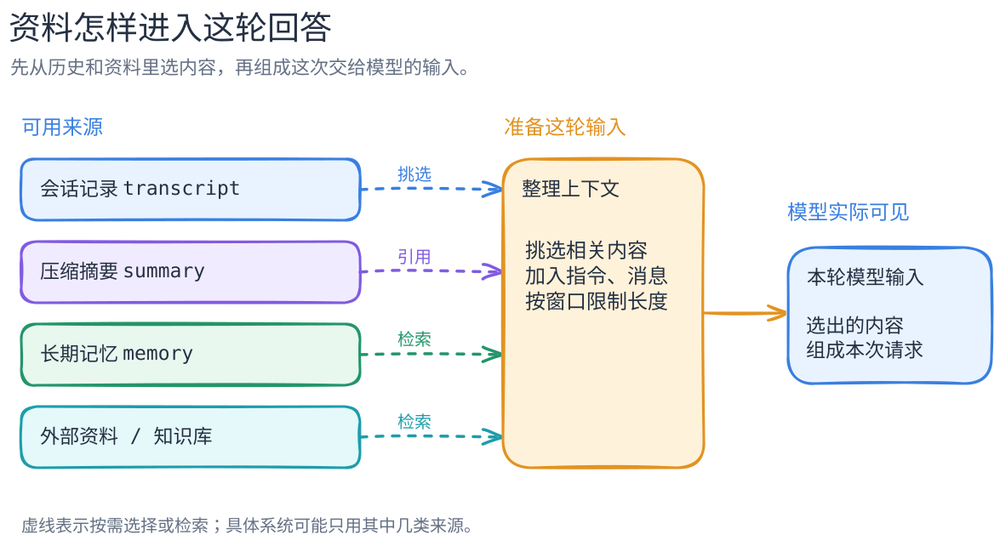

# 动手：把需要的历史选进本轮输入

[返回学习路线](../learning-path.md) · [上下文与记忆的机制解释](../concepts/context-vs-memory.md) · [第一条本地练习](first-agent-loop.md)

## 3 分钟显微镜：跑完这几行，你会亲眼看到什么？

你肯定遇到过这种怪事：第一轮对话明明立下死规矩“没有用户批准，绝不对外发布”，中间聊了十几轮目录和排版之后，Agent 突然把最早那条禁令忘得一干二净。翻看后台数据库，那条记录明明一个字都没丢！

跑完本实验的几行命令，你会在终端 JSON 里亲眼抓到两幕极反直觉的现场：

1. 「**存得好好的**」与「**本轮没看见**」**同屏出现**：在 `recent` 模式下，事后审计字段会同时打出 `"critical_record_stored": true` 和 `"critical_record_visible": false`——仅仅因为窗口预算还剩最后 `8` 个字符，塞不下 `36` 字符的整条禁令 `r1`，装配器直接跳过了它，判读器当场失去禁令依据！
2. **哪怕检索精准命中了第 1 名，预算卡死照样上不了车**：在后面的极限压缩测试里，检索器明明把 `r1` 捞出来排到了候选第一位，但因为扣掉固定问题开销后只剩 `35` 个字符，差 `1` 个字符塞不下 `36` 字符的 `r1`，装配器照样跳过它，反而让恰好 `35` 字符的无关记录 `r3` 捡漏装进了上下文！

实验模拟了 5 条草稿讨论记录（最早的 `r1` 写着“本轮只允许生成预览稿；没有用户批准，不得对外发布”，`r2`～`r5` 讨论目录、来源、排版与学习路线），让判读程序根据**本轮实际分到的上下文字符串**判断能否对外发布。仅需 Python 3.10+ 标准库，无需 API Key、不联网。

## 第一步：同场跑完三种装配策略

在仓库根目录依次运行宽预算、按时间取近、按检索重排三种模式及单元测试：

```bash
python3 examples/context-budget/demo.py --mode full
python3 examples/context-budget/demo.py --mode recent
python3 examples/context-budget/demo.py --mode retrieve
python3 -m unittest discover -s examples/context-budget -p 'test_*.py'
```

装配规则非常真实：先把不可省的系统规则和当前问题装进去，再按候选顺序逐条尝试塞入完整历史记录（**宁可整条跳过，也不把一条规则拦腰截成半句引发歧义**）。默认从最新的 `r5` 往回拿；而 `retrieve` 模式会先做关键词检索，把命中的 `r1` 提到候选队首，在**完全相同的 220 字符紧预算**下重新装配：

| 模式 | 预算上限／实际占用 | 本轮装入的 `visible_ids` | 判读器结论 `answer` | 发生了什么取舍 |
| --- | --- | --- | --- | --- |
| `full` | `1200`／`248` 字符 | `r5, r4, r3, r2, r1` | `do_not_publish` | 预算充裕，5 条全进，最早的禁令 `r1` 清晰可见 |
| `recent` | `220`／`212` 字符 | `r5, r4, r3, r2` | `insufficient_evidence` | 按时间倒序装完前 4 条只剩 8 字符，`r1` 被挤出窗口 |
| `retrieve` | `220`／`217` 字符 | `r1, r5, r4, r3` | `do_not_publish` | **一分钱预算没加**，靠检索把 `r1` 提到队首优先上车，代价是把 `r2` 挤出 |

细看 `recent` 模式里最后一条选择日志，失忆的瞬间被拍得清清楚楚：

```json
{
  "event": "select_record",
  "id": "r1",
  "characters": 36,
  "remaining_before": 8,
  "selected": false,
  "reason": "whole_record_does_not_fit"
}
```

`r1` 根本没丢（依然躺在 `stored_records` 里），只是死在了“剩余 8 字符 vs 需要 36 字符”的装配闸口前。

## 第二步：对着架构图看清四份数据各归谁管



对照这张图（附[完整文字说明](../../figures/context-vs-memory/README.md)），输出 JSON 里的四个顶层字段正好对应系统里的四个物理位置：

- **底层持久库**（`stored_records`）：进程保存的全部 5 条原始记录，模型是直接看不见它的。
- **本轮请求窗口**（`context` 与 `visible_ids`）：经过预算裁剪后真正喂给判读器的那串文本——**判读器的全世界只有这一个字符串**。
- **模型或规则输出**（`answer`）：仅凭 `context` 做出的决策，绝不允许偷瞄外面的 `stored_records`。
- **事后独立审计**（`audit`）：回答结束后对照全量底账生成的体检单，帮你一眼看穿是“根本没存（`stored=false`）”还是“存了但没塞进去（`visible=false`）”。

想看代码怎样严防“判读器偷看全局历史”，打开 [`demo.py`](../../examples/context-budget/demo.py) 扫一眼这四个函数即可：

1. `retrieve()`：在持久记录里做字面检索（查找“用户批准”），把命中项排到前面。
2. `assemble()`：先扣掉固定规则与问题开销，再逐条核对剩余额度并写下 `select_record` 账单。
3. `judge_visible(context)`：参数只有一个拼好的 `context` 字符串，物理隔绝了全局历史。
4. `run()`：串联检索、装配、判读与最后的事后 `audit` 对账。这套骨架与 [Pi 的调用前上下文装配](../concepts/context-vs-memory.md)、[Mem0 的候选检索](../systems/mem0/README.md)和 [Letta 的分层记忆](../systems/letta/README.md) 遵循同一条工程逻辑。

## 第三步：连调三次预算参数，把边界试穿

现在不用改一行代码，光改命令行 `--budget` 参数，亲眼验证三个极有意思的临界点：

1. **给 `recent` 精准补齐最后那 28 个字符缺口**：

```bash
python3 examples/context-budget/demo.py --mode recent --budget 248
```

你会看到总占用刚好卡在 `248`，原本掉队的 `r1` 压线进场，`answer` 立刻从 `insufficient_evidence` 恢复为 `do_not_publish`。

2. **触发“检索查中了第一名，却还是塞不进去”的名场面**：

```bash
python3 examples/context-budget/demo.py --mode retrieve --budget 91
```

仔细看这次的日志：`retrieve` 明明命中了 `r1`！但固定规则和问题先占掉了 `56` 字符，剩下 `35` 字符面对 `36` 字符的 `r1` 只能叹气跳过；装配器接着往后试，发现 `r3` 刚好 `35` 字符严丝合缝塞了进去！最终 `visible_ids` 只有 `["r3"]`，`critical_record_visible` 依然是 `false`。这证明了「**检索命中**（Retrieved）」和「**装入上下文**（Assembled）」完全是两码事。

3. **把预算压到连题目本身都装不下**：

```bash
python3 examples/context-budget/demo.py --mode recent --budget 10
```

程序立刻报错返回 `budget_too_small`（`required_characters=56`，`context=null`，进程退出码为 `2`），拒绝静默截断问题去瞎猜答案。

## 来源与边界

本实验使用 Python `len(str)`（Unicode 码点数）模拟窗口容量预算，使用字面匹配与固定短语规则替代向量检索与真实大模型推理，重点演示“持久存储 → 候选排序 → 预算装配 → 可见判读”之间的精确取舍。真实生产系统还需单独考量不同语种的 Tokenizer 切分倍率、工具 Schema 隐性开销、检索语义漂移以及长窗口内的注意力衰减。
