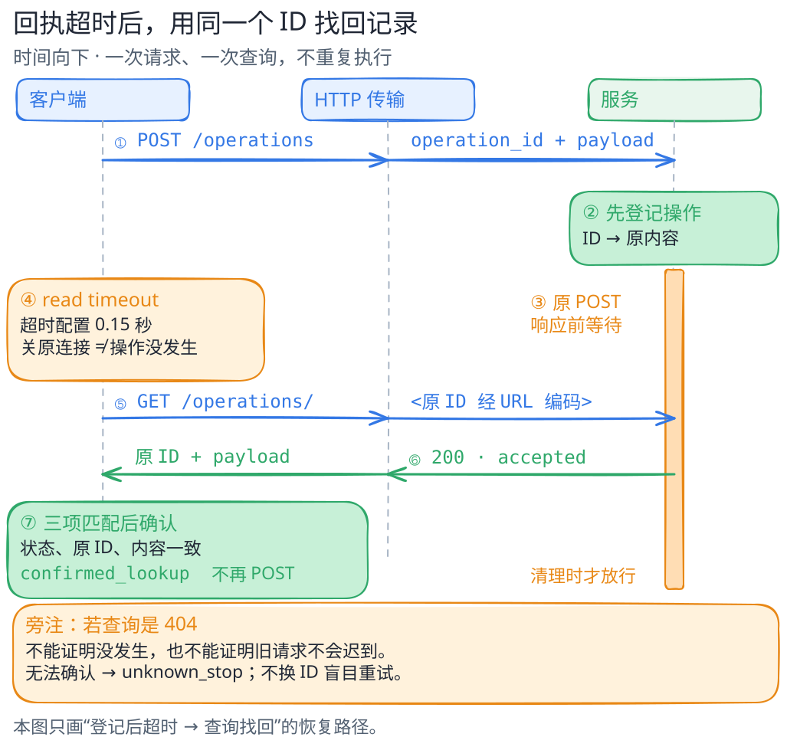

# 动手：用本地 HTTP 观察回执与查询

[返回学习路线](../learning-path.md) · [先读内存版回执练习](remote-effect.md) · [权限与恢复对照](../comparisons/permission-and-recovery.md)

## 3 分钟显微镜：跑完这几行，你会亲眼看到什么？

如果说上一节[内存版练习](remote-effect.md)是静态沙盘，这一节就是真刀真枪的**本机 TCP/HTTP 显微镜**——程序会在本机 `127.0.0.1` 拉起真实的多线程 HTTP 服务，用真实的 `socket.timeout` 掐断连接，让你在终端里亲眼目睹分布式系统里最容易坑惨 Agent 开发者的两幕奇观：

1. **两个一模一样的 404，背后藏着两种完全不同的暗渡陈仓**：在 `lookup_lag` 和 `late_commit` 模式下，客户端先遇到 `POST` 读超时，紧接着开新连接发 `GET` 对账，两次都收到了冷冰冰的 `404 Not Found`！可等服务收尾清理后翻开底账（`observer_after_cleanup`），**账本里竟然全都躺着 1 条已生效的发布记录**！一个是“早写进去了但主从读库滞后没让你看见”，一个是“你查的那一毫秒真没写，你前脚刚放弃它后脚就落盘了”。谁敢在看到 404 后换个新 ID 重发，立马酿成重复发布。
2. **同样是超时后重发请求，带原 ID 安全拿回原结果，篡改内容却当场撞上 409 冲突**：你会亲眼看到服务端如何在同一把锁里守住幂等账本（`200 replayed=true` 对比 `409 Conflict`），既防住并发线程撞车，又揪出篡改参数的同名重试。

运行仅需 Python 3.10+ 标准库，全程只监听本机回环地址 `127.0.0.1`、用完自动关闭，不写磁盘、不连外网（请保持 `127.0.0.1`，不要改成对外暴露的 `0.0.0.0`；标准库 [`http.server` 不适合生产服务](https://docs.python.org/3/library/http.server.html)）。

## 第一步：跑通正常回执与“超时后换连接查账”

在仓库根目录先跑通正常模式、单测套件与超时对账模式：

```bash
python3 examples/http-receipt/demo.py --mode normal
python3 -m unittest discover -s examples/http-receipt -p 'test_*.py'
```

`normal` 模式下，客户端收到 `POST 201`，核对 ID 与 `payload=publish-v1` 无误后给出 `host.status=confirmed_receipt`，事后账本也是 `1` 条记录；16 个单元测试全部跑绿。接着立刻触发一次真实的 HTTP 读超时：

```bash
python3 examples/http-receipt/demo.py --mode timeout_then_lookup
```

看输出里的三条关键线索如何咬合：

| 输出字段 | 这是谁的视角 | 你在里面看到了什么 |
| --- | --- | --- |
| `host.events` | 客户端收到的真实网络事件 | 第一次 `submit` 报 `transport=timeout`、`http_status=null`；第二次 `lookup` 拿到 `GET 200` |
| `host.status` | 宿主仅凭网络证据做出的裁决 | `confirmed_lookup`——没重发 `POST`，靠查询回执确认了原请求早已落账 |
| `observer_after_cleanup` | 收尾后直接翻看服务端内存账本快照 | `registered_effects` 确为 `1`，与宿主的对账结论完全吻合 |



[图源](../../figures/http-receipt-timeline/scene.excalidraw) · [PNG 预览](../../figures/http-receipt-timeline/preview.png) · [不看图的说明](../../figures/http-receipt-timeline/README.md)

顺着上面这张时序图看就更透彻了：第一条连接的 `POST` 其实已经让服务端完成了账本登记，只是响应卡住导致客户端读超时并关掉了原套接字；宿主没有慌乱重发写入，而是另开一条干净连接发 `GET` 查询同一个操作 ID，稳稳把回执找了回来。

## 第二步：同场比武七种模式，看透真假 404 与幂等锁

现在把其余五种关键场景一口气跑出来，做一次完整的故障图谱对照：

```bash
python3 examples/http-receipt/demo.py --mode normal
python3 examples/http-receipt/demo.py --mode same_id_retry
python3 examples/http-receipt/demo.py --mode lookup_lag
python3 examples/http-receipt/demo.py --mode late_commit
python3 examples/http-receipt/demo.py --mode unsafe_new_id
python3 examples/http-receipt/demo.py --mode payload_conflict
```

前三种确认成功的路径进程退出码为 `0`；后四种未确认、冲突或错误重试路径退出码均为 `2`：

| 模式 | 客户端做决定时看到了什么 | 宿主最终 `host.status` | 收尾后 `registered_effects` | 背后的分布式真相 |
| --- | --- | --- | --- | --- |
| `normal` | `POST 201`，ID 与内容匹配 | `confirmed_receipt` | `1` | 最顺畅的一次性闭环 |
| `timeout_then_lookup` | 读超时 → 原 ID `GET 200` | `confirmed_lookup` | `1` | 回执丢在回程，靠查询对账找回 |
| `same_id_retry` | 读超时 → 原 ID 原内容再 `POST` 得 `200`（`replayed=true`） | `confirmed_replay` | `1` | 服务端认出同一幂等键，直接返回首次登记结果 |
| `lookup_lag` | 读超时 → 第一次 `GET 404` | `unknown_stop` | `1` | **假 404 之一**：其实早落账了，只是读接口暂时滞后没查到 |
| `late_commit` | 读超时 → `GET 404` | `unknown_stop` | `1` | **假 404 之二**：查询时在途请求卡在落账闸门前（`GET 404`），宿主保守停机（`host.status = unknown_stop`）后收尾清理触发释放闸门（cleanup release gate），请求才真正落账写入（`registered_effects = 1`） |
| `unsafe_new_id` | 读超时 → 查明已生效却仍换新 ID `POST` | `duplicate_effect` | `2` | 换号绕过服务端去重，硬生生造出双倍副作用 |
| `payload_conflict` | 读超时 → 原 ID 改换内容 `POST` 得 `409` | `conflict_stop` | `1` | 服务端发现同号不同参，拒绝覆盖原 `publish-v1` |

仔细品味 `lookup_lag` 与 `late_commit` 这两行：**站在客户端视角，它们收到的字节一模一样，因此宿主唯一正确的保守决策就是停在未知状态**（`unknown_stop`）。只有当目标服务像 `same_id_retry` 那样在服务端实现了严格的同键幂等重放时，超时后带**原 ID、原参数**重放才是安全的。

## 第三步：为什么“幂等”靠的是服务端那把锁，而不是提示词？

很多人误以为在 Agent 提示词里写一句“请带上请求 ID”就算实现了幂等。实际上，标准 HTTP 的 `POST` 本身并不自带幂等承诺（协议语义见 RFC 9110 [幂等与重试说明](https://www.rfc-editor.org/rfc/rfc9110.html#section-9.2.2)），真正的防线全在服务端 `Ledger.register()` 的那把互斥锁里：

- **同 ID 且同参数内容**（`payload` 一致）：直接返回已有登记并标明 `replayed=true`，绝不写第二条；
- **同 ID 但参数内容不同**（`payload` 冲突）：立即返回 `409 Conflict`，防止张冠李戴篡改原操作；
- **检查与写入在同一把锁内原子完成**：哪怕四个线程同时发来一模一样的初次请求（见单测 `test_atomic_parallel_deduplication`），也只会产生**一个 201、三个 200 和唯一一条账本记录**，绝不会出现“两个线程同时查到没记录、然后各自插一条”的竞态漏洞。

想追看这五处精确的时序卡点，打开 [`demo.py`](../../examples/http-receipt/demo.py) 按顺序扫一遍即可：

1. `running_service()`：启动本机回环服务，并在 `finally` 块里先放开阻塞闸门（`ledger.release.set()`）让在途请求走完，再优雅关闭服务——注意**关闭连接池只是清理资源，绝不会回滚已执行的业务**。
2. `Handler.do_POST()`：控制故障注入点——`late_commit` 的精确时序是：客户端发 `POST` 后卡在落账前等待闸门；客户端读超时并发起 `GET` 查账返回 `404`；宿主据此定格为 `unknown_stop` 停机；宿主主流程退出触发收尾清理（cleanup release gate，即 `ledger.release.set()`）；卡住的 `POST` 线程被释放并调用 `Ledger.register()` 成功落盘，导致事后观察器统计出 `registered_effects = 1`。其余超时模式则卡在 `Ledger.register()` 落账之后、发响应之前。
3. `Ledger.register()`：在互斥锁内原子完成查重、比对 `payload` 与写入。
4. `request()`：基于标准库 [`HTTPConnection` 的超时与响应读取](https://docs.python.org/3/library/http.client.html) 捕获真实 `socket.timeout`（为保证每次必现确定性时序，发送后借本地同步事件 `fixture_before_read` 对齐服务端状态后再开始读超时计时）。
5. `run()`：严格只按客户端收到的 HTTP 状态码与报文决定 `host.status`，事后才读取内部账本生成 `observer_after_cleanup` 供读者对照。

## 动手思考题：先猜结果再验证

挑下面任意一个变体，先在纸上写下你预测的 HTTP 状态码、宿主 `status` 和最终账本条数，再去临时副本或单测里印证：

- 超时后保持原 ID 重发 `POST`，但把内容偷偷改成 `publish-v2`（对应 `payload_conflict`，返回 `409` 与 `conflict_stop`，原 `publish-v1` 完好保留）；
- 四个并发线程同一时刻用相同 ID、相同内容猛击 `POST`（对应单测 `test_atomic_parallel_deduplication`，返回 1 个 `201`、3 个 `200`，账本稳稳停在 `1` 条）；
- 第一次 `GET` 收到 `404` 后，误以为“肯定没成”，立刻换个新 ID 重发 `POST`（一旦撞上 `lookup_lag` 或 `late_commit`，当场变成 `2` 条重复发布）。

## 来源与边界

本实验在单进程内存账本与本机回环套接字上真实复现了 HTTP 读超时、主从读滞后、在途迟到提交与服务端原子幂等重放。它不包含持久化磁盘账本、幂等键过期淘汰、多租户隔离或跨机分布式事务；对接真实生产 API 前，请务必核对其幂等键保留时长、参数冲突返回码与取消／补偿接口规范。
