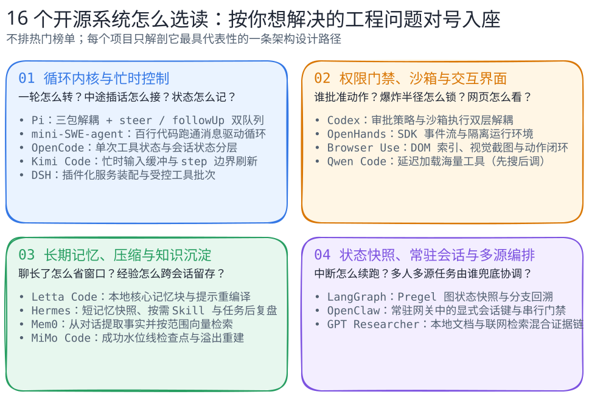

# 从入门理解到应用实践：选择你的阅读路线

[返回首页](../README.md) · [术语表](glossary.md) · [当前书稿范围](roadmap.md)

学习 Agent 系统最容易两头踏空：要么一上来就克隆几万行源码仓库，还没摸清主循环就淹没在流式渲染与配置细节里；要么停留在“写段提示词调个函数”的玩具原型，一旦遇上长对话遗忘约束、工具越权读写，或是网络超时引发重复提交，立刻束手无策。

这条阅读路线把全局拆成**四个递进台阶**——每一阶聚焦一层核心工程矛盾，先顺着图解立住心智模型，再用随书练习或开源项目源码亲手验证。第一次接触 AI，可以从下面的零代码热身起步；带着明确技术问题而来，直接跳到对应台阶即可。

## 先体验，再解释，再带回自己的场景

1. **纸笔走通一次可靠整理**：打开[学习与实践](learning-and-practice.md)，根据三份简短通知写一段句句带出处、缺项单列待查的活动说明，直观感受“有据可查”与“顺口脑补”的差别。
2. **对着架构图认领角色**：读 [Agent loop](concepts/agent-loop.md)，在图上指认用户目标、检索读取、工具回执与最终核验各自落在哪个节点。
3. **迁移到手头真实材料**：拿一份你平时要处理的课程讲义、项目纪要或变更通知，照着[应用入口](learning-and-practice.md#把方法带到你的场景)的任务卡试做一轮。
4. **带着真问题往深处走**：好奇资料为什么会漏读就看第一阶上下文；想给助手接外部工具就看第二阶权限边界；想啃代码或做容错设计则直接进入第三、四阶。途中卡壳时，随时开启[阅读指南](../book/frontmatter/reading-guide.md#和-ai-一起读)里的苏格拉底陪读对练。

## 1. 先看模型与工具怎样接力

**核心矛盾**：模型只是一台根据当前输入生成文本的推理引擎，碰不到真实文件与网络；怎样让它既能借助外部工具干活，又不会把未经核实的猜测当成事实输出？

先顺读 [Agent loop](concepts/agent-loop.md)、[职责分工](concepts/model-harness-cli-mcp-skill.md)与[上下文与记忆](concepts/context-vs-memory.md)，立住最关键的三角关系：**模型提议下一步、工具执行真实操作、宿主掌控组装与流转**。落到具体字节上，一轮最简接力只是宿主维护的消息列表在不断追加：

```json
[
  { "role": "user", "content": "查一下杭州今天下午要不要带伞？" },
  { "role": "assistant", "tool_calls": [{ "name": "get_weather", "args": { "city": "杭州" } }] },
  { "role": "tool", "name": "get_weather", "content": "{\"Afternoon\": \"中雨, 18C\"}" },
  { "role": "assistant", "content": "杭州今天下午有中雨（18°C），出门建议带伞。" }
]
```

**动手自检**：在纸上画出上面这四步，标出哪一步由宿主发起网络调用；接着把工具换成“向全群发送通知”，思考宿主必须在哪个箭头之间插入人工确认门禁。想直接看代码跑通这一轮，可打开基于 Python 标准库、无需 API 账号的[本地循环小实验](labs/first-agent-loop.md)。

延伸阅读：[Hugging Face Agents Course 第一单元](https://huggingface.co/learn/agents-course/unit1/introduction) · [Anthropic 的工作流与 Agent 模式](https://www.anthropic.com/engineering/building-effective-agents)。

## 2. 再看能力怎样接入

**核心矛盾**：当助手需要接入几十种外部工具与操作规范时，全塞进提示词会撑爆窗口，全放开执行又可能删库改配置——能力扩展与安全收敛怎样兼顾？

精读 [Skill、MCP 与工具权限](concepts/mcp-skill-tool-lifecycle.md)与 [Codex 的命令执行](systems/codex/README.md)，看清现代 Agent 为什么要把能力拆成三层：

- **Skill 按需装载经验**：用结构化的 `SKILL.md` 存放特定任务的作业步骤与验收标准，命中场景时才读入上下文，避免常驻提示词臃肿。
- **MCP 统一连接协议**：把外部数据源与工具封装成标准接口，让宿主无需为每个服务重写适配层。
- **宿主审批与沙箱兜底**：工具连得上不代表允许随意执行。即便用户批准运行 `npm test`，仍需通过[沙箱](concepts/sandbox-execution.md)限制工作目录之外的文件写入与未知外网访问，收紧爆炸半径；涉及图形界面与网页自动化时，结合[Computer／Browser Use](concepts/computer-and-browser-use.md)中“只填表、不提交”的案例，理解如何在不可逆动作前刹住车。

**动手自检**：为你常用的一个只读搜索工具写一张契约卡（输入参数、返回字段、允许扫描的目录范围、超时报错格式），再补一份配套 `SKILL.md`；随后假设要开放“修改文件”权限，写明哪些路径必须人工二次确认。

延伸阅读：[MCP 架构规范](https://modelcontextprotocol.io/specification/2025-11-25/architecture) · [Agent Skills 格式](https://github.com/agentskills/agentskills/blob/main/docs/specification.mdx)。

## 3. 想读源码时，先选一个项目

**核心矛盾**：真实工程仓库动辄上万行，夹杂着 UI 渲染、日志埋点与多模型适配，怎样不迷路地揪出核心骨架？

秘诀是死死盯住三个锚点：**任务从哪个入口进入并组装成模型输入**、**工具调用在哪里被拦截与分发执行**、**主循环依据什么条件继续下一轮或停机退出**。先顺着正常路径走完一轮，再去翻工具报错或用户中断的异常分支。

推荐从分层最干净的 [Pi](systems/pi/README.md) 及其[代码导读](systems/pi/code-walkthrough.md)起步——它把模型通信层、Agent 运行核心与终端交互外壳拆得清清楚楚。你也可以对着下面的全书开源系统地图，按自己关心的工程切面挑选目标仓库：



[可编辑图源](../figures/systems-landscape/scene.excalidraw) · [PNG 预览](../figures/systems-landscape/preview.png) · [图的文字版](../figures/systems-landscape/README.md)

- [mini-SWE-agent](systems/mini-swe-agent/README.md)：用极精简的代码跑通完整修 Bug 循环，适合一口气读完主干。
- [OpenCode](systems/opencode/README.md)：观察工具部分执行、等待审批与外层会话状态如何分别推进。
- [Kimi Code](systems/kimi-code/README.md)：看系统正在跑工具的半途中收到用户新消息时，如何安全插队与消费。
- [MiMo Code](systems/mimo-code/README.md)：看超长任务快撑爆窗口时，如何压缩历史并生成可续接的工作摘要。

想亲手对比不同上下文裁剪策略的得失，可配合阅读[上下文预算小实验](labs/context-budget.md)，通过确定性字符预算直观观察保留与丢弃规则的影响。

官方源码：[Pi](https://github.com/earendil-works/pi) · [mini-SWE-agent](https://github.com/SWE-agent/mini-swe-agent) · [OpenCode](https://github.com/anomalyco/opencode) · [Kimi Code](https://github.com/MoonshotAI/kimi-code) · [MiMo Code](https://github.com/XiaomiMiMo/MiMo-Code)。

## 4. 需要做系统时，再看保存、协作与恢复

**核心矛盾**：三五轮的短对话失败了大不了重来；但跨越多步骤、耗时数十分钟甚至包含外部写操作的长任务一旦中途断电或超时，盲目重跑不是丢失半程心血，就是把同一笔外部写入重复执行两遍。

围绕生产级可靠性，按具体痛点切入以下专题：

- [LangGraph](systems/langgraph/README.md)：看图编排引擎如何在每一步边界落盘状态检查点（Checkpoint），实现断点续跑与人工介入。
- [Letta Code](systems/letta/README.md)：看常驻窗口的核心记忆与按需调取的归档记忆如何分层维护。
- [GPT Researcher](systems/gpt-researcher/README.md)：看多路检索子任务如何并行搜集材料、去重归并并沉淀为有引用的长报告。
- [横向对照](comparisons/README.md)：把不同项目在循环终止、四种状态划分、权限恢复与完成证据上的架构取舍摆在一起横向拆解。

**动手自检**：设计一个“读取三份报告 → 提炼交叉结论 → 写入归档库”的任务流。假设进程在读完三份报告后、写入归档库时遭遇网络超时，列出哪些步骤无需重做、重连后必须先发什么查询请求确认写入是否已生效，再配套选跑三个进阶实验：

- [不可信资料与结果检查](labs/evidence-contract.md)：验证提示词注入防护、出处对齐与越权调用拦截。
- [回执丢失](labs/remote-effect.md)：复现请求已生效但回执在半路丢失时，“盲目重试”与“先查后补”的天壤之别。
- [本地 HTTP](labs/http-receipt.md)：在本机回环地址（loopback）启动真实 HTTP 服务，实测读超时、幂等键（Idempotency Key）重放与并发冲突处理。

官方源码：[LangGraph](https://github.com/langchain-ai/langgraph) · [Letta Code](https://github.com/letta-ai/letta-code) · [GPT Researcher](https://github.com/assafelovic/gpt-researcher) · [Microsoft Agent Framework](https://github.com/microsoft/agent-framework)。

## 怎样继续选材料

读完主干后，若想进一步拓宽编排视野，可对照查看多角色协作框架 [CrewAI](https://github.com/crewAIInc/crewAI)，或阅读 [AutoGen README](https://github.com/microsoft/autogen/blob/main/README.md) 了解其架构演进脉络；想对照成熟闭源编码助手的官方机制拆解，可参考 [Claude Code 的官方说明](https://code.claude.com/docs/en/how-claude-code-works)；若关注受限边界内的结构化推理判断，可延伸翻阅 [Jev 文档](https://docs.typesafe.ai/introduction)。

## 来源与边界

本路线串联的系统篇均锚定各自上游仓库的固定 commit 展开静态源码与官方文档研读（具体版本号及核对范围见各章末尾），随书实验采用零网络依赖的确定性脚本或仅监听本机回环地址的服务复现核心状态机，不替代具体业务场景下的真实模型压测与线上安全审计。引用或二次分发上游项目代码与文档时，请核对其当前维护状态并遵守对应开源许可。
