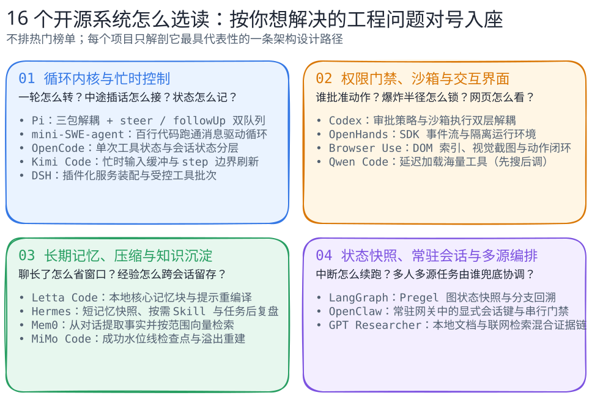

# 按开源系统阅读

[返回首页](../../README.md)

把一个十万行代码的开源 Agent 仓库克隆到本地，直接点开 `src/` 往往只会陷入迷宫：命令行参数解析、终端渲染、多家模型适配器和埋点日志缠在一起，看了两小时，依然没搞明白一条危险命令到底在哪一层被拦下、一次工具报错为什么没有把整场对话直接搞崩。

这一篇**不排热门榜单**，也不给任何项目写面面俱到的功能说明书。相反，我们把 16 个代表性开源系统固定在具体的 Git 提交上，**每个系统只解剖一条最具代表性的工程路径**——顺着一个真实会踩坑的矛盾切入，一路追到源码里的结构体、队列和状态机，看清不同团队在同一个工程岔路口做出的不同取舍。

[图的文字版](../../figures/systems-landscape/README.md) · [可编辑图源](../../figures/systems-landscape/scene.excalidraw) · [PNG 预览](../../figures/systems-landscape/preview.png)

## 两条最高效的读法

- **第一次顺着源码摸清骨架**：先读 [Pi](pi/README.md)，看它怎样把模型接口、纯粹循环核与终端会话外壳拆成三个互不越界的包；接着翻到 [mini-SWE-agent](mini-swe-agent/README.md)，看砍掉一切花哨抽象后，不到两百行代码如何靠一份消息列表跑通完整任务；再去读 [DSH / DeepSeek Harness](dsh/README.md)，对比插件化依赖注入怎样管理并发工具池与按序结果提交。
- **带着手头的具体故障对号入座**：直接按工程痛点查表——想搞懂「批准执行」与「沙箱限权」为什么必须拆成两道门，看 [Codex](codex/README.md)；想解决流式界面里「单个工具报错或中断」与「会话整体状态」打架的问题，看 [OpenCode](opencode/README.md)；正在被长对话遗忘、中途插话或记忆污染困扰，直接跳去 [MiMo Code](mimo-code/README.md)、[Kimi Code](kimi-code/README.md) 或 [Letta Code](letta/README.md)。

## 16 个开源系统与核心看点

| 系统入口 | 解剖的工程切面与核心看点 |
| --- | --- |
| [Pi](pi/README.md) | `pi-ai`、`pi-agent-core`、`pi-coding-agent` 三包解耦，双队列插话（`steer` / `followUp`），以及 Extension 与 Skill 的执行边界 |
| [DSH / DeepSeek Harness](dsh/README.md) | 基于 Cordis 的插件化服务注入，有界并发工具池如何将「执行完成」与「按序提交结果」拆成两道关口 |
| [Codex](codex/README.md) | Rust 核心 `exec_command` 的双层安全闸门：`ExecPolicy` 管批不批，`ToolOrchestrator` 与沙箱管关在哪个笼子里跑及撞墙后如何升权 |
| [OpenCode](opencode/README.md) | 双层状态机设计：单次工具零件 `ToolPart`（`pending / running / completed / error`）与外层会话 `SessionStatus`（`busy / retry / idle`）如何解耦 |
| [OpenHands](openhands/README.md) | SDK 事件流闭环：`ActionEvent` 如何跨过安全确认闸门，最终落定为模型可见的 `ObservationEvent` |
| [mini-SWE-agent](mini-swe-agent/README.md) | 极简主义骨架：纯 `messages` 列表驱动循环、格式错误喂回下一轮自纠，以及用输出哨兵触发 `role=exit` 停机契约 |
| [Letta Code](letta/README.md) | 本地文件记忆架构：local MemFS v1 如何把磁盘上的记忆文件映射进模型当前可见的上下文窗口 |
| [Hermes Agent](hermes/README.md) | 会话内外的记忆治理：启动时的内置记忆快照、运行中的 Skill 写入审批，以及任务结束后的知识审视闭环 |
| [Mem0](mem0/README.md) | 外部记忆层：OSS 同步记忆写入流水线与多信号重排（rerank）如何划定召回候选边界 |
| [LangGraph](langgraph/README.md) | 图编排状态持久化：同一 `thread` 下每次状态推进如何生成不可变 checkpoint 版本并支持时间旅行分支 |
| [Browser Use](browser-use/README.md) | 视觉与 DOM 闭环：单次 `step` 内如何串联页面状态采样、模型动作生成、浏览器执行与历史压缩 |
| [OpenClaw](openclaw/README.md) | 多租户网关路由：Gateway 收到显式 `sessionKey` 时，如何完成会话所有者解析与工具授权目标绑定 |
| [GPT Researcher](gpt-researcher/README.md) | 混合检索汇流：Hybrid 模式下本地文档与网页搜索材料如何汇合，以及遇到空材料时的降级边界 |
| [Qwen Code](qwen-code/README.md) | 工具规模膨胀治理：面对海量 MCP 与内置工具时，延迟工具（deferred tools）如何拆开 schema 按需发现与执行双路径 |
| [Kimi Code](kimi-code/README.md) | 运行时方向盘：Agent 正忙于多步工具调用时，用户发来的 `steer` 缓冲如何在 `step` 边界安全注入当前 `turn` |
| [MiMo Code](mimo-code/README.md) | 超长会话防失忆：异步落盘 `writer`、压缩水位线 `checkpoint watermark` 与崩溃后的上下文窗口重建 |

## 阅读约定与扩展边界

每一章都在章末公开固定仓库提交（40 位 commit SHA）、核对日期与静态源码阅读范围；后续新增系统剖析统一按[模板](TEMPLATE.md)起稿。Aider、Cline、Goose、Gemini CLI 等项目暂列为扩展对照候选，只有当它们能揭示上表尚未覆盖的架构取舍时再立专章深读；闭源商业产品仅依据官方公开工程文档做边界清晰的对照，绝不包装成源码级剖析。
