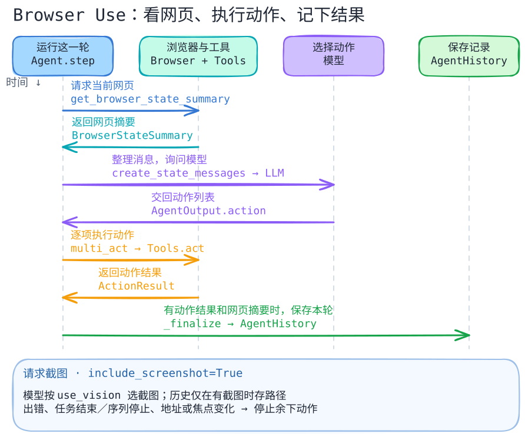

# browser-use：把杂乱动态网页压成可索引的单步闭环

[返回系统目录](../README.md) · [关键代码导读](code-walkthrough.md) · [文字版](../../../figures/browser-use-step/README.md)

如果你试过直接把现代电商或后台系统的原始 HTML 塞给大模型，马上就会撞上两场灾难：一页动辄五万 token 的嵌套 `<div>` 和脚本瞬间灌满上下文窗口；更糟的是，就算模型好不容易猜出一个 CSS 选择器，半秒后弹窗动画或路由跳转一发生，后续点击就会结结实实点错按钮。

`browser-use` 的核心价值，就是用 `Agent.step()` 把充满噪声、随时跳变的真实浏览器，驯服成一个「**提取可交互索引 → 模型输出结构化动作序列 → 浏览器带熔断执行 → 归档因果历史**」的紧凑单步闭环。



[文字版](../../../figures/browser-use-step/README.md) · [可编辑图源](../../../figures/browser-use-step/scene.excalidraw) · [关键代码导读](code-walkthrough.md)

## 1. 网页瘦身与视觉门控：给模型看什么，替历史留什么

每一轮 `step()` 开始时，`BrowserSession` 不会把整棵原始 DOM 树倒给模型，而是提炼出一份带数字编号的可交互元素摘要（连同标签页、URL 与页面截图），再由消息管理器（`MessageManager`）拼上「上一步动作的执行反馈」，组装成定长可控的当前轮输入。这样历史轮次的庞大网页快照不会在上下文里无限堆积。[一轮工作](https://github.com/browser-use/browser-use/blob/d8110c5ff87ccba887aaa726cdb780f2f84bef8d/browser_use/agent/service.py#L1033-L1085) · [保存这一轮](https://github.com/browser-use/browser-use/blob/d8110c5ff87ccba887aaa726cdb780f2f84bef8d/browser_use/agent/service.py#L1356-L1415)

多模态截图是最昂贵的上下文消耗源之一，`browser-use` 把「采集截图」「送给模型」和「写入历史」拆成了三个独立开关：

- **采集层**：`_prepare_context()` 请求网页状态时默认要求附带截图（能否真正拿到取决于浏览器当次返回）。
- **模型输入层**：即便摘要里有截图，消息管理器也会按 `use_vision` 分流——设为 `True` 时始终送入视觉模型；设为 `False` 时一律省去图片以节省开销；设为 `"auto"` 时，**只有上一步动作结果显式请求查看截图**才把图片放进本轮消息。
- **历史归档层**：`_make_history_item()` 独立保存可用截图引用。排查问题时要格外小心：在回放历史里看见截图，**不代表模型推理时也看到了这张图**，必须同时核对 `use_vision` 配置。[请求截图](https://github.com/browser-use/browser-use/blob/d8110c5ff87ccba887aaa726cdb780f2f84bef8d/browser_use/agent/service.py#L1091-L1099) · [选择模型图片输入](https://github.com/browser-use/browser-use/blob/d8110c5ff87ccba887aaa726cdb780f2f84bef8d/browser_use/agent/message_manager/service.py#L449-L502) · [保存截图](https://github.com/browser-use/browser-use/blob/d8110c5ff87ccba887aaa726cdb780f2f84bef8d/browser_use/agent/service.py#L1748-L1779)

## 2. 动态防呆：元素索引一旦过期，立刻熔断后续动作

给页面元素编上 `[12]`、`[15]` 这样的短索引虽然极大省下了 token，却引入了一个致命隐患：**索引是绑定在特定页面快照上的易碎品**。为了防止模型拿着旧地图在新页面上乱点，`browser-use` 设了两道防线：

1. **状态采集超时清空映射**：如果 `BrowserSession` 提取页面状态超时，它会主动清空内部的 DOM 元素查找表，并返回带错误提示的兜底状态，绝不让上一页残留的元素映射继续生效。[状态超时处理](https://github.com/browser-use/browser-use/blob/d8110c5ff87ccba887aaa726cdb780f2f84bef8d/browser_use/browser/session.py#L1616-L1679)
2. **多动作序列（`multi_act`）中途熔断**：为了减少往返延迟，模型可以在一次输出里连排多个动作（例如「填邮箱 → 填密码 → 点登录 → 点个人中心」）。`multi_act()` 按顺序逐个执行时，只要遇到以下任一信号就立刻丢弃本轮剩余动作：执行报错、整个任务被标为完成（`is_done`）、该动作声明结束序列，或者**页面 URL / 焦点目标发生了跳转**。[执行与停止条件](https://github.com/browser-use/browser-use/blob/d8110c5ff87ccba887aaa726cdb780f2f84bef8d/browser_use/agent/service.py#L2730-L2828)

下面这段流转数据展示了「批处理提速」与「跳转即熔断」是如何配合的：

```text
// 1. BrowserSession 提炼当前页摘要（不含冗余布局标签）
URL: https://shop.example/login
Interactive DOM:
  [11] <input type="email" placeholder="邮箱" />
  [12] <input type="password" placeholder="密码" />
  [14] <button>登录</button>

// 2. 模型一次规划 3 个结构化动作
AgentOutput.action = [
  { "input_text": { "index": 11, "text": "dev@example.com" } },
  { "click_element": { "index": 14 } },
  { "click_element": { "index": 20 } }
]

// 3. multi_act() 逐项执行并实时监测页面跳变
动作 1 (index 11) → 成功，URL 未变，继续
动作 2 (index 14) → 成功，触发跳转至 https://shop.example/home！
动作 3 (index 20) → 检测到 URL 变化，立即中止序列；留待下一轮 step 重新提取新页面索引
```

## 3. 历史归档：为什么存的是「动作前页面 + 动作后结果」

在一轮收尾的 `_finalize()` 中，只有同时具备本轮网页摘要与动作执行结果 `last_result` 时，程序才会生成一条 `AgentHistory` 记录（若中途抛错、暂停或状态超时缺失任一要素，则按异常分支处理）。[保存条件](https://github.com/browser-use/browser-use/blob/d8110c5ff87ccba887aaa726cdb780f2f84bef8d/browser_use/agent/service.py#L1356-L1385) · [异常处理](https://github.com/browser-use/browser-use/blob/d8110c5ff87ccba887aaa726cdb780f2f84bef8d/browser_use/agent/service.py#L1258-L1314)

初读代码时很容易疑惑：为什么 `AgentHistory` 里保存的网页快照是**本轮点击前**的旧页面，而不是点击后的新页面？因为历史记录回答的是决策因果链——「**面对这张页面，模型为什么选了这组动作，执行后拿到了什么反馈**」；至于点击引发的新页面，会留给下一轮 `step()` 开头的 `_prepare_context()` 重新采样。

想逐行对照 `step()` 里的上下文清理时机、动作超时包装与收尾事件，请继续阅读[关键代码导读](code-walkthrough.md)。另外，`run()` 启动阶段还可以将外部 Skills 注册为可调用动作，这部分扩展入口见 [`service.py#L2562-L2574`](https://github.com/browser-use/browser-use/blob/d8110c5ff87ccba887aaa726cdb780f2f84bef8d/browser_use/agent/service.py#L2562-L2574)。

## 来源与边界

本篇依据官方固定提交 [`browser-use/browser-use@d8110c5ff87ccba887aaa726cdb780f2f84bef8d`](https://github.com/browser-use/browser-use/tree/d8110c5ff87ccba887aaa726cdb780f2f84bef8d) 静态梳理 `Agent.step()` 的网页摘要采集、视觉输入门控、`multi_act()` 序列熔断与 `AgentHistory` 归档逻辑；真实浏览器环境下的渲染竞态、跨 iframe 焦点变化及截图采集耗时需结合具体站点实测确认。
