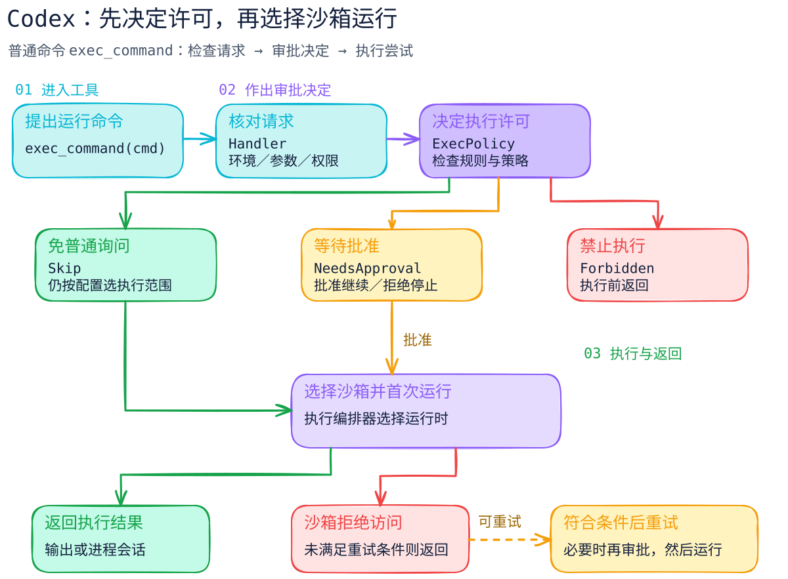

# Codex：把「批不批」与「关在哪个笼子里跑」彻底拆开

[返回系统目录](../README.md) · [关键代码路径](code-walkthrough.md) · [图的文字版](../../../figures/codex-exec-approval/README.md)

设想你在本地仓库里让编码 Agent 跑一句最平常不过的 `npm test`，并顺手配了「跑测试免弹窗」。如果系统天真地把「免人工审批」等同于「直接给宿主机完整权限」，那么一旦 `package.json` 的 `posttest` 脚本里藏着一句读取 `~/.ssh/id_rsa` 外发或者误删上级目录的命令，整台开发机瞬间就会失守；反过来，如果系统胆小到连每次 `ls`、`cargo check` 都弹框让你点确认，不出五分钟你就会陷入「弹窗疲劳」，闭着眼睛狂点「全部允许」，让审批彻底沦为摆设。

OpenAI 在 Codex 的 Rust 核心（`codex-rs/core`）里，用一套非常硬核的**双层安全闸门**解开了这个死结：第一道门 `ExecPolicy` 只回答**要不要打扰人类审批**；第二道门 `ToolOrchestrator + Sandbox` 则回答**哪怕免批放行了，命令该关在哪个沙箱笼子里跑，以及万一撞上沙箱围栏后怎么区分普通报错与升权重试**。

## 一图看懂 `exec_command` 的双层闸门

在源码主干上，一条命令请求依次穿过请求处理器（Handler）、执行策略（`ExecPolicy`）与执行编排器（`ToolOrchestrator`）：Handler 先核对工作目录与权限上限，策略层给出 `Skip / NeedsApproval / Forbidden` 三态裁决，最后由编排器串联审批、沙箱入笼与失败重判（见[整理请求](https://github.com/openai/codex/blob/c44deff7b1083e9660ac55d02122481f1cdf139b/codex-rs/core/src/tools/handlers/unified_exec/exec_command.rs#L186-L245)、[作出审批决定](https://github.com/openai/codex/blob/c44deff7b1083e9660ac55d02122481f1cdf139b/codex-rs/core/src/exec_policy.rs#L337-L458)与[安排执行](https://github.com/openai/codex/blob/c44deff7b1083e9660ac55d02122481f1cdf139b/codex-rs/core/src/tools/orchestrator.rs#L116-L220)）。



[可编辑图源](../../../figures/codex-exec-approval/scene.excalidraw) · [PNG 预览](../../../figures/codex-exec-approval/preview.png) · [不看图的说明](../../../figures/codex-exec-approval/README.md)

## 核心取舍一：为什么免批（`Skip`）绝不等于免沙箱

很多自研 Agent 把权限做成一个非黑即白的单开关：白名单命令直接裸跑，非白名单命令弹窗后裸跑。Codex 之所以把审批和沙箱正交拆成两个维度，是因为**静态看命令字面量根本猜不透子进程运行时的真实触角**。

在 Codex 中，`ExecPolicy` 给出的三个裁决含义极其精确：

- **直接禁止**（`Forbidden`）：命中黑名单，或原本需要询问但当前策略禁止交互询问，直接拦死。
- **需要审批**（`NeedsApproval`）：命令存在潜在风险（或[未匹配命令的处理](https://github.com/openai/codex/blob/c44deff7b1083e9660ac55d02122481f1cdf139b/codex-rs/core/src/exec_policy.rs#L770-L858)结合审批策略、沙箱配置与命令分类判定需人工介入），先挂起等待批准。
- **跳过询问**（`Skip`）：跳过常规的人工询问弹窗——**注意，它跳过的只是弹窗，而不是沙箱**！

哪怕一条命令拿到了 `Skip` 免批通行证，编排器默认照样把它塞进受限的文件系统与网络沙箱里执行，把爆炸半径锁死在工作区内。甚至当某条命令因为每一段都命中显式白名单而拿到了「允许跳过首次沙箱」的标记时，只要当前环境配置了禁止读取敏感路径的 `deny-read` 规则，[首次沙箱的选择条件](https://github.com/openai/codex/blob/c44deff7b1083e9660ac55d02122481f1cdf139b/codex-rs/core/src/tools/sandboxing.rs#L239-L279)依然会一票否决这次绕过，强行保留文件系统沙箱，确保私密文件绝不裸露。

## 核心取舍二：首次跑挂了，怎样分清「测试没过」与「撞上铁丝网」

把命令默认关进沙箱跑第一次，紧接着就会引出第二个工程难题：假如 `cargo test` 返回了非零退出码，到底是因为**代码写错了导致单元测试断言失败**，还是因为**测试需要联网拉依赖、被沙箱无情掐断了**？

如果不做区分，遇到报错就申请脱掉沙箱重跑，那么每次单元测试写挂都会弹窗求你给宿主机裸跑权限，既荒唐又危险；可如果一概不许升权，合法需要跨出默认沙箱的构建步骤又会彻底卡死。Codex 用精细的错误分类把两条路彻底分流：

```text
第 1 次在受限沙箱内运行命令
  │
  ├─► 情况 A：普通业务报错（如断言失败 exit code 1、语法错误）
  │     └─► 不触发升权！直接把报错输出打包成工具结果交回模型，让模型老老实实改代码
  │
  └─► 情况 B：识别为沙箱拒绝（如越界写目录、受限系统调用或网络被沙箱拦截）
        └─► 进入二次裁决状态机（结合 Never / OnRequest / Granular / UnlessTrusted 等策略）：
              ├─ 策略不允许升权 ──► 直接终止，将沙箱拒绝原因返回模型
              └─ 策略允许升权   ──► 向用户发起专门的脱沙箱/扩权审批，获批后才跑第 2 次尝试
```

这套「**先关笼子试跑，撞墙再按策略谈升权**」的乐观沙箱模式，把 95% 乖乖待在工作区内的日常读写测试变成了零弹窗、有隔离的丝滑体验，同时把真正越界的少数动作精准拎出来交给人类拍板。想顺着结构体和行号看清整条调用链，请直接进入下一篇[关键代码路径](code-walkthrough.md)。

## 来源与边界

本文基于官方仓库固定提交 [`openai/codex@c44deff7b1083e9660ac55d02122481f1cdf139b`](https://github.com/openai/codex/tree/c44deff7b1083e9660ac55d02122481f1cdf139b) 编写，核对日期 2026-09-23。全文聚焦 `codex-rs/core` 中普通 `exec_command` 的审批与沙箱编排源码路径；Codex 的回合上下文压缩、桌面端/CLI 外壳交互细节及各操作系统内核沙箱实现需按对应模块分别核查。
