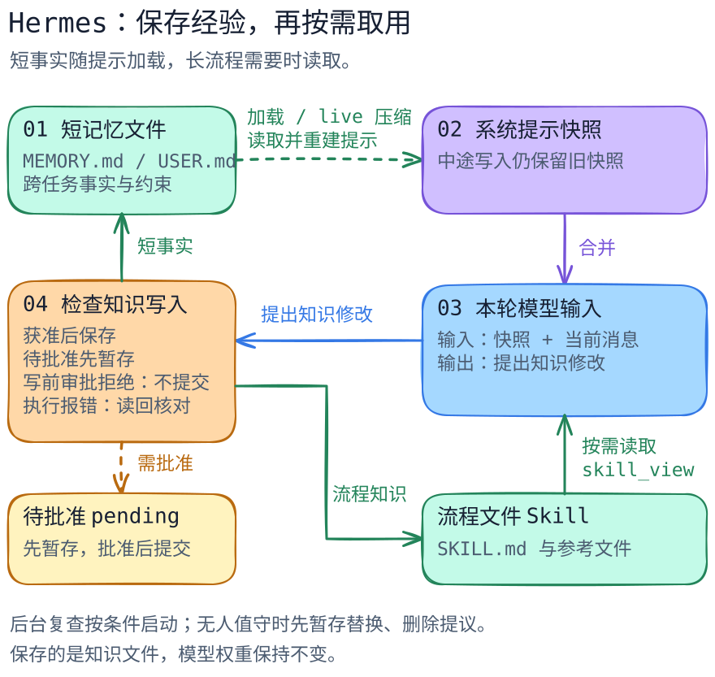

# Hermes：把排障经验沉淀成受控的跨会话资产

[返回系统目录](../README.md) · [关键代码导读](code-walkthrough.md) · [上下文与记忆](../../concepts/context-vs-memory.md)

你花半小时陪 Agent 排完一次棘手的集成测试失败：先确认测试只能跑在隔离容器里、绝不能连生产库，再顺着连接池快照定位到超时根因。关掉当前窗口后，下次再开新会话遇到同类报错，普通助手往往忘得一干二净；可如果反过来放任 Agent 自动把每次对话总结塞进系统提示，不出几天提示词就会膨胀成流水账，甚至把某次偶然猜错的结论当成“项目铁律”永久写死，静默污染后续所有会话。

Hermes Agent 在宿主层搭了一套严密的**跨会话经验治理管线**（不涉及模型权重微调，全部作用于宿主文件与上下文组装）：把高频短约束关进字符受限的 `MEMORY.md / USER.md`，把长篇操作手册拆成按需 `skill_view` 的 Skill，在任务收尾后拉起权限受限的后台 **review fork** 提炼经验，并用**系统提示快照隔离**与**待批准暂存机制**（`staged: true`）守住上下文缓存与知识库质量。

## 短事实进记忆块，长流程进按需 Skill

同样是“下次还要用的经验”，一句环境红线和一套七步排障SOP对上下文的消耗完全不同。Hermes 在存储入口就把它们拆成了两条轨道：

- **高频短事实写入字符受限的记忆文件**：`MEMORY.md` 存放项目与环境事实（默认上限 **2,200 个字符**），`USER.md` 存放用户偏好与背景（默认上限 **1,375 个字符**）。注意这里按字符数而非 token 硬卡上限，随系统提示常驻加载；如果是外部手工塞入了超长文件，加载器会保留磁盘原文但主动发出超限提醒。[内置存储与加载](https://github.com/NousResearch/hermes-agent/blob/a9109b07f42685f88397008d0d5a6c3d481b3b28/tools/memory_tool_store.py#L88-L164)
- **多步操作手册写成可复用的 Skill**：排障流程、部署清单这类长文本写成独立的 `SKILL.md`。系统提示在启动时只渲染一份轻量的「**名称 + 简述**」目录索引；只有当模型判断当前任务需要这套方法时，才主动调用 `skill_view` 把正文及关联参考文件读入当轮工具结果。[索引生成](https://github.com/NousResearch/hermes-agent/blob/a9109b07f42685f88397008d0d5a6c3d481b3b28/agent/prompt_builder.py#L1359-L1415) · [按需读取](https://github.com/NousResearch/hermes-agent/blob/a9109b07f42685f88397008d0d5a6c3d481b3b28/tools/skills_tool.py#L573-L693)

这样一来，每轮必守的红线（如“严禁连接生产库”）永远在系统提示里兜底，而几百行的排障步骤平时只占一行索引，按需展开后仍受宿主工具权限约束。

## 一条经验从“踩坑”到“入库”的六步闭环

沿着一次完整的排障会话看，Hermes 的知识读取与沉淀按以下顺序运转：

1. **初始化快照**：宿主启动内置记忆时构建 `MemoryStore`，从磁盘加载 `MEMORY.md` 与 `USER.md`，同时冻结一份专供系统提示使用的快照（snapshot）。
2. **组装轻量提示**：系统提示拼接“短记忆快照 + Skill 目录索引”，让模型既握有全局红线，又知道手头有哪些现成手册可查。
3. **按需展开手册**：遇到测试失败时，模型调用 `skill_view` 加载对应的 `SKILL.md` 正文，必要时再继续按路径读取 Skill 附带的脚本或参考文档。
4. **盘中主动记录**：排障途中如果用户明确交代了新规矩，或模型修正了旧流程，模型可直接发起 `memory` 或 `skill_manage` 调用，经宿主门禁与审批检查后处理写入。
5. **盘后后台复盘**（review fork）：一轮对话收尾时，只要已有最终答复、任务未被中断且未禁用复查，宿主就会派生一个独立的后台复查分支，带着会话记录与受限工具白名单，专门审视“刚才这轮有哪些经验值得留存”。
6. **正式落盘或暂存待批**：提炼出的改动要么原子写入正式文件，要么生成 `staged: true` 的待批准提议；等后续触发提示重建或再次调用 `skill_view` 时，新资产才会真正进入下一轮推理。

具体函数级跳转可对照[代码导读](code-walkthrough.md)。下图聚焦“磁盘正式文件、系统提示快照、当轮输入与待批准队列”四者之间的状态隔离：



[图源](../../../figures/hermes-session-memory/scene.excalidraw) · [PNG 预览](../../../figures/hermes-session-memory/preview.png) · [不看图的说明与箭头证据](../../../figures/hermes-session-memory/README.md)

## 系统提示快照隔离：为什么写完记忆不能立刻改提示

假设你在第 5 轮对话里让 Hermes 记下“测试超时统一设为 30 秒”，`MemoryStore` 立刻更新了内存里的 `live entries` 并落盘到了 `MEMORY.md`；但如果你去抓第 6 轮发给大模型的请求包，会发现系统提示里的记忆块**还是第 1 轮启动时的旧快照**。

这不是漏刷缓存的 Bug，而是刻意为之的**提示词前缀稳定性设计**：

```text
会话启动 ──► MemoryStore.load_from_disk()
              ├── live_entries            (随 memory 工具写入实时更新并落盘)
              └── _system_prompt_snapshot (冻结！format_for_system_prompt 始终读它)
                                                │
                 ┌──────────────────────────────┘
                 ▼
      单轮及连续多轮对话期间：系统提示前缀保持逐字节不变（保护 Prompt Cache 命中率）
                 │
                 ▼
      触发上下文压缩 (conversation_compression) ──► invalidate 旧提示缓存 ──► 重读存储生成新快照
```

现代大模型推理高度依赖前缀 KV 缓存（Prompt Caching）。如果每次调用 `memory` 工具都实时改写位于上下文最顶部的系统提示，整段长对话的前缀缓存就会瞬间失效，延迟与计费成本陡增。反正当前会话里刚刚发生的用户指令和 `memory` 工具返回结果已经在消息历史里了，模型本轮并不会“失忆”；等到会话增长到触发上下文压缩提交时，宿主本来就要重组历史消息，此时再顺手清除提示缓存、重读最新存储并重建快照，就能以最小代价完成跨阶段刷新（而携带预置 `seeded prompt` 的 `detached` 分离回合则会刻意沿用预置提示）。[写入与快照的分离](https://github.com/NousResearch/hermes-agent/blob/a9109b07f42685f88397008d0d5a6c3d481b3b28/tools/memory_tool_store.py#L245-L295) · [快照读取](https://github.com/NousResearch/hermes-agent/blob/a9109b07f42685f88397008d0d5a6c3d481b3b28/tools/memory_tool_store.py#L463-L481) · [压缩边界](https://github.com/NousResearch/hermes-agent/blob/a9109b07f42685f88397008d0d5a6c3d481b3b28/agent/conversation_compression.py#L3144-L3188) · [失效时重载](https://github.com/NousResearch/hermes-agent/blob/a9109b07f42685f88397008d0d5a6c3d481b3b28/agent/system_prompt.py#L790-L820)

## 防止脏知识污染记忆库的五道工程护栏

让模型自己写记忆和改 Skill，最大的风险就是“静默写坏”。Hermes 在写入链路上埋了五层防御：

- **容量硬顶与整条替换，拒绝静默丢数据**：`add` 或 `replace` 一旦超出字符配额，工具直接返回失败并要求模型先做缩写、合并或清理，绝不悄悄踢掉老条目。同时 `replace` 采用**整条 entry 替换**——`old_text` 仅作唯一定位子串，若匹配到多条记录则直接报错拒绝盲改；连续整理失败达到上限后还会给出终止提示，防止模型为了塞进一条笔记陷入死循环而卡住主答复。[容量与整条替换](https://github.com/NousResearch/hermes-agent/blob/a9109b07f42685f88397008d0d5a6c3d481b3b28/tools/memory_tool_store.py#L276-L362) · [连续失败限制](https://github.com/NousResearch/hermes-agent/blob/a9109b07f42685f88397008d0d5a6c3d481b3b28/tools/memory_tool_store.py#L93-L131)
- **待批准暂存队列与落盘态分离**（`staged: true`）：开启 `write_approval` 时，Skill 修改默认进入暂存区，记忆写入则按前台交互或后台任务来源决定弹窗询问还是暂存。看下面这段典型的暂存回包：

```json
{
  "success": true,
  "staged": true,
  "message": "Change staged for user approval"
}
```

如果只看 `success: true`，很容易误以为新经验已经写进磁盘；实际上 `staged: true` 代表它只是一份躺在待批列表里的候选提议，用户拒绝后正式存储分毫未动。[审批决策](https://github.com/NousResearch/hermes-agent/blob/a9109b07f42685f88397008d0d5a6c3d481b3b28/tools/write_approval.py#L169-L193) · [Skill 暂存结果](https://github.com/NousResearch/hermes-agent/blob/a9109b07f42685f88397008d0d5a6c3d481b3b28/tools/skill_manager_tool.py#L618-L648)

- **原子替换与写后扫描回滚**：记忆落盘走“写临时文件 + 原子 rename”，杜绝进程崩溃留下半截损坏文件；而 Skill 写入的一条路径会在写盘后执行内容安全扫描，一旦扫描拦截便尝试用旧内容回滚（若异常中断则需读回磁盘文件核对真实状态）。[记忆修改顺序](https://github.com/NousResearch/hermes-agent/blob/a9109b07f42685f88397008d0d5a6c3d481b3b28/tools/memory_tool_store.py#L245-L274) · [原子文件写入](https://github.com/NousResearch/hermes-agent/blob/a9109b07f42685f88397008d0d5a6c3d481b3b28/utils.py#L264-L326) · [Skill 写后扫描与恢复](https://github.com/NousResearch/hermes-agent/blob/a9109b07f42685f88397008d0d5a6c3d481b3b28/tools/skill_manager_tool.py#L350-L369)
- **后台 `review fork` 权限收窄**：盘后自动拉起的后台复查工作在无人值守状态，因此默认工具白名单直接剔除了普通 terminal 命令执行与任意文件写入工具（除非配置显式追加 `extra_tools`）。更关键的是，哪怕全局关闭了通用写入审批，无人值守 review 一旦试图 `replace` 或 `remove` 既有记忆，依然会被强制拦截进待批准队列（若暂存失败则直接拒绝），防止后台任务静默删改老规矩。[无人值守删除门禁](https://github.com/NousResearch/hermes-agent/blob/a9109b07f42685f88397008d0d5a6c3d481b3b28/tools/memory_tool.py#L167-L204) · [review 白名单](https://github.com/NousResearch/hermes-agent/blob/a9109b07f42685f88397008d0d5a6c3d481b3b28/agent/background_review.py#L1083-L1124)
- **加载 Skill 时的预处理与依赖激活边界**：`skill_view` 并非单纯的 `cat SKILL.md`，默认路径还会对正文做预处理并尝试激活该 Skill 声明的工具依赖，这也是为什么引入外部 Skill 时需要把正文指令与依赖声明一并纳入安全边界考量。[预处理与依赖分支](https://github.com/NousResearch/hermes-agent/blob/a9109b07f42685f88397008d0d5a6c3d481b3b28/tools/skills_tool.py#L573-L664)

## 与 Pi 的架构取舍对照

把 Hermes 与[Pi 的极简底座剖面](../pi/README.md)及[扩展与 Skill 机制](../pi/extensions-and-skills.md)放在一起对比，能看清两种截然不同的宿主哲学：

- **Pi 选择做薄内核**：把核心循环压到最简，按需指令走静态 Skill，复杂工作流留给用户通过 Extension 自行挂载；
- **Hermes 选择在宿主内置知识生命周期**：直接把容量受限的短记忆、可增删改的 Skill 管理、盘后自动复盘（review fork）以及 `staged` 审批队列做成了宿主的一等公民。

内聚的好处是开箱即具备“越用越熟”的自维护闭环；代价则是宿主必须自己扛起提示快照一致性、脏知识审批拦截、并发文件锁与后台分支权限隔离等一整套状态机复杂度。排查这类系统时，永远要沿着「**工具回包（是否 `staged`）→ 磁盘正式文件 → 提示重建边界 → 下次任务实际输入**」四步核对，而不能只看模型嘴上说了一句“我已经记住了”。

## 来源与边界

本篇基于 [`NousResearch/hermes-agent@a9109b07f42685f88397008d0d5a6c3d481b3b28`](https://github.com/NousResearch/hermes-agent/tree/a9109b07f42685f88397008d0d5a6c3d481b3b28) 做静态源码核对（核对日期 2026-09-27，上游提交时间 2026-09-27 03:21:39 UTC，[仓库 LICENSE 为 MIT](https://github.com/NousResearch/hermes-agent/blob/a9109b07f42685f88397008d0d5a6c3d481b3b28/LICENSE)）。本文未启动 Hermes 实例、未调用在线模型或验证审批交互界面，也未展开外部记忆 provider、上下文压缩算法内部细节、Skill Hub 扫描器、插件体系、terminal 后端与 Computer Use 模块；若上游滚动文档与该固定提交存在出入，以本文源码行号为准。
