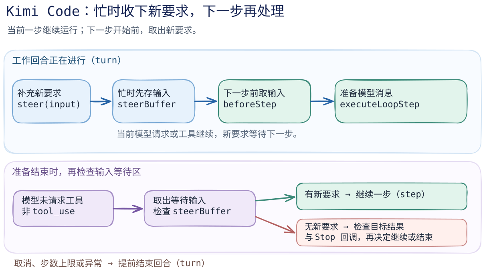

# Kimi Code：Agent 正忙时，用 steerBuffer 在 step 边界安全转向

[返回系统目录](../README.md) · [逐段代码导读](code-walkthrough.md) · [图的文字版](../../../figures/kimi-code/README.md) · [来源台账](../../../sources/kimi-code.md)

你让编码 Agent 修一个测试报错。它正紧锣密鼓地跑 `pytest`，你在滚动日志里一眼揪出了真凶，赶紧敲下一句：「先别改 `auth.ts`，把夹具竞态的原因给我讲清楚。」

这句中途插话把 Agent 运行时逼进了一个两难死角：

- **如果当场强杀当前工具**：测试进程被拦腰斩断，磁盘上可能留下半截临时文件或锁文件；更致命的是，上下文里多出一条没有 `tool_result` 配对的悬空 `tool_use`，下一次调用大模型 API 会因为违反消息协议直接报错。
- **如果锁死输入框等整轮跑完**：一个复杂回合（`turn`）往往连跑十几个步骤（`step`），等它彻底停下来，三四个无辜文件早就被改得面目全非了。

Kimi Code 的 `TurnFlow` 选了一条既不留脏状态、又不让任务跑偏的中间路线：**忙时先把补充指令暂存进 `steerBuffer` 缓冲区，等当前工具原子化收尾，立刻在下一个 `step` 起点和回合结束关口把新指令刷入上下文**。



[图的文字版](../../../figures/kimi-code/README.md) · [可编辑图源](../../../figures/kimi-code/scene.excalidraw) · [PNG 预览](../../../figures/kimi-code/preview.png) · [逐段代码导读](code-walkthrough.md) · [来源台账](../../../sources/kimi-code.md)

## 核心机制：两道刷盘关口，接住每一条中途插话

在 Kimi Code 里，一次用户任务对应一个回合（`turn`），内部由若干次「模型推理 + 工具执行」步骤（`step`）串联而成。`TurnFlow.steer()` 把中途纠偏拆成了「**忙时入队 → 步前注入 → 收尾兜底**」三个动作：

1. **忙时只进缓冲，绝不并发双开回合**：调用 `TurnFlow.steer()` 时，程序先看当前是否有活动回合。若系统空闲，直接调 `launch()` 开启新回合；若正在忙，则把消息与来源塞进 `steerBuffer` 等待区，并返回 `null`（代表复用当前回合，不生成新回合 ID），从根源上杜绝两个 worker 同时篡改同一份会话历史。[源码：`steer()`](https://github.com/MoonshotAI/kimi-code/blob/75a894e9ad5e8d49509664b3daaa1bbc9bb39432/packages/agent-core/src/agent/turn/index.ts#L120-L143)
2. **第一道关口——步前刷入**（`beforeStep`）：每当上一步的工具体面跑完、产出合法的 `tool_result` 后，`runStepLoop()` 在下一步开头的 `beforeStep` 钩子里第一时间调用 `flushSteerBuffer()`，按先进先出顺序把等待区消息追加为用户消息，**随后才执行上下文压缩与补充材料注入**，最终拼出下一步的模型请求。刚才跑着的 `pytest` 完整收尾，紧接着下一轮推理立刻看见「先别改文件」的新约束。[源码：缓冲与追加](https://github.com/MoonshotAI/kimi-code/blob/75a894e9ad5e8d49509664b3daaa1bbc9bb39432/packages/agent-core/src/agent/turn/index.ts#L265-L273) · [源码：`beforeStep`](https://github.com/MoonshotAI/kimi-code/blob/75a894e9ad5e8d49509664b3daaa1bbc9bb39432/packages/agent-core/src/agent/turn/index.ts#L578-L604)
3. **第二道关口——压哨续命**（`shouldContinueAfterStop`）：要是你的补充消息抵达时，模型恰好没调工具、正流式吐出最后一段总结准备收工呢？如果看到没有工具调用就直接退出循环，`steerBuffer` 里的消息就会被遗忘在半路。为此 `runTurn()` 在准备停机前必定询问 `shouldContinueAfterStop`——Kimi Code 在这里**最先再次刷新等待缓冲区**（`steerBuffer`）：只要捞出新消息，当场判定「本回合继续下一步」；只有等待区确实为空时，才按顺序检查持续目标（goal）状态与 `Stop` 钩子，最终结束回合。[源码：loop 的停止检查](https://github.com/MoonshotAI/kimi-code/blob/75a894e9ad5e8d49509664b3daaa1bbc9bb39432/packages/agent-core/src/loop/run-turn.ts#L99-L128) · [源码：继续优先序](https://github.com/MoonshotAI/kimi-code/blob/75a894e9ad5e8d49509664b3daaa1bbc9bb39432/packages/agent-core/src/agent/turn/index.ts#L611-L657)

用时间线对照消息列表与缓冲区的状态跃迁，就能看清为什么这两道关口缺一不可：

```text
// 时刻 T1：Step 1 正在跑 pytest，用户发来 steer
context.messages = [ user("修测试报错"), assistant(tool_use: bash "pytest") ]
steerBuffer      = [ "先别改 auth.ts，解释夹具竞态原因" ]

// 时刻 T2：pytest 正常返回 tool_result，进入 Step 2 的 beforeStep
context.messages = [
  user("修测试报错"),
  assistant(tool_use: bash "pytest"),
  tool_result("FAILED test_login - fixture lock timeout"),
  user("先别改 auth.ts，解释夹具竞态原因")   // ← flushSteerBuffer() 赶在压缩与请求前注入
]
steerBuffer      = []

// 时刻 T3（压哨边界）：若 Step 2 模型只输出解释、无 tool_use，正准备结束时用户又追问一句
// → runTurn 触发 shouldContinueAfterStop → 再次 flushSteerBuffer() 发现新消息 → 同一 turn 顺延进入 Step 3！
```

## 架构取舍：把转向、急停与权限拆成三条正交通道

把交互切入点定在 `step` 边界，本质上是用**至多等待当前单步工具跑完的响应延迟**，换取**工具副作用与大模型消息协议的绝对完整**。如果当前跑的是秒级单测，转向几乎无感；但如果卡在一个十分钟的长耗时命令上，单靠 `steer` 就只能干等。

因此 Kimi Code 没有把所有控制信号塞进同一个队列，而是严格拆开三条职责：

- **中途转向与紧急叫停分道而行**（`steer` 与 `cancel()`）：用户真想掐断慢命令时，走的是独立的 `cancel()` 通道。`runTurn()` 在每步前同时检查中止信号与最大步数 `maxSteps`；而且定向取消会核对目标回合 ID，防止上一轮迟到的取消点击误杀新开启的回合。回合收尾时，`runOneTurn()` 将结局清晰映射为 `completed`、`cancelled` 或 `failed`。[源码：步数与中断](https://github.com/MoonshotAI/kimi-code/blob/75a894e9ad5e8d49509664b3daaa1bbc9bb39432/packages/agent-core/src/loop/run-turn.ts#L74-L128) · [源码：取消](https://github.com/MoonshotAI/kimi-code/blob/75a894e9ad5e8d49509664b3daaa1bbc9bb39432/packages/agent-core/src/agent/turn/index.ts#L205-L216) · [源码：结束映射](https://github.com/MoonshotAI/kimi-code/blob/75a894e9ad5e8d49509664b3daaa1bbc9bb39432/packages/agent-core/src/agent/turn/index.ts#L441-L510)
- **注入新指令不等于豁免工具审批**：`steer` 只是把用户补充原话送进上下文；倘若模型在下一步据此决定写文件或跑高危命令，`runStepLoop()` 挂接的 `authorizeToolExecution` 依然会调用 `agent.permission.beforeToolCall(ctx)` 逐次验权。[源码：授权回调](https://github.com/MoonshotAI/kimi-code/blob/75a894e9ad5e8d49509664b3daaa1bbc9bb39432/packages/agent-core/src/agent/turn/index.ts#L658-L692)

## 横向对照：Kimi Code、Pi 与 Codex 的切面分工

| 对照维度 | Kimi Code（`TurnFlow` 切面） | Pi（`Agent` 队列切面） | Codex（`exec_command` 切面） |
| --- | --- | --- | --- |
| 忙时新指令停在哪里 | 暂存于 `TurnFlow.steerBuffer`，在下一步 `beforeStep` 与停机前 `shouldContinueAfterStop` 刷入 | 拆分为 `steering` 与 `follow-up` 双队列：前者在轮间插队，后者在回合将结束时检查 | 本书现有 Codex 篇聚焦命令审批与沙箱重试，未覆盖忙时输入队列 |
| 核心工程取舍 | 单一缓冲区兼顾步间纠偏与压哨续命，响应速度受当前正在执行的单步耗时约束 | 内核显式区分「打断改向」与「做完追加」，外层会话管理交由 `coding-agent` 承担 | 把「人工批准执行」与「内核沙箱兜底」解耦为双层防线 |

对照延伸阅读：Pi 的[输入队列主篇](../pi/README.md)与[固定版的 `Agent.prompt()`、队列及 `runLoop` 导读](../pi/code-walkthrough.md)，以及 Codex 的[固定版 `exec_command` 切面](../codex/README.md)。想顺着 `TurnFlow` 把启动互斥、Hook 拦截与外层 `goal` 驱动一次看全，请进入下一篇[代码导读](code-walkthrough.md)。

## 来源与边界

本篇核对官方固定提交 [`MoonshotAI/kimi-code@75a894e9ad5e8d49509664b3daaa1bbc9bb39432`](https://github.com/MoonshotAI/kimi-code/tree/75a894e9ad5e8d49509664b3daaa1bbc9bb39432)（核对日期 2026-09-23，仓库根目录 [LICENSE](https://github.com/MoonshotAI/kimi-code/blob/75a894e9ad5e8d49509664b3daaa1bbc9bb39432/LICENSE) 为 MIT），研究对象为新版 Kimi Code CLI 的 `packages/agent-core`，而非旧版 [`kimi-cli`](https://github.com/MoonshotAI/kimi-cli)。除静态阅读 `TurnFlow` 与通用 `runTurn` 循环外，2026-09-24 另复跑了该提交 `agent-core` 的 3 组共 68 例 mock 单元测试（含「等待 Bash 审批期间收到 `steer`，批准后在同一 `turn` 下一步读到该消息」的用例），执行细节与环境记录见[测试与环境记录](../../../sources/kimi-code.md)。CLI/TUI 到 `steer()` 的上层按键绑定、`wire.jsonl` 落盘恢复、子 Agent 上下文隔离以及真实模型流式并发竞态未在本篇展开，可结合官方[会话文档](https://moonshotai.github.io/kimi-code/en/guides/sessions)与[子 Agent 文档](https://moonshotai.github.io/kimi-code/en/customization/agents)进一步追踪。
