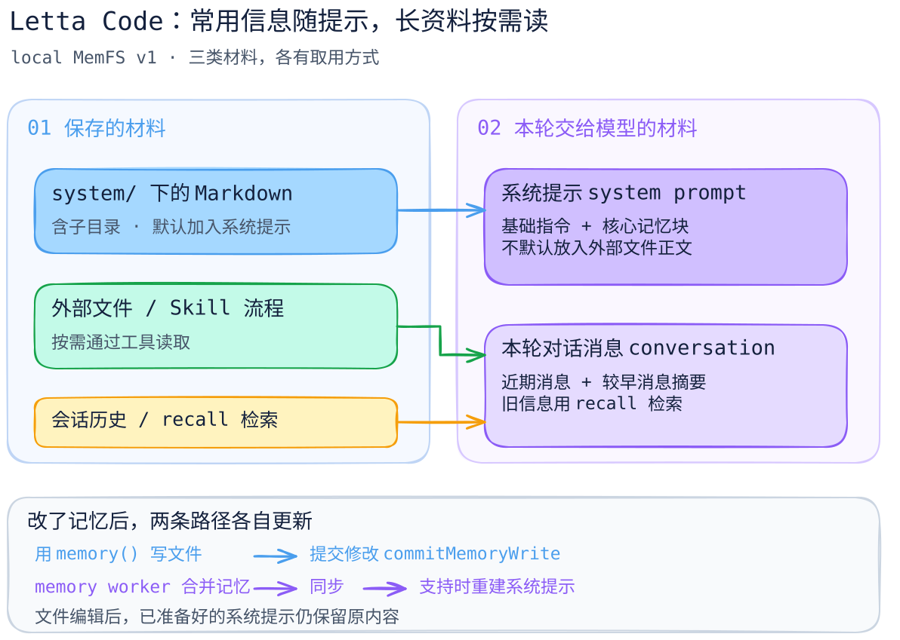

# Letta Code：分层记忆文件系统与提示重编译时序

## 为什么记忆不能“全塞进提示”也不能“全靠检索”

给编码助手加长期记忆时，最容易踩中两个相反的坑：如果把编码规范、排障手册和历史讨论全塞进系统提示，几千行低频细节会迅速挤占上下文窗口，不仅抬高每轮首字延迟，还会冲淡真正关键的约束；反过来，如果把所有经验都扔进外部检索库，聊到第 30 轮时，Agent 又可能因为某次检索没命中，突然忘掉“本项目一律用 `pnpm` 严禁 `npm`”这种每轮必守的底线。更让人困惑的是更新时序：你明明看到工具已经把新规范写进了本地记忆文件，紧接着追问时，模型却还在按旧规矩行事——因为**磁盘上的 Markdown 变了，不代表当前回合的系统提示已经重编译**。

Letta Code 用 **MemFS**（记忆文件系统）解决这组矛盾：它直接用**目录结构定义知识的驻留层级**，让高频约束常驻系统提示、长篇资料按需读取、早期对话靠历史检索（recall）打捞，并用 Git 提交与显式的提示重编译把“文件落盘”和“上下文生效”拆成受控的两步。下面聚焦 **local MemFS v1** 配置，拆解这套分层设计与生效时序。



[可编辑图源](../../../figures/letta-memory/scene.excalidraw) · [PNG 预览](../../../figures/letta-memory/preview.png) · [图的文字版](../../../figures/letta-memory/README.md)

[按阅读顺序跟代码](code-walkthrough.md)

## 用目录边界划分三层记忆预算

如果把模型的上下文窗口比作容量有限的高速缓存，Letta Code 在 local MemFS v1 下把知识拆成了三档成本截然不同的存储层：

| 知识类型 | local MemFS v1 中的存放位置 | 何时进入模型上下文 | 工程取舍 |
| --- | --- | --- | --- |
| 身份、高频偏好、目录索引 | `system/` 下的 Markdown（核心记忆块） | 编译系统提示时常驻装入 | 零检索延迟、每轮必见，但持续消耗固定输入预算 |
| 长篇排障手册、操作步骤 | `system/` 之外的外部 Markdown 与 Skills | 先看路径或描述，需要时调工具读正文 | 平时不占主体窗口，代价是多一次工具调用往返 |
| 早已滑出窗口的旧讨论 | 对话历史存储与 recall 检索 | 近期消息与摘要随轮次附带，更早细节按需查询 | 避免长对话无限膨胀，靠检索词打捞历史上下文 |

这套分工直接写进了内置提示与路径判定逻辑里：目录位置本身就是契约。把文件放进 `system/`，就等于声明“哪怕每轮都付 token 税，也必须让模型随时看见它”；放进普通目录或 Skills，则是把正文留在盘上按需分页。[内置 local MemFS 提示：历史与三类记忆](https://github.com/letta-ai/letta-code/blob/1f55d3dc66e238d203757fae288bb53f3adc7cd3/src/agent/prompts/letta_local_memfs.md#L8-L55)

```text
memory_dir/                       # local MemFS v1 根目录
├── system/                       # 核心记忆区：递归计入系统提示预算
│   ├── persona.md                # 角色与输出风格约束（常驻）
│   └── project-rules.md          # 高频项目铁律与外部资料索引（常驻）
├── notes/                        # 外部参考区：不进系统提示，按需读取
│   └── db-migration-runbook.md   # 长篇迁移手册（工具读取时才进入当轮消息）
└── .git/                         # 每次记忆写入生成可追溯的 Git 版本
```

## 改了记忆文件，为什么当前回合不会立刻变

很多开发者第一次调试记忆工具时，都会以为“改了 `system/project-rules.md`，下一条工具返回后系统提示就自动变了”。实际上，从磁盘文件变更到模型真正读到新版系统提示，中间隔着四道明确的工程工序：

1. **识别目录契约**（`detectMemoryFormat` / `isCoreMemoryPath`）：本地 MemFS 固定识别为 `v1`；只有非本地模式且根目录存在 `MEMORY.md` 时才识别为 `v2`。基于这个判定，`isCoreMemoryPath` 在 `v1` 下只认 `system/` 目录下的 Markdown，在 `v2` 下则认根目录 Markdown。[源码](https://github.com/letta-ai/letta-code/blob/1f55d3dc66e238d203757fae288bb53f3adc7cd3/src/agent/memory-format.ts#L6-L29)
2. **核算常驻预算**（`estimateSystemPromptSize`）：为了防止 `system/` 被无节制塞满，预算统计函数复用同一套格式规则——`v1` 递归扫描 `system/`，`v2` 扫描根目录 Markdown，并按**每 4 字节折算约 1 个 token** 做快速容量估算，给上下文水位提供轻量预警（精确 token 数仍取决于具体模型的分词器）。[源码](https://github.com/letta-ai/letta-code/blob/1f55d3dc66e238d203757fae288bb53f3adc7cd3/src/agent/system-prompt-size.ts#L1-L106)
3. **受控编辑与 Git 留痕**（`memory()` → `commitMemoryWrite`）：Agent 调用 `memory()` 工具时，代码先解析并校验目标路径仍在合法记忆目录内、核对工作树状态、落盘修改，随后调用 `commitMemoryWrite` 把受影响路径提交成一个新的 Git revision。这一步解决的是**可审计与可回滚**——哪怕模型写坏了某条核心记忆，历史版本也不会被静默覆盖；但此时改变的仅仅是本地工作树与 Git 历史。[工具实现](https://github.com/letta-ai/letta-code/blob/1f55d3dc66e238d203757fae288bb53f3adc7cd3/src/tools/impl/memory.ts#L99-L157) · [Git 提交实现](https://github.com/letta-ai/letta-code/blob/1f55d3dc66e238d203757fae288bb53f3adc7cd3/src/agent/memory-git.ts#L1319-L1358)
4. **同步与提示重编译**（memory worker → `recompileAgentSystemPrompt`）：当后台整理记忆的 memory worker 合并改动时，它必须先完成文件同步，随后在当前环境支持时显式请求 `recompileAgentSystemPrompt` 重新编译系统提示。之所以不在每次磁盘改动瞬间强行改写当前回合的系统提示，一方面是为了保持单轮推理内部的指令一致性与前缀缓存稳定，另一方面也是因为远端或跨组件状态需要先对齐再重编提示。[worker 路径](https://github.com/letta-ai/letta-code/blob/1f55d3dc66e238d203757fae288bb53f3adc7cd3/src/agent/subagents/memory-worker.ts#L95-L139) · [重编译入口](https://github.com/letta-ai/letta-code/blob/1f55d3dc66e238d203757fae288bb53f3adc7cd3/src/agent/modify.ts#L683-L729)

```text
当前回合开始（沿用已编译的旧系统提示）
  │
  ├─► memory() 写入 system/project-rules.md
  ├─► commitMemoryWrite() 生成 Git commit（磁盘与版本库已更新，当前回合系统提示未变）
  │
后台合并 / 跨轮次衔接
  ├─► memory worker 同步记忆文件
  └─► recompileAgentSystemPrompt() 重编系统提示 ──► 后续模型请求才看见新版核心记忆块
```

排查“为什么写了记忆却没生效”时，顺着「**磁盘文件内容 → Git revision → 同步事件 → 提示重编译请求**」这四个路标逐段核对，就能精确定位卡在哪一环。

## 切到 API-backed v2 时，目录契约如何变化

Letta Code 在同一套代码库里并存了多种部署形态，切配置时最容易混淆核心记忆的目录位置：

- **local MemFS v1**：以 `system/` 子目录作为核心记忆区，外部参考资料放在 `system/` 之外。
- **API-backed MemFS v2**：以根目录存在 `MEMORY.md` 作为格式标记，直接将**根目录下的 Markdown** 当作常驻核心记忆，并要求子目录维护逐级的 `MEMORY.md` 索引文件。

因此，阅读或迁移记忆目录时，第一步永远是先看 `detectMemoryFormat` 走的是 `v1` 还是 `v2`，再判断某个 `.md` 文件究竟会常驻系统提示，还是只做按需读取的外部文档。[格式判定与索引约束](https://github.com/letta-ai/letta-code/blob/1f55d3dc66e238d203757fae288bb53f3adc7cd3/src/agent/memory-format.ts#L6-L72) · [创建 Agent 时根块的用途](https://github.com/letta-ai/letta-code/blob/1f55d3dc66e238d203757fae288bb53f3adc7cd3/src/agent/create-agent-request.ts#L170-L205)

## 设计自建助手时的三条实战准则

1. **给核心记忆设硬门槛**：只把“每轮不看就会犯错”的身份约束、高频偏好和简短目录索引放进 `system/`；一旦某段说明只在特定子任务才用得上，立刻拆到外部 Markdown，只留一行索引指路。
2. **用 Git 管理可写记忆**：允许模型自己改写核心记忆时，像 `commitMemoryWrite` 那样每次落盘生成独立 revision，才能在模型总结跑偏时一键比对差异并回退。
3. **显式管理提示重编译边界**：不要假设写盘即生效，把“文件写入”与“系统提示重编译”做成可观测的两个独立事件，避免在长链路调试中误判记忆丢失。

## 来源与边界

本篇基于 [`letta-ai/letta-code@1f55d3dc66e238d203757fae288bb53f3adc7cd3`](https://github.com/letta-ai/letta-code/tree/1f55d3dc66e238d203757fae288bb53f3adc7cd3) 的源码与内置提示做静态核对。正文与配图聚焦 **local MemFS v1** 路径；仓库同时包含 API-backed MemFS v2 与非 MemFS 模式，其他编辑入口的同步时机需按对应调用链单独核查。本篇未执行运行时重编译抓包、跨设备同步测试或真实任务召回率评测。
