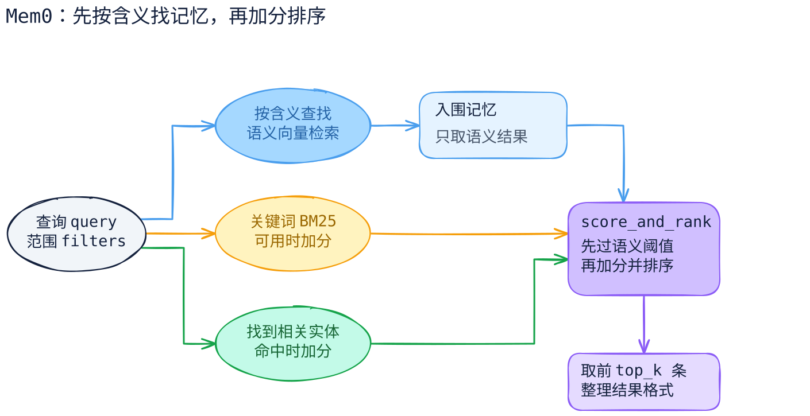

# Mem0：外挂记忆层的事实提炼、混合打分与调用方边界

## 为什么接了外挂记忆库，Agent 还是会“记串”或“答偏”

不少团队把 Mem0 这类外挂记忆组件接进应用时，默认它会自动替 Agent 打理好一切：对话结束丢进去，下次提问搜出来，新旧事实自动覆盖、上下文自动对齐。真正跑起来才会撞上三道现实落差：第一，直接把原始聊天切片塞进向量库会搜出一堆没有主语的半截废话，而开启模型提炼（`infer=True`）后，开源版当前 V3 路径实际执行的是 **ADD-only**（只追加新事实，即使函数旧注释里还保留着自动增删改的旧说法）——用户上周说“输出用英文”，这周改口“以后全用中文”，两条记录可能同时留在库里；第二，搜索接口返回的只是一组带分数的候选字典，**怎么拼进系统提示、新旧冲突听谁的，Mem0 概不代劳，全靠上层应用拍板**。

与 [Letta Code](../letta/README.md) 在宿主内部统筹目录层级与系统提示重编译不同，Mem0 把边界切得很薄：**它只做对话事实的提取存储（`add`）与作用域检索排序（`search`），不接管 Agent 的上下文编排**。看清这条边界，才能用好外挂记忆层。



[可编辑图源](../../../figures/mem0-retrieval/scene.excalidraw) · [PNG 预览](../../../figures/mem0-retrieval/preview.png) · [图的文字版](../../../figures/mem0-retrieval/README.md)

[按阅读顺序跟代码](code-walkthrough.md)

## 写入路径：`Memory.add(infer=True)` 如何把闲聊变成原子事实

如果把用户原话“太啰嗦了，以后先给三行结论再贴链接，对了今天北京挺冷的”原封不动存进向量库，寒暄噪音会拉偏向量表示。`Memory.add()` 的核心价值，是在落库前加了一道由大模型驱动的**事实蒸馏漏斗**：

1. **强制绑定归属作用域**：入口先校验 `user_id`、`agent_id`、`run_id` 至少提供一个，拒绝无归属的孤儿记忆，从源头防止多用户记忆串味。
2. **带参考上下文的事实提取**：在默认的 `infer=True` 路径下，程序读取同一作用域的近期消息，并用新消息检索最多 10 条相关既有记忆一并塞进提取提示词，让大模型分辨哪些是值得长期留存的新事实、哪些只是随口寒暄。
3. **向量化、MD5 排重与落库**：提取出的候选文本转换为 embedding，并用文本 MD5 与刚检索到的既有记录及本批记录比对去重，最后写入向量库、记录 `ADD` 历史并保存本轮原始消息（哪怕模型判定“本轮没有新事实可提”，原始消息依然会入库留档）。[作用域构造](https://github.com/mem0ai/mem0/blob/f8082a7345dadd9e042ebbc40b57b1498c8f6d63/mem0/memory/main.py#L314-L409) · [`add` 分派](https://github.com/mem0ai/mem0/blob/f8082a7345dadd9e042ebbc40b57b1498c8f6d63/mem0/memory/main.py#L760-L877) · [提取与落库](https://github.com/mem0ai/mem0/blob/f8082a7345dadd9e042ebbc40b57b1498c8f6d63/mem0/memory/main.py#L879-L1067)

```json
{
  "input_messages": [
    {"role": "user", "content": "以后汇报先给简短结论，再列出处链接。"}
  ],
  "scope": {"user_id": "u_42"},
  "add_return": {
    "results": [
      {
        "id": "mem_9a7c...",
        "memory": "偏好先看简短结论，再看来源出处链接",
        "event": "ADD"
      }
    ]
  }
}
```

阅读这段源码时，特别要避开一个**注释滞后陷阱**：`add()` 的文档字符串里虽然还写着模型会自动决定添加、更新或删除既有记忆，但在该固定版本的 Python OSS V3 `infer=True` 分支里，代码只生成 `ADD` 记录——既有记忆的参考仅用于帮模型避免重复提取，**不会自动覆写或删除冲突旧记录**。要修改或清理过时记忆，必须显式调用独立的 `update` 或 `delete` API（而 `infer=False` 与 `procedural_memory` 则分别走直接落库和流程记忆分支）。[`infer=False` 与 V3 路径分叉](https://github.com/mem0ai/mem0/blob/f8082a7345dadd9e042ebbc40b57b1498c8f6d63/mem0/memory/main.py#L879-L944) · [项目 README 对新算法的限定](https://github.com/mem0ai/mem0/blob/f8082a7345dadd9e042ebbc40b57b1498c8f6d63/README.md#L49-L76)

## 检索路径：`Memory.search` 的“语义入围、多路加分”漏斗

到了下一轮会话，应用带着当前问题调用 `Memory.search(query, filters={"user_id": "u_42"}, top_k=5)`。很多人把混合检索想象成“向量搜一批、关键词搜一批，最后取并集”，但 Mem0 这里的真实漏斗是**单门入围、多维重排**：

1. **语义向量决定入围名单**：先校验作用域过滤条件，把 `query` 编码为 embedding，从向量库拉取一批大于 `top_k` 的语义相近记录作为唯一的候选池（默认跳过已过期记录）。
2. **阈值过滤与混合加分**（`score_and_rank`）：先剔除语义相似度低于阈值的记录；随后在已入围的候选集上，叠加可用的 **BM25 关键词匹配分**与**实体关联加分**，按当前激活的信号归一化综合得分，截断返回前 `top_k` 条。[`search` 入口](https://github.com/mem0ai/mem0/blob/f8082a7345dadd9e042ebbc40b57b1498c8f6d63/mem0/memory/main.py#L1379-L1528) · [检索候选与加分](https://github.com/mem0ai/mem0/blob/f8082a7345dadd9e042ebbc40b57b1498c8f6d63/mem0/memory/main.py#L1628-L1726) · [排序函数](https://github.com/mem0ai/mem0/blob/f8082a7345dadd9e042ebbc40b57b1498c8f6d63/mem0/utils/scoring.py#L60-L143)

这层取舍直接决定了它的召回边界：

- **冷门专有名词可能卡在第一关**：如果某个错误码或内部代号在语义向量空间里距离太远、没挤进语义候选池，后面的关键词信号再强也救不回来；
- **关键词加分高度依赖底层适配器**：向量库抽象基类的 `keyword_search()` 默认直接返回 `None`，只有选用的具体向量库适配器实现了该方法，BM25 加分才会真正生效。[向量库基类](https://github.com/mem0ai/mem0/blob/f8082a7345dadd9e042ebbc40b57b1498c8f6d63/mem0/vector_stores/base.py#L68-L81)

## 上层应用自己必须兜住的四件事

既然 Mem0 只交付候选素材，生产系统在它之上封装 Agent 时必须补齐以下四块拼图：

1. **在应用层做提示组装与冲突裁决**：`search` 返回的只是候选文本与元数据。当新旧两条矛盾偏好同时被召回时，应用需要结合创建时间戳或显式规则决定注入顺序，甚至在检测到用户改口时主动调用 `update / delete` 清理旧记录。
2. **严守 `filters` 租户边界**：每次检索都必须显式传入匹配的 `user_id / agent_id / run_id` 过滤字典，不能依赖全局无过滤查询。
3. **写盘异常时做读回校验**：当批量写入向量库失败并退化为逐条插入时，单条插入异常目前只记日志而未从返回列表里剔除，因此对高敏感记忆不能只信返回包里的 `ADD` 事件，故障恢复时应按 ID 读回核验。
4. **区分开源版（OSS）与托管平台能力**：官方 README 明确把托管平台与开源版算法及基准成绩分开表述，选型与对标时要先认准自己跑的是哪一套实现。[官方说明](https://github.com/mem0ai/mem0/blob/f8082a7345dadd9e042ebbc40b57b1498c8f6d63/README.md#L49-L76)

## 来源与边界

本篇基于 [`mem0ai/mem0@f8082a7345dadd9e042ebbc40b57b1498c8f6d63`](https://github.com/mem0ai/mem0/tree/f8082a7345dadd9e042ebbc40b57b1498c8f6d63) 的 Python OSS 同步路径（`Memory.add(infer=True)` 与 `Memory.search`）做静态源码核对。本文未启动在线大模型、具体向量数据库或重跑基准评测，不覆盖 Mem0 托管平台、异步客户端 `AsyncMemory`、图记忆后端及各向量库适配器的差异化实现。
