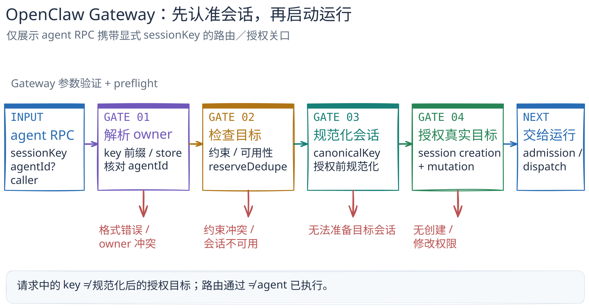

# OpenClaw：常驻多助手网关怎样守住会话归属与授权关口

[返回系统目录](../README.md) · [关键代码路径](code-walkthrough.md) · [图的文字版](../../../figures/openclaw-session-gates/README.md)

在本地命令行里跑一个单人编码助手很简单：一个终端窗口就是一个进程、一段对话，谁发的消息一目了然。但只要把 Agent 变成**常驻后台服务**——同时挂着“代码维护助手”和“私人资料助手”，还要接收来自网页、桌面端或聊天软件的远程请求——麻烦立刻就来了：

如果请求里带了一个会话名 `sessionKey: "daily-notes"`，同时又传了 `agentId: "coder"`，而这段会话原本属于资料助手，系统该听谁的？如果调用者随便猜了一个别人的会话键，能不能直接往里塞指令甚至覆盖上下文？

OpenClaw 的 Gateway（请求网关）专门解决这类“**在模型真正开口之前，先把请求送到对的房间、验明正身**”的接线难题。下面沿着一次携带显式 `sessionKey` 的 `agent` RPC 调用，看它如何用三道门禁防止串台与越权。

[可编辑图源](../../../figures/openclaw-session-gates/scene.excalidraw) · [PNG 预览](../../../figures/openclaw-session-gates/preview.png) · [不看图的说明](../../../figures/openclaw-session-gates/README.md)

## 核心设计顺序：先定归属，再归一化目标，最后按目标验权

很多早期网关最容易犯的安全错误，是“先拿用户传进来的原始字符串做权限检查，后面路由解析时又因为别名或默认回退跑到了另一个实际会话上”。OpenClaw 在这段路径里严格执行三步递进（[RPC 入口](https://github.com/openclaw/openclaw/blob/b373c9a9bcd4954ccdab963e3ed71336302b82be/src/gateway/server-methods/agent-run-handler.ts#L10-L51) · [请求路由](https://github.com/openclaw/openclaw/blob/b373c9a9bcd4954ccdab963e3ed71336302b82be/src/gateway/agent-turn/agent-request-routing.ts#L71-L105) · [规范化后授权](https://github.com/openclaw/openclaw/blob/b373c9a9bcd4954ccdab963e3ed71336302b82be/src/gateway/agent-turn/agent-turn-service.ts#L279-L334)）：

### 第 1 道门：解析会话归属（Owner），拒绝模糊与冲突

调用方传来的参数往往五花八门：可能同时带了 `agentId` 和形如 `agent:researcher:topic-1` 的带前缀 `sessionKey`，也可能只给了一个裸的会话键。

`resolveRequestedSessionAgentId()` 会把请求参数与已落盘的会话归属记录摆在一起交叉核验：

- 如果显式指定的 `agentId` 根本不存在，直接拒绝；
- 如果 `sessionKey` 前缀写着 A 助手，参数 `agentId` 却写着 B 助手，直接报错打回，绝不暗中二选一；
- 如果存储里这段老会话绑定的原助手已经下线退役，或者裸 key 在多助手环境下无法唯一确定归属，同样立即拦截并要求调用方指明（[归属解析源码](https://github.com/openclaw/openclaw/blob/b373c9a9bcd4954ccdab963e3ed71336302b82be/src/gateway/session-request-agent.ts#L112-L207)）。

### 第 2 道门：把请求键收敛成唯一的内部坐标（Canonical Key）

搞清“归哪个助手管”之后，路由层选出 `requestedSessionKey`，交由 `prepareAgentSession()` 统一收敛成系统内部真正要读写的 `canonicalKey` 与 `canonicalSessionAgentId`。无论是大小写、前缀补全还是缺省目标展开，都在这里尘埃落定——后续一切读写与锁操作只认这组规范化坐标。

### 第 3 道门：对着最终目标检查创建与修改权限

拿到板上钉钉的 `canonicalKey` 后，Gateway 才执行最终的会话级授权判断：**当前调用者是否有权创建这段新会话？或者是否有权向这段已有会话追加与修改内容？** 把授权卡在“规范化之后、模型调度之前”，就彻底堵死了靠别名绕过权限检查的缝隙（[规范化与目标授权](https://github.com/openclaw/openclaw/blob/b373c9a9bcd4954ccdab963e3ed71336302b82be/src/gateway/agent-turn/agent-turn-service.ts#L279-L334)）。

只有闯过这三关，请求才会进入接纳与去重检查，最终拉起模型运行循环。函数级调用链可继续看[关键代码路径](code-walkthrough.md)。

## 延伸探索的入口

除了本文聚焦的“显式 `sessionKey`”主干外，OpenClaw 网关还支持按 `sessionId` 寻址、省略 key 走默认会话、按外部收件人 `channel + to` 路由以及 `chat.send` 等分支；进入调度后还有并发排队、去重与结果投递机制，适合需要自研多租户/多渠道 Agent 网关的读者顺藤摸瓜（[其他路由分支](https://github.com/openclaw/openclaw/blob/b373c9a9bcd4954ccdab963e3ed71336302b82be/src/gateway/agent-turn/agent-request-routing.ts#L107-L174) · [运行接纳与派发入口](https://github.com/openclaw/openclaw/blob/b373c9a9bcd4954ccdab963e3ed71336302b82be/src/gateway/agent-turn/agent-turn-service.ts#L557-L583)）。

## 来源与边界

本文基于官方仓库 [`openclaw/openclaw@b373c9a9bcd4954ccdab963e3ed71336302b82be`](https://github.com/openclaw/openclaw/tree/b373c9a9bcd4954ccdab963e3ed71336302b82be)（核对日期 2026-09-24，根 LICENSE 为 MIT）对 Gateway `agent` RPC 显式 `sessionKey` 的归属解析与会话授权路径做静态源码剖析；未启动 Gateway 服务做多身份并发压测，也不覆盖 Telegram / WhatsApp 等外部渠道适配器的完整收发架构。
