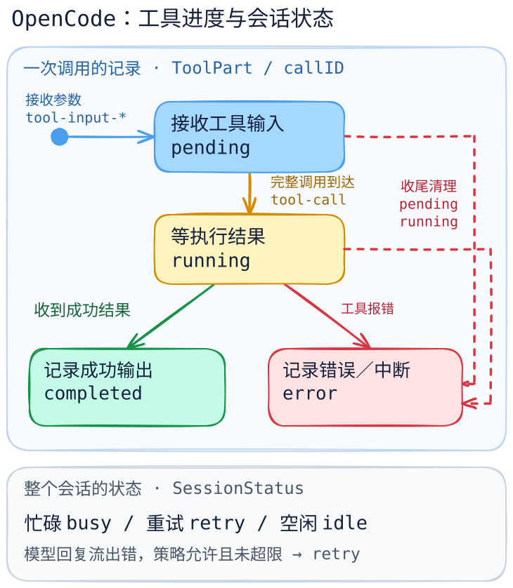

# OpenCode：把「工具零件状态」与「外层会话状态」拆成两层

[返回系统目录](../README.md) · [关键代码导读](code-walkthrough.md)

做过流式编码 Agent 界面的工程师，大多被两类状态错乱折磨过：第一，大模型正在慢吞吞地流式吐出一段两百行的改文件 JSON 参数，整整八秒钟里工具根本还没开始跑，界面却只挂着一个笼统的「忙碌中」，用户根本分不清是网络卡死了还是命令正在执行；第二，某次 `read` 读到了不存在的路径返回报错，或者用户半途按下了取消键——如果把单个工具状态和整场会话绑死在一起，要么一次寻常的工具报错就把整场对话误判成崩溃停机，要么流断掉后留下一排永远在转圈的「僵尸工具卡片」。

OpenCode 的解法非常干脆：把状态拆成互不越界的两层——微观层为每一次工具调用单独建一张挂在助手消息下的零件单 `ToolPart`（流转于 `pending / running / completed / error` 四态），宏观层用独立的 `SessionStatus`（`busy / retry / idle`）表达整场会话的心跳。**单个零件报错不代表整台机器停摆，而整条流意外中断时又能精准给所有未收口零件盖上中断戳**。



[图的文字版](../../../figures/opencode-tool-state/README.md) · [可编辑图源](../../../figures/opencode-tool-state/scene.excalidraw) · [关键代码导读](code-walkthrough.md)

## 微观层：`ToolPart` 为什么要把 `pending` 和 `running` 拆开

在流式协议下，大模型并不是一口气把完整工具调用扔过来的，而是先发调用编号 `callID` 与工具名，再一段段往外挤 JSON 参数增量块。如果等参数收齐才建记录，这几秒钟在消息历史里就是一片空白。

因此 OpenCode 把单次调用的进度拆成四个精确阶段，并始终凭 `callID` 对号入座（见[建立记录](https://github.com/anomalyco/opencode/blob/18ef3cc7c5a25b82114c953a80ccc09f4988f74e/packages/opencode/src/session/processor.ts#L216-L253)、[记录运行](https://github.com/anomalyco/opencode/blob/18ef3cc7c5a25b82114c953a80ccc09f4988f74e/packages/opencode/src/session/processor.ts#L331-L354)、[写入结果](https://github.com/anomalyco/opencode/blob/18ef3cc7c5a25b82114c953a80ccc09f4988f74e/packages/opencode/src/session/processor.ts#L160-L204)与[标记中断](https://github.com/anomalyco/opencode/blob/18ef3cc7c5a25b82114c953a80ccc09f4988f74e/packages/opencode/src/session/processor.ts#L585-L610)）：

- **参数流式接收期**（`pending`）：流式输入刚露头就立刻凭 `callID` 建好占位零件，界面马上能渲染出「正在接收某工具参数」，不再干瞪眼。
- **参数收齐执行期**（`running`）：完整 `tool-call` 落定，写入完整输入参数与启动时间戳；死循环检测（连续重复调用拦截）与权限门禁也卡在这一步。
- **执行成功收口**（`completed`）：匹配到处于 `running` 态的原记录，写入工具输出、附件与结束时间戳。
- **报错或中断兜底**（`error`）：不仅接住工具真实抛出的执行错误，还负责在流结束清扫时，把所有没来得及拿回结果的悬空调用统一改写为带中断标记的 `error`，彻底消灭「僵尸转圈卡片」。

## 宏观层：为什么单个工具 `error` 时会话依然是 `busy`

再看外层：每张 [ToolPart 内容](https://github.com/anomalyco/opencode/blob/18ef3cc7c5a25b82114c953a80ccc09f4988f74e/packages/opencode/src/session/processor.ts#L236-L251)只管那一次调用的输入输出与起止耗时，而整场对话当前到底在不在干活，由独立的 [`SessionStatus`](https://github.com/anomalyco/opencode/blob/18ef3cc7c5a25b82114c953a80ccc09f4988f74e/packages/opencode/src/session/status.ts#L30-L48) 维护（仅含 `busy / retry / idle` 三态）。把同一时刻的两层状态摆在一起看，解耦的价值一目了然：

```json
{
  "sessionStatus": { "type": "busy" },
  "assistantMessageParts": [
    {
      "type": "tool",
      "callID": "call_01",
      "tool": "read",
      "state": { "status": "error", "error": "ENOENT: config.yaml not found" }
    },
    {
      "type": "tool",
      "callID": "call_02",
      "tool": "glob",
      "state": { "status": "running", "input": { "pattern": "*.yml" } }
    }
  ]
}
```

在这幅真实常见的快照里，`call_01` 因为猜错文件名已经落定为 `error`，模型看到错误后顺手发起 `call_02` 去搜正确后缀；整个过程里外层会话稳稳保持 `busy`——前端顶栏知道「Agent 还在正常推进任务」，消息流里又能清清楚楚展开第 1 次失败原因与第 2 次实时进度。只有遇到上游限流退避时外层才切为 `retry`，整轮彻底收工才切回 `idle`。

## 从用户输入到钩子包裹的执行主线

顺着调用链鸟瞰一圈：用户发出消息后，`SessionPrompt.prompt()` 先持久化消息并拉起循环，`runLoop()` 每轮选定 Agent 与模型、装配好可用工具集，再交由 `SessionProcessor.process()` 消费模型流事件（见[接收输入](https://github.com/anomalyco/opencode/blob/18ef3cc7c5a25b82114c953a80ccc09f4988f74e/packages/opencode/src/session/prompt.ts#L1042-L1070)、[准备这一轮](https://github.com/anomalyco/opencode/blob/18ef3cc7c5a25b82114c953a80ccc09f4988f74e/packages/opencode/src/session/prompt.ts#L1081-L1132)与[交给处理器](https://github.com/anomalyco/opencode/blob/18ef3cc7c5a25b82114c953a80ccc09f4988f74e/packages/opencode/src/session/prompt.ts#L1221-L1286)）。

而在真正执行工具时，`SessionTools.resolve()` 给每个工具外层套上了洋葱式的插件钩子：`tool.execute.before` → 真实 `item.execute` → `tool.execute.after`；执行完毕产出的 `tool-result` 流事件回到处理器后，再精准回写对应 `callID` 的 `ToolPart`（见[工具与插件](https://github.com/anomalyco/opencode/blob/18ef3cc7c5a25b82114c953a80ccc09f4988f74e/packages/opencode/src/session/tools.ts#L92-L132)与[接收结果](https://github.com/anomalyco/opencode/blob/18ef3cc7c5a25b82114c953a80ccc09f4988f74e/packages/opencode/src/session/processor.ts#L383-L419)）。下一篇[关键代码导读](code-walkthrough.md)将带你逐个函数拆开死循环拦截、流中断清扫与空闲内存回收的实现细节。

## 来源与边界

本文依据官方仓库固定提交 [`anomalyco/opencode@18ef3cc7c5a25b82114c953a80ccc09f4988f74e`](https://github.com/anomalyco/opencode/tree/18ef3cc7c5a25b82114c953a80ccc09f4988f74e) 编写，核对范围为 `packages/opencode/src/session` 下的会话循环、流事件处理器与工具包装源码。全文聚焦静态源码中的双层状态流转与清理机制，数据库底层存储、上下文摘要压缩与子 Agent 编排不在本篇范围内。
