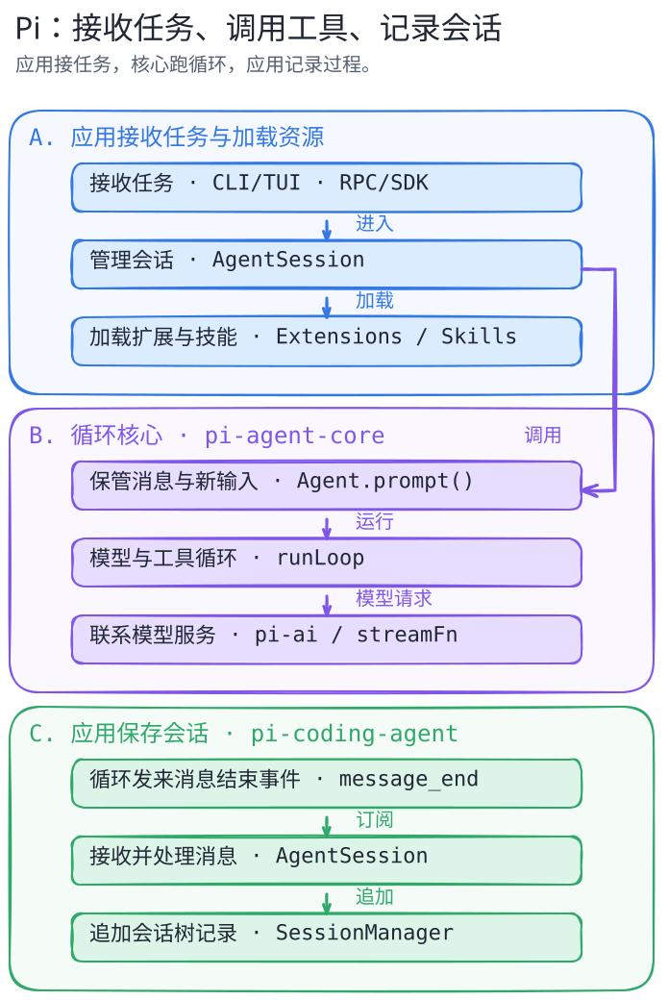

# Pi：为什么它是极佳的第一套源码读本

[返回系统目录](../README.md) · [关键代码导读](code-walkthrough.md) · [Extensions、Skills 与 Packages](extensions-and-skills.md)

很多 Agent 项目在第一周只有几百行干净代码，半年后却长成一团谁也不敢动的泥球：模型服务商的流式分块格式直接写死在工具循环里，JSONL 落盘逻辑硬塞在 `while` 循环中间，加一个终端斜杠命令就得顺手改掉核心状态。一旦你想把同一个运行核嵌进后台服务，或者单独测试上下文压缩逻辑，就会发现根本拆不下来。

Pi 最值得反复细读的地方，恰恰在于它克制得近乎苛刻的**三包解耦**：把「跟哪家模型说话」「怎么驱动多轮工具循环」和「在终端里怎么存盘与扩展」切成了三个职责互不越界的独立包。把它当作第一套源码读本，你能在不被 UI 渲染和磁盘读写干扰的前提下，一眼看穿 Agent 运行时的纯粹骨架。

## 三包解耦：两条干净的架构切口

Pi 用两次关键切分隔离了变化最快的工程细节：第一刀把千差万别的模型 API 协议挡在循环外，第二刀把会话持久化、自动重试与插件生态留在外壳层。

| 包层级 | 核心职责与不做什么 | 关键源码锚点 |
| --- | --- | --- |
| `pi-ai` | **统一模型适配层**：抹平不同模型服务商（provider）的流式事件、工具调用增量块与计费统计；它不知道什么是会话文件，也不执行任何本地工具 | [仓库包说明](https://github.com/earendil-works/pi/blob/898ab804050730e9dcefb4443875d5a932aa6a32/README.md)、[准备模型请求](https://github.com/earendil-works/pi/blob/898ab804050730e9dcefb4443875d5a932aa6a32/packages/agent/src/agent-loop.ts#L380-L406) |
| `pi-agent-core` | **纯粹内存循环核**：`Agent` 维护内存消息与双输入队列，`runLoop` 只管「请求模型 → 校验并执行工具 → 推进下一轮」并向外广播生命周期事件；**零终端依赖、零磁盘落盘** | [`Agent.prompt()`](https://github.com/earendil-works/pi/blob/898ab804050730e9dcefb4443875d5a932aa6a32/packages/agent/src/agent.ts#L367-L442)、[`runLoop`](https://github.com/earendil-works/pi/blob/898ab804050730e9dcefb4443875d5a932aa6a32/packages/agent/src/agent-loop.ts#L162-L320) |
| `pi-coding-agent` | **终端产品外壳**：订阅核心抛出的事件，用 `AgentSession` 与 `SessionManager` 把消息组织成 JSONL 会话树，接管报错重试、上下文溢出压缩，并加载 Extension 与 Skill | [`AgentSession` 处理消息](https://github.com/earendil-works/pi/blob/898ab804050730e9dcefb4443875d5a932aa6a32/packages/coding-agent/src/core/agent-session.ts#L921-L943)、[`SessionManager`](https://github.com/earendil-works/pi/blob/898ab804050730e9dcefb4443875d5a932aa6a32/packages/coding-agent/src/core/session-manager.ts#L1189-L1211) |

这种切分带来了一个直接的工程红利：当你只想造一个嵌入桌面端或 Web 服务的定制 Agent 时，只需引入 `pi-ai` 与 `pi-agent-core`，完全不必背负终端交互和 JSONL 文件树的包袱；反过来，终端应用想升级上下文压缩算法时，`runLoop` 连一行代码都不用改。



[图源](../../../figures/pi-architecture/scene.excalidraw) · [PNG 预览](../../../figures/pi-architecture/preview.png) · [不看图的说明](../../../figures/pi-architecture/README.md)

## 轮间急转弯与收尾续单：为什么中途输入要拆成两条队列

设想你让 Agent 重构五个模块，它刚改完第一个文件准备动第二个，你突然发现它改错了目录；又或者它改得很好，你只是想顺口补一句「等全改完了顺便跑一下构建」。

如果系统在任务运行期直接锁死输入框，你纠正方向的唯一手段就是粗暴按下取消键，白白扔掉半截上下文；可如果把所有中途输入一股脑塞进下一轮，那句「全改完了顺便跑构建」就会打断正在推进的修改主线，诱发模型提前收工。Pi 在 `pi-agent-core` 里用两条内存队列精准化解了这个矛盾：

```text
当前正在执行第 1 轮工具批次（read src/auth.ts → edit src/auth.ts）
  │
  ├─ 用户调用 steer("别动 src/legacy 目录，只改 v2")
  │    └─ 进入 steeringQueue ──► 第 1 轮工具刚跑完、第 2 轮请求模型前立即注入！（急转弯方向盘）
  │
  └─ 用户调用 followUp("全部改完后补一段 CHANGELOG")
       └─ 进入 followUpQueue ──► 等模型不再调工具、准备结束整次运行时才取出续跑！（收尾追加清单）
```

在单轮循环内部，`Agent.prompt()` 先经由 `transformContext`（业务层裁剪或改写消息）和 `convertToLlm`（转换成统一模型载荷）发起请求；工具跑完写成 `toolResult` 送回下一轮；每当一条消息定稿，`runLoop` 只管向外发出 `message_end` 事件，外层的 `AgentSession` 接住事件后交给 `SessionManager` 写入分支化的会话树。整条链路没有一处反向耦合。

## 刻意不内置沙箱：把能力边界摊在明面上

读 Pi 源码时，另一个不能忽略的设计选择是它的权限观：[官方仓库说明](https://github.com/earendil-works/pi/blob/898ab804050730e9dcefb4443875d5a932aa6a32/README.md)明确指出，Pi **默认直接继承启动它的宿主用户所拥有的全部文件、进程、网络与凭据权限**，核心并没有内置操作系统沙箱或细粒度权限弹窗。

这么做让核心代码保持了极高透明度，但也意味着安全边界完全取决于宿主程序注册了哪些工具、在 `beforeToolCall` 钩子里写了什么拦截规则，以及运行环境本身有没有做容器隔离。尤其在安装第三方 Extension 或带脚本的 Skill 前，必须当作直接运行本地代码来审查来源。

## 顺着源码继续深挖

- [关键代码导读](code-walkthrough.md)：像拆解精密钟表一样，顺着 `prompt()` 跟完参数截断保护、并行工具保序、双队列检查点、错误重试与会话树三层投影。
- [Extensions、Skills 与 Packages](extensions-and-skills.md)：看清为什么按需读取的 Markdown 工作手册（Skill）与注入进程执行的代码插件（Extension）绝不能混为一谈。

## 来源与边界

本文基于官方仓库固定提交 [`earendil-works/pi@898ab804050730e9dcefb4443875d5a932aa6a32`](https://github.com/earendil-works/pi/tree/898ab804050730e9dcefb4443875d5a932aa6a32) 编写，核对日期 2026-09-23（原 `badlogic/pi-mono` 仓库迁移背景见[官方公告](https://pi.dev/news/2026/5/7/pi-has-a-new-home)）。全篇聚焦静态源码中的包边界、循环控制流与会话投影设计，不涉及跨模型端到端基准评测与吞吐压测。
