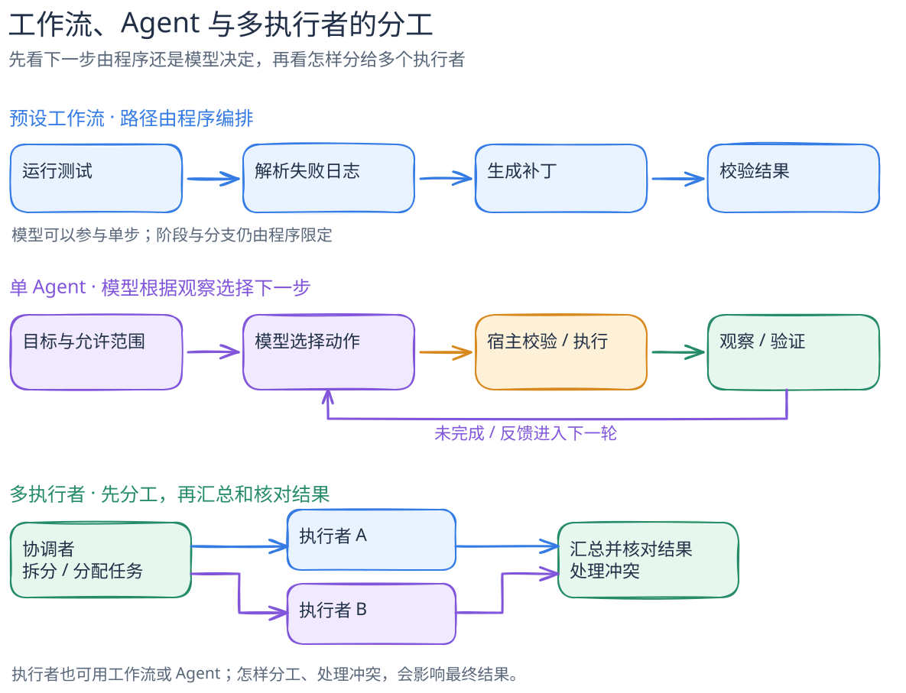

# Agent、工作流与多 Agent：安排任务的三种办法

# Agent、工作流与多 Agent：安排任务的三种办法

[返回机制目录](README.md) · [可编辑图源](../../figures/agent-workflow-multiagent/scene.excalidraw) · [PNG 预览](../../figures/agent-workflow-multiagent/preview.png)

团队第一次把大模型搬进工程系统时，最容易掉进两个相反的深坑：要么把本来三步 `if/else` 就能稳定跑完的每日发票提取，硬塞给一群“自主协商的多 Agent”，结果延迟翻了十倍、每次跑出来的格式还不一样；要么把横跨十几个模块的线上故障排查全堆进同一个对话窗口，翻到第 20 个日志文件时，满屏中间输出早就把最初的排障目标冲没了。

之所以会选错架构，是因为很多人把“**下一步由谁决定**”和“**有几个独立执行窗口**”混成了一件事。只要把这两个正交维度拆开看，工作流（Workflow）、单 Agent 与多执行者（Multi-Agent）各自的甜点区一目了然。



图的上半部分回答**控制流归属**（代码写死轨道，还是模型动态选路），下半部分回答**执行上下文切分**（单兵推进，还是分头处理再汇总）。一条固定工作流里完全可以并行调用多个模型节点；反过来，一个自主 Agent 也完全能独自闭环复杂任务。各条路径的逐步对照见[图的文字版](../../figures/agent-workflow-multiagent/README.md)。

## 两个正交维度，切出三种主流组织方式

借用 [Anthropic《Building Effective Agents》对 Workflow 与 Agent 的经典界定](https://www.anthropic.com/engineering/building-effective-agents)：**Workflow** 是通过预定义代码路径编排大模型与工具的系统，而 **Agent** 则是由大模型动态决定推理过程与工具使用方式的系统；至于其中的协调者-工作者（Orchestrator-Workers）模式，则是在人数维度上进一步把子任务动态拆给多个独立执行者。

我们把同一个真实研发任务——**上线前审查一次涉及多模块的变更请求**（提取配置改动、排查接口兼容性风险、给出发布建议）——放进三种架构里跑一遍，立刻就能看出取舍：

### 1. 预设工作流（Workflow）：代码锁死轨道，模型只做认知工序

如果你的审查标准非常固定：先用脚本跑 `git diff` 列出变更文件，再让模型逐份提取新增环境变量，接着用正则核对配置模板是否补齐，最后由模型汇总成固定格式的发布清单——那就应该直接写 **Workflow**。

```text
git diff 脚本 ──▶ 模型提取配置项 ──▶ 代码校验必填字段 ──▶ 模型生成固定格式摘要
                     (结构化 JSON)       (缺项直走告警分支)
```

- **为什么这时固定流水线完胜自主循环**：控制权 100% 握在确定性代码手里。哪怕模型某次突发奇想“想顺便帮你重构一下业务代码”，外层压根没给它暴露修改工具和循环分支。它的步数固定、延迟与成本可精确预估，而且每一个中间节点都能单独写单元测试。**铁律很简单：只要你能提前把流程图画清楚，就别让模型去猜下一步**。

### 2. 单 Agent：路径事先未知，靠观察反馈动态探路

换成另一种情况：这次变更触发了一条诡异的集成测试偶发失败。你事先根本不知道问题出在路由层、缓存失效还是异步重试——必须先读报错堆栈，打开疑似文件 `order-service.ts`，发现它调用了 `retry-policy.ts`，再临时跑一次单测验证假设。

这种**下一步完全取决于上一轮工具返回了什么**的开放式探索，固定流水线根本写不出所有分支，正是**单 Agent** 的主场。但“模型动态选路”绝不等于“放任模型裸奔”——真正的执行与边界控制依然牢牢锁在宿主（Harness）手里。以 Pi 的运行内核为例，这条受控循环在源码里分三步咬合：

1. [`Agent.prompt()`](https://github.com/earendil-works/pi/blob/898ab804050730e9dcefb4443875d5a932aa6a32/packages/agent/src/agent.ts#L367-L442) 接收用户目标，初始化单执行者的运行上下文；
2. [`runLoop`](https://github.com/earendil-works/pi/blob/898ab804050730e9dcefb4443875d5a932aa6a32/packages/agent/src/agent-loop.ts#L162-L320) 在“模型提议下一步动作”与“工具返回真实结果”之间持续往返调度；
3. [参数检查和执行前钩子](https://github.com/earendil-works/pi/blob/898ab804050730e9dcefb4443875d5a932aa6a32/packages/agent/src/agent-loop.ts#L703-L771) 在真正触发工具前完成参数校验与前置拦截，确保模型只能在允许的工具集和目录边界内探路（完整调用链见[Pi 代码导读](../systems/pi/code-walkthrough.md)）。

### 3. 多执行者（Multi-Agent）：用子窗口隔离噪音，但要交“协调税”

很多初学者拆多 Agent，喜欢让三个模型分别扮演“产品经理、架构师、测试工程师”在同一个群里来回聊天开会——这恰恰是工程上信噪比最低、最容易跑偏的反模式。

在真实生产系统里，拆出多个子执行者（Sub-agents）最核心的收益只有两个：**并行提速**，以及更关键的**上下文隔离**（Context Isolation）。假如这次变更横跨 12 个微服务，让单个 Agent 挨个翻遍上百个文件，中间产生的几万行搜索碎屑会把主窗口彻底淹没；拆成三个只读子 Agent 分头排查网关、订单和账务模块后，每个子 Agent 把翻找日志的脏活留在自己的临时窗口里销毁，最终只向主协调者交回几百字的结构化结论与行号证据。

但天下没有免费午餐，每多拆一个执行者，系统就要多交一笔**协调通信税**（Coordination Tax）：

| 架构方案 | 步骤谁决定 | 核心工程收益 | 典型故障与隐性成本 | 适用信号 |
| --- | --- | --- | --- | --- |
| **固定工作流** | 程序代码预定义 | 延迟可控、成本封顶、易测试验真 | 遇到预设分支外的意外情况直接卡壳 | 阶段明确、规则清晰、高频批处理 |
| **单 Agent** | 模型按观察动态决定 | 灵活应对未知线索，上下文完整连贯 | 轮次失控烧钱，长任务后期注意力稀释 | 探索式排障、跨文件改动、路径无法穷举 |
| **多执行者** | 协调者拆分（子内部可为工作流或 Agent） | 子窗口隔离搜索噪音，独立切片可并行 | 切分不清导致漏查重查、信息耗损、并发写冲突 | 子任务高度解耦，或单窗口已被中间资料撑爆 |

## 拆多执行者时，交接契约决定成败

把一句含糊的“你们几个一起审查一下这次上线风险”直接丢给三个助手，得到的往往是三份车轱辘话加上互相覆盖的文件修改。真正可落地的委派，必须把自然语言变成边界分明的**交接契约**（Handoff Contract）：

```json
{
  "worker": "audit-payment-module",
  "scope": ["services/payment/"],
  "permissions": {"read": true, "write": false, "network": false},
  "required_output": {
    "breaking_changes": "列出不兼容字段及文件行号",
    "unverified_assumptions": "跨模块依赖中尚未确认的外部接口"
  }
}
```

设计多执行者协作时，四条规矩缺一不可：

- **职责切片不重叠**：明确每个子执行者负责哪几个目录或哪几份材料，严禁边界模糊导致两边同时改同一个文件。
- **读写权限最小化**：负责搜集情报与代码走查的子 Agent 一律给只读权限；涉及高风险命令时明确规定由谁上报用户审批。
- **交付结论必带原始凭证**：子窗口被销毁后，主协调者看不到它的中间过程；因此子执行者交回的摘要必须附带精确文件路径、行号或命令退出码，方便发现矛盾时回查原文。
- **外部副作用单点收口**：两个子结果对同一接口假设冲突时，由协调者指定复核；最终写文件、提 PR 或发通知等外部写操作尽量收归单一出口执行，避免重复触发。

## 选型阶梯：永远从最简单的一档往上加

架构复杂度本身就是负债——每一层额外的自主循环和跨 Agent 通信，都会放大调试难度与失败概率。动手搭建前，建议严格按下面四级阶梯自底向上试探，只有上一档确实兜不住时才升档：

1. **单次模型调用**：所需材料已经明确齐备，一次装入上下文就能直接得出答案，连循环都不必开。
2. **预设工作流**（Workflow）：需要多步处理，但先后顺序和异常分支都能用代码写清楚，优先用流水线锁死确定性。
3. **单 Agent 循环**：任务充满未知分支，必须边跑工具、边看真实反馈才能决定下一步。
4. **多执行者协作**：单窗口已经被海量中间搜索结果撑爆，或者任务天然能切成几块互不干扰的并行子问题，且收益足以覆盖协调通信税。

理清了宏观编排选型，如果想深入单执行者内部看一轮请求怎样周转，可以回看[Agent loop](agent-loop.md)；想继续搞清楚宿主怎样在调用工具那一步锁住安全边界，可接着读[审批、沙箱、工作目录](approval-vs-sandbox.md)。

## 来源与边界

- **架构分类与源码锚点**：本章关于 Workflow、Agent 与 Orchestrator-Workers 的分类框架引自 [Anthropic《Building Effective Agents》](https://www.anthropic.com/engineering/building-effective-agents)；宿主循环与工具前置钩子路径对应 `earendil-works/pi` 固定提交 `898ab804050730e9dcefb4443875d5a932aa6a32` 的静态源码审阅。
- **适用边界**：不同开源框架对 Agent、Workflow、Sub-agent 或 Crew 的命名习惯可能存在差异，阅读时以“控制流谁决定”和“上下文是否隔离”两项实际机制为准；具体延迟、成本与准确率取舍需结合业务自身的评测集实测验证。
