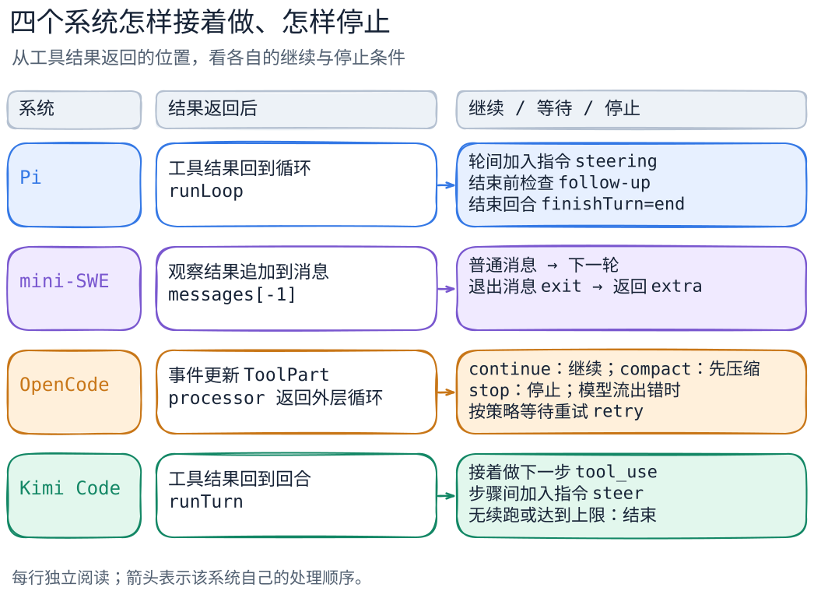

# 一轮工具调用后，谁决定下一步？

# 一轮工具调用后，谁决定下一步？

[返回横向对照](README.md)

想象这样一个高频事故现场：编码 Agent 正在埋头连跑第 4 个工具，你扫了一眼终端输出，发现它找错了目录、正准备大改核心认证模块。你赶紧敲下一句：“停，别碰 `auth/`，只改单元测试！”——这时候，底层的循环引擎正面临一道两难选择题：

- **如果立刻把你的话硬塞进消息列表**：此时上一批工具还没跑完，模型刚发出的 `assistant(tool_calls)` 后面还没配齐对应的 `tool_result`。一旦中间插进一条 `user` 消息，消息序列的配对协议当场断裂，下一次请求模型 API 直接报 `400 Bad Request` 崩溃。
- **如果干脆屏蔽忙时输入**：等它一口气跑完十几个步骤、把十几个文件改得面目全非之后才读取你的新指令，不仅白烧了大量 Token，工作区也早已被污染。

同样棘手的还有工具报错后的拍板权：一条 `bash` 命令返回非零退出码，到底是常规的测试失败（应该把报错喂回给模型让它接着修），还是致命故障或人工拒绝（应该立刻刹停整个回合）？

把 **Pi**、**mini-SWE-agent**、**OpenCode** 和 **Kimi Code** 的循环源码摆在一起就会发现：所有成熟的 Agent 循环，本质上都在设计「**轮间闸口**」——即工具结果以什么格式封口写回、谁握有一票否决权、忙时插话（`steering` / `steer`）与后续追问（`follow-up`）究竟卡在哪个缝隙放行。



[图的文字版](../../figures/loop-and-stop/README.md) · [可编辑图源](../../figures/loop-and-stop/scene.excalidraw) · [PNG 预览](../../figures/loop-and-stop/preview.png)

## 为什么插话与停机必须卡准“缝隙”？

先看一段真实的协议约束。当模型一次提出两个工具调用时，上下文里的消息序列必须严格闭环：

```json
[
  {"role": "assistant", "tool_calls": [{"id": "call_1", "name": "read"}, {"id": "call_2", "name": "bash"}]},
  {"role": "tool", "tool_call_id": "call_1", "content": "..."},
  {"role": "tool", "tool_call_id": "call_2", "content": "Error: permission denied", "isError": true},
  {"role": "user", "content": "[Steering] 不要修改系统目录，改用临时路径重试"}
]
```

注意最后两条的顺序：**哪怕 `call_2` 执行失败甚至在执行前就被权限拒绝，宿主也必须先为它补齐一条带错误标记的 `tool` 结果，把这一批 `tool_calls` 完整“封口”，然后才能在下一轮模型请求发出前插入用户的 `steering` 新指令**。谁破坏了这个封口时序，谁就会把上下文搞成残废状态。

围绕这道边界，四套系统演化出了截然不同的复杂度取舍：

| 对照维度 | [Pi 核心循环](../systems/pi/code-walkthrough.md) | [mini-SWE 基类](../systems/mini-swe-agent/code-walkthrough.md) | [OpenCode 会话](../systems/opencode/code-walkthrough.md) | [Kimi Code 单 turn](../systems/kimi-code/code-walkthrough.md) |
| --- | --- | --- | --- | --- |
| **谁拍板下一步** | `runLoop` 驱动轮次，`finishTurn` 回调可覆写续跑或停止决定 | `run()` 循环每轮只检查最后一条消息角色 | 内层 `processor` 返回单步处理结论，外层 `runLoop` 决定会话去向 | `runTurn` 推进步骤；模型未发 `tool_use` 时进入停止回调 |
| **状态看什么** | 消息列表、工具批次 `terminate` 标记、`steering` 与 `follow-up` 双队列 | 单一扁平 `messages` 列表末尾的 `messages[-1].role` | **双层分离**：单次调用的 `ToolPart` 状态 vs 整个会话的运行状态 | `steerBuffer` 缓冲区、已跑步数 `maxSteps`、取消信号 |
| **工具结果怎么封口** | 统一包装为 `tool result`；抛错或前置拒绝标为 `isError` | 环境输出（observation）直接追加进 `messages` | 收到 `tool-result` 或 `tool-error` 更新对应 `ToolPart`；中断清理时补标 `interrupted` | 整批工具全部交回 `tool.result` 事件后，才算当前 step 封口 |
| **何时停、何时放行插话** | `finishTurn=end` 最高优停机；`steering` 在轮间插队，`follow-up` 等自然结束点才接力 | 末尾出现 `exit` 角色即退出；格式错误追加提示让模型自愈，未知异常直接抛出 | `stop` 正常结束；流式网络故障在 `processor` 内退避重试；`compact` 转入上下文压缩 | 有 `tool_use` 则续跑；忙时 `steer` 先进缓冲，等 step 间刷新点或停止回调处再注入 |

## 拆解两道核心设计取舍

### 取舍一：单层哨兵的极简，还是双层状态的解耦？

如果你追求“50 行代码让人一眼看穿全部控制流”，**mini-SWE-agent** 的基类是教科书式的极简设计：它没有复杂的事件总线或部件状态表，整个世界就是一个 `messages` 数组。本地环境一旦检测到任务提交哨兵（如特定输出标记）、费用超限或连续格式错误达到上限，就捕获对应信号往末尾塞一条 `role="exit"` 的消息；外层 `while` 循环每轮只看一眼 `messages[-1].role != "exit"`。这种做法心智负担极低，代价是控制粒度粗——工具输出、格式纠错与停机信号全挤在同一条消息流里。

一旦进入需要支持流式 UI 渲染、断线重连和长会话压缩的工程产品，**OpenCode** 就选择了相反的路线：**把“单次工具调用的死活”和“整个会话的走停”拆成上下两层**。

- 在内层 `processor` 中，每次工具调用都是一个独立的 `ToolPart`（经历等待、运行、`completed` 或 `error`）。单个工具跑挂了，只是把那个 `ToolPart` 标为 `error` 喂给模型，**绝不会直接炸停整个会话**；相反，如果是底层大模型流式接口抽风（如速率限制或网络抖动），则在 `processor` 内部走指数退避重试；万一用户中途强行打断，清理逻辑会扫描所有悬空未收束的 `ToolPart`，统一补写成 `interrupted` 错误完成封口。
- 在外层 `prompt.ts` 的 `runLoop` 中，程序只关心内层返回的宏观指令：是正常 `stop` 结束，是继续下一轮请求，还是因为窗口快满了转去执行 `compact`（上下文压缩）。两层各司其职，互不污染。

### 取舍二：忙时插话，为什么要分 `steering` 和 `follow-up`？

再看用户交互体验极佳的终端 Agent 怎样处理“忙时打字”。**Pi** 和 **Kimi Code** 都允许你在 Agent 干活时继续输入，但它们都严守了“绝不劈开正在执行的工具批次”这条铁律：

- **Pi 拆出两条语义完全不同的队列**：`steering` 代表“打方向盘纠偏”（例如“别改那个文件”），一旦当前工具批次收束封口，立刻在**下一轮模型请求前**插队放行；`follow-up` 则代表“顺手排个下一单”（例如“修完这个顺便把文档更新了”），它会安静等在当前任务自然结束点之后再触发续跑。更精妙的是优先级设计：如果 `finishTurn` 回调明确返回 `end` 要求强制收工，它的优先级高于自然结束点的 `follow-up`，防止该停的时候被排队消息无限拖着跑。
- **Kimi Code 采用 `steerBuffer` 缓冲刷新**：在活跃 `turn` 运行期间，新进来的 `steer` 指令先进内存缓冲区 `steerBuffer` 排队，不会鲁莽中断正在跑的 `turn-step`；等到本步所有工具调用都拿到 `tool.result` 完成封口、准备迈入下一 step（或者准备触发非 `tool_use` 停止回调）的那道缝隙，再一次性把缓冲区里的指令刷进对话上下文。

下次调试任何 Agent 框架的“死循环”或“插话报错”时，只要顺着这三步摸排就能瞬间定位病灶：① **错误或拒绝结果写回哪个字段完成了配对封口**？② **忙时新消息暂存在哪个队列、卡在哪个缝隙刷入**？③ **最终由哪一层判断决定发下一次请求还是退出循环**？

## 源码定位（深入核对）

- **Pi** · `earendil-works/pi@898ab804050730e9dcefb4443875d5a932aa6a32`：[回合与双队列决策](https://github.com/earendil-works/pi/blob/898ab804050730e9dcefb4443875d5a932aa6a32/packages/agent/src/agent-loop.ts#L162-L320)、[工具结果包装与前置拒绝](https://github.com/earendil-works/pi/blob/898ab804050730e9dcefb4443875d5a932aa6a32/packages/agent/src/agent-loop.ts#L703-L861)、[整批结果的 `terminate` 判断](https://github.com/earendil-works/pi/blob/898ab804050730e9dcefb4443875d5a932aa6a32/packages/agent/src/agent-loop.ts#L685-L687)。注意 `finishTurn=end` 优先于自然结束点的 `follow-up`；`terminate` 检查针对整批已收束结果（其中可能包含执行前即被拒绝生成的错误结果），单看该标记仅决定循环分支，不能等同于“所有工具均成功执行”。此外，外层 `coding-agent` 还在 [`message_end` 事件处持久化常规消息](https://github.com/earendil-works/pi/blob/898ab804050730e9dcefb4443875d5a932aa6a32/packages/coding-agent/src/core/agent-session.ts#L921-L943)。
- **mini-SWE-agent** · `SWE-agent/mini-swe-agent@04d809ceab9df28f9adaed044884180159172930`：[基类循环、异常分支与尾部 `exit` 判定](https://github.com/SWE-agent/mini-swe-agent/blob/04d809ceab9df28f9adaed044884180159172930/src/minisweagent/agents/default.py#L88-L157)、[本地环境的提交哨兵检测](https://github.com/SWE-agent/mini-swe-agent/blob/04d809ceab9df28f9adaed044884180159172930/src/minisweagent/environments/local.py#L24-L56)。费用或步数限额、成功提交、连续格式错误达阈值均可生成 `exit` 消息；未捕获的一般异常则在记录后继续向上抛出。默认 CLI 使用的[交互子类 `InteractiveAgent`](https://github.com/SWE-agent/mini-swe-agent/blob/04d809ceab9df28f9adaed044884180159172930/src/minisweagent/agents/interactive.py#L58-L94) 在此基础上额外增加了人工确认逻辑。
- **OpenCode** · `anomalyco/opencode@18ef3cc7c5a25b82114c953a80ccc09f4988f74e`：[外层会话退出检查](https://github.com/anomalyco/opencode/blob/18ef3cc7c5a25b82114c953a80ccc09f4988f74e/packages/opencode/src/session/prompt.ts#L1081-L1132)、[`processor` 结论汇入外层 `runLoop`](https://github.com/anomalyco/opencode/blob/18ef3cc7c5a25b82114c953a80ccc09f4988f74e/packages/opencode/src/session/prompt.ts#L1272-L1335)、[`ToolPart` 结果更新](https://github.com/anomalyco/opencode/blob/18ef3cc7c5a25b82114c953a80ccc09f4988f74e/packages/opencode/src/session/processor.ts#L383-L420)、[未收束 `ToolPart` 的中断清理](https://github.com/anomalyco/opencode/blob/18ef3cc7c5a25b82114c953a80ccc09f4988f74e/packages/opencode/src/session/processor.ts#L585-L610)、[停止分支与流式退避](https://github.com/anomalyco/opencode/blob/18ef3cc7c5a25b82114c953a80ccc09f4988f74e/packages/opencode/src/session/processor.ts#L641-L695)、[可重试错误分类与上限计算](https://github.com/anomalyco/opencode/blob/18ef3cc7c5a25b82114c953a80ccc09f4988f74e/packages/opencode/src/session/retry.ts#L85-L205)。
- **Kimi Code** · `MoonshotAI/kimi-code@75a894e9ad5e8d49509664b3daaa1bbc9bb39432`：[通用 `runTurn` 循环](https://github.com/MoonshotAI/kimi-code/blob/75a894e9ad5e8d49509664b3daaa1bbc9bb39432/packages/agent-core/src/loop/run-turn.ts#L74-L128)、[工具批次执行与单 step 封口](https://github.com/MoonshotAI/kimi-code/blob/75a894e9ad5e8d49509664b3daaa1bbc9bb39432/packages/agent-core/src/loop/turn-step.ts#L123-L176)、[`steer` 压入缓冲区](https://github.com/MoonshotAI/kimi-code/blob/75a894e9ad5e8d49509664b3daaa1bbc9bb39432/packages/agent-core/src/agent/turn/index.ts#L130-L143)、[`steer` 刷新与停止回调衔接](https://github.com/MoonshotAI/kimi-code/blob/75a894e9ad5e8d49509664b3daaa1bbc9bb39432/packages/agent-core/src/agent/turn/index.ts#L578-L657)、[执行前工具授权回调](https://github.com/MoonshotAI/kimi-code/blob/75a894e9ad5e8d49509664b3daaa1bbc9bb39432/packages/agent-core/src/agent/turn/index.ts#L658-L692)。

## 来源与边界

本文四条源码路径均于 2026-09-23 按上述固定提交核对，属于静态控制流对比：Pi 覆盖 `agent` 核心循环与 `coding-agent` 消息记录接口；mini-SWE-agent 聚焦 `DefaultAgent` 与本地环境基类；OpenCode 聚焦 `session` 会话与处理器主干（未展开全部 Provider、MCP 与插件分支）；Kimi Code 聚焦 `agent-core` 单 `turn` 循环（未展开外层 CLI 接线、长目标调度及拒绝消息的终端展示细节）。并发工具竞争、取消信号极端竞态与真实任务耗时需结合具体运行环境另行验证。
