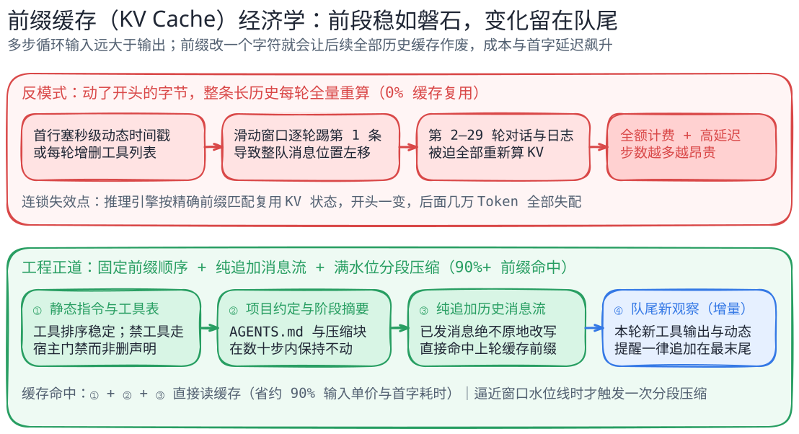

# 前缀缓存（KV Cache）与上下文经济学：为什么乱改提示词会让账单暴涨十倍

# 前缀缓存（KV Cache）与上下文经济学：为什么乱改提示词会让账单暴涨十倍

[返回机制目录](README.md) · [上下文与记忆](context-vs-memory.md) · [长会话压缩与记忆](session-compaction-and-memory.md) · [可编辑图源](../../figures/prefix-cache-mechanics/scene.excalidraw) · [PNG 预览](../../figures/prefix-cache-mechanics/preview.png)

不少团队第一次把多步编码或网页操作 Agent 推上生产时，都会被月底账单和首字响应速度吓一跳：明明每一步模型只吐出百来个 Token 的工具调用 JSON，跑完一单 30 步的修 Bug 任务，累计消耗的输入 Token 却高达 90 万，每一步等模型吐第一个字（TTFT）还要干等好几秒。翻开代码一查，罪魁祸首往往只是一行看似无害的习惯写法——有人在 System Prompt 第一行拼了句 `当前时间：2026-11-18 22:10:32`，还在历史超长时用了“每进一条新消息，就删掉最老一条消息”的滑动窗口。

在单轮问答里，这种写法无关痛痒；但在 Agent 循环里，它会直接废掉现代大模型推理底座最重要的一项硬件级红利——**前缀缓存**（Prefix Caching / Prompt Caching）。



[图的文字版](../../figures/prefix-cache-mechanics/README.md)逐条拆解了上排失效链路与下排高命中拼装顺序。看懂这张图背后的物理机制，是区分“玩具提示词拼接”与“生产级 Harness 上下文工程”的分水岭。

## 为什么 Agent 的账单结构与普通聊天截然不同

普通聊天机器人一问一答，输入与输出长度大致在 `2:1` 到 `5:1` 之间。而 Agent 是一个围绕工具反馈运转的多步循环：每执行完一次 `grep`、读完一个文件、跑完一轮单测，宿主都要把**系统指令 + 工具 Schema 列表 + 之前所有轮次的对话与工具观察 + 刚刚拿到的一小段新输出**重新打包发给模型。

假设基础系统提示与工具定义占 `6,000` Token，每步新增工具观察与回复共 `1,000` Token，连续跑 25 步：

- 模型实际新生成的输出总量只有约 `3,000 ~ 5,000` Token；
- 但 25 次请求累计发送的输入总量高达 $\sum_{k=1}^{25} (6000 + 1000k) = 475,000$ Token——**输入与输出悬殊到将近 `100:1`**！

好消息是，在第 $k$ 步和第 $k+1$ 步之间，前 $k$ 步的输入序列本该是**逐字节完全一致**的。主流推理引擎（如 vLLM 的 Automatic Prefix Caching）与各大模型服务商（Anthropic、OpenAI 等）均利用 Transformer 自回归注意力的因果特性——每个位置词元的键值张量（KV 状态）只依赖它左侧的前缀词元——把已算过的前缀块缓存在显存或高速存储中。只要下一次请求的前缀词元序列一字不差，引擎就能跳过前段的注意力矩阵重算，直接从末尾新增的那 `1,000` Token 接着往下算，通常可省去 **50% 至 90% 的缓存命中输入单价**并大幅削减首字延迟。

坏消息同样冷酷：**前缀匹配从左往右逐块校验，哪怕第 10 个词元变了一个字符，从第 10 个词元往后的几万 Token 缓存会瞬间全部作废**。

## 摧毁前缀缓存的四大反模式与工程解法

排查线上 Agent 的缓存命中率（如接口返回的 `cache_read_input_tokens` 或 `cached_tokens` 占比）时，九成以上的雪崩都踩中了以下四个反模式：

| 高频反模式 | 为什么会引发全盘失配 | 生产级 Harness 改造方案 |
| --- | --- | --- |
| **1. 系统提示开头塞秒级时间戳或随机请求号** | 第 1 块词元每秒都在变，导致后面挂着的几千字指令、工具表与全部对话历史每步 0% 命中 | 系统提示只保留天级静态日期或完全固定；确需精确到秒的运行态信息，作为增量消息挂在 `messages` 最末尾 |
| **2. 每步动态增删或乱序重排 `tools` 定义数组** | 工具 Schema 在底层模板中通常紧贴系统提示排在最前端；删掉一个工具或字典无序遍历都会改变整段前缀 | 顶层工具数组顺序严格固定；某步不允许调写工具时，靠**宿主执行门禁拦截**或状态提示约束，而非每步篡改工具声明列表 |
| **3. 逐条滑动窗口裁剪**（每超限一步就 `pop(0)` 踢掉首条历史） | 删掉 `messages[0]` 会使原 `messages[1..N]` 整体前移，序列偏移后整段历史哈希全部改变 | 平时保持**纯追加**（Append-Only）不动历史；直到逼近上下文容量水位线，才一次性把前段压成固定摘要块 |
| **4. 工具返回 JSON 键名乱序或夹带易变调试噪声** | 同一结构如果重放或重整时字典键序飘忽、混入无意义的临时内存地址，会破坏相邻前缀块稳定性 | 工具序列化统一固定键序（如 `sort_keys=True`），剥离每次随机变动的无关追踪句柄 |

### 在数据流里看清“逐条滑动”与“水位线分段压缩”的账本差距

对比一下处理超长会话的两种裁剪方式：

```text
❌ 逐条滑动窗口（第 21、22、23 步每步都踢掉最老 1 条消息）：
Step 21: [System] + [m2, m3, ..., m21]  ──► 相比 Step 20 少了 m1，[m2..m20] 全部缓存失配！
Step 22: [System] + [m3, m4, ..., m22]  ──► 相比 Step 21 少了 m2，[m3..m21] 再次全部失配！
Step 23: [System] + [m4, m5, ..., m23]  ──► 步步位移，步步全额重算

✅ 水位线分段压缩（平时纯追加，满 80% 水位才集中压一次）：
Step 1 ~ 20:  [System] + [m1, m2, ..., mk]                 ──► 连续 19 步历史前缀 100% 命中缓存！
Step 21 触发压缩：[System] + [Summary(m1..m16)] + [m17..m21] ──► 仅此一步重建新前缀锚点
Step 22 ~ 35: [System] + [Summary(m1..m16)] + [m17..mk]    ──► 随后 14 步再次连续命中新锚点！
```

回看第二部分的两个开源系统，你会立刻明白它们为什么那样写代码：

- **[Qwen Code](../systems/qwen-code/README.md)** 面对上百个 MCP 工具时，没有每轮挑十几个工具塞进顶层 `tools` 定义里来回切换，而是始终固定暴露极简的 `tool_search` 与脱壳调用入口——既省下了常驻窗口体积，又死死守住了顶层工具前缀的稳定性。
- **[MiMo Code](../systems/mimo-code/README.md)** 没有每步零敲碎打地删旧消息，而是让主循环一路纯追加往前跑，直到逼近上下文溢出水位线，才用后台早已异步写好的 `checkpoint` 水位线摘要一次性重建新窗口。

## 按“稳定度递减”排布你的上下文工作台

自己设计 Agent Harness 的请求组装器时，只需记住一条黄金排版律——**越稳定、跨步越不变的内容越靠左（靠前），越鲜活、每步都在变的内容越靠右（靠后）**：

1. **第一层（全局恒定）**：核心角色边界、安全准则与按固定字典序排列的工具 Schema 声明。若支持显式缓存断点（如 Anthropic 的 `cache_control`），在此处打下第一个常驻锚点。
2. **第二层（会话级稳定）**：仓库级静态约定（如 `AGENTS.md`）与常驻核心记忆文件。整场任务期间尽量不改动；这也解释了为什么 [Letta Code](../systems/letta/README.md) 不在单个回合中途每步实时改写系统提示，而是等同步重编译边界再统一切换。
3. **第三层（阶段级稳定）**：早期多轮交互浓缩出的阶段性摘要块（Compaction Summary）。几十步才更新一次。
4. **第四层（步级纯追加）**：本阶段内一轮接一轮往后追加的用户消息、模型提案与工具返回结果——**一旦发出去进入历史，绝不回头篡改其中某一条的措辞**。
5. **第五层（本步瞬态队尾）**：仅针对当前这一步的剩余步数提醒、待办进度勾选或最新环境状态。

上线后别靠感觉猜缓存生没生效：直接把模型响应里的 `usage` 字段（总输入 Token、缓存读取 Token、缓存新建 Token）打进每一轮轨迹日志。如果一个跑了 20 步的任务平均缓存命中率低于 `60%`，拿前后两步发出去的原始请求 JSON 做一次 `diff`，十有八九能在前一百行里抓到那个偷偷变动的字节。

## 来源与边界

本章机制与计费模型依据推理引擎与模型服务商公开技术文档，并结合本书固定源码样本交叉印证：

- **前缀缓存规范与引擎原理**：[vLLM Automatic Prefix Caching 设计文档](https://docs.vllm.ai/en/latest/design/prefix_caching.html)、[Anthropic Prompt Caching 文档](https://docs.anthropic.com/en/docs/build-with-claude/prompt-caching)、[OpenAI Prompt Caching 指南](https://platform.openai.com/docs/guides/prompt-caching)。
- **书中关联源码锚点**：Qwen Code 延迟工具固定入口见 [`QwenLM/qwen-code@b9840886`](../systems/qwen-code/README.md)；MiMo Code 水位线溢出重建路径见 [`XiaomiMiMo/MiMo-Code@a273d345`](../systems/mimo-code/README.md)；Letta Code 系统提示重编译边界见 [`letta-ai/letta-code@1f55d3dc`](../systems/letta/README.md)。
- **适用边界**：不同推理服务商的最小起缓门槛（如 1024 Token 起）、缓存存活时间（TTL，常见 5 分钟至 1 小时）与折扣比例各不相同；在极短的 1~2 轮单次调用或高并发跨实例无亲和路由场景下，缓存收益可能低于长链路单会话任务，需以线上实测 `usage` 账单为准。
