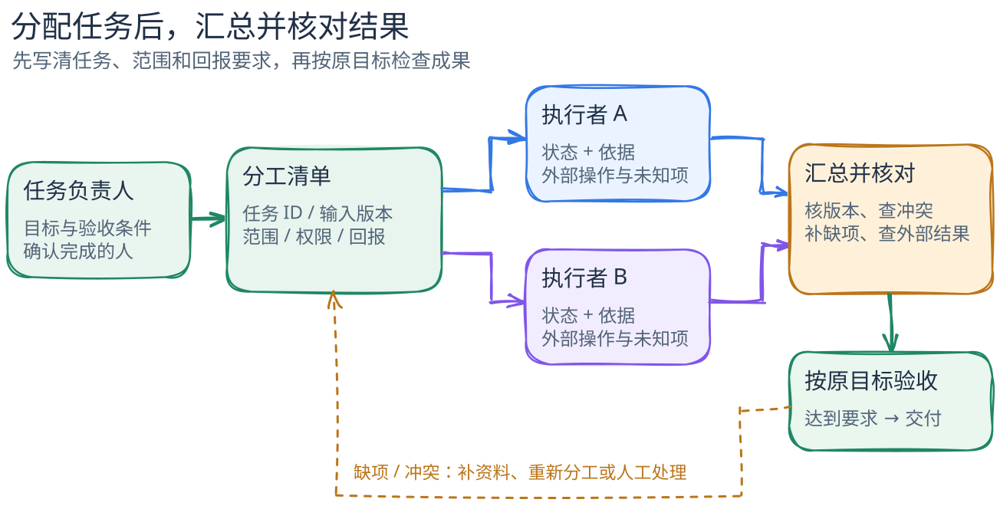

# 委派与交接：切分独立上下文，拒绝共享大泥球

# 委派与交接：切分独立上下文，拒绝共享大泥球

[返回机制目录](README.md) · [Agent、工作流与多 Agent](agent-workflow-multiagent.md) · [可编辑图源](../../figures/delegation-and-handoff/scene.excalidraw) · [PNG](../../figures/delegation-and-handoff/preview.png)

让单个 Agent 独立审查一次横跨鉴权中间件、SQL 迁移脚本与二十多个路由文件的大型发版变更时，它翻到第 25 个文件往往就开始顾此失彼：前面几千行 `grep` 搜索废料把最初的安全约束挤出了注意力焦点。有人灵机一动改成“多 Agent 团队”，却图省事把整段聊天记录原封不动广播给所有子 Agent，还放任它们同时读写同一个配置文件——结果 Token 账单翻了三倍，错误假设互相传染，先改好的文件还被后跑完的节点直接覆盖回旧版。

多 Agent 协作最容易翻车的地方就在这里：**委派不是当甩手掌柜拉大群，而是切分独立的上下文窗口（Context Isolation）并立下严格的输入输出契约**。子任务翻阅几十个文件产生的中间噪音应当锁死在子窗口里就地销毁，交回协调者的只有经过提炼的结构化结论与证据坐标。



[图的文字版](../../figures/delegation-and-handoff/README.md)逐条拆解了图中的派发、执行与合并连线。下面先厘清两种核心协作拓扑的取舍，再深入 LangGraph 源码看状态分发与归并如何落地。

## 父子委派 vs 控制权交接：两种截然不同的拓扑

在多 Agent 系统里，“把活分出去”其实对应两种完全不同的控制流模型——**父子委派**（Delegation）与**控制权交接**（Handoff）。选错模型，轻则上下文冗余，重则没人对最终交付物负责：

| 维度 | 父子委派（Delegation / 扇出归并） | 控制权交接（Handoff / 状态接力） |
| --- | --- | --- |
| **谁握最终交付权** | 父协调者（Coordinator）全程保留全局目标与验收权 | 当前节点完成本阶段工作后退场，由下一任专职 Agent 接管会话主导权 |
| **上下文传递方式** | 给每个子 Agent 开辟隔离窗口，只传该子任务必需的最小材料包 | 将提炼后的阶段状态包与用户意图单向移交给下一棒，不背负前序全量废料 |
| **返回路径** | 子 Agent 按约定 Schema 把结论与证据交回父节点，由父节点核对合并 | 控制流直接跳转到目标节点继续推进，无需原路返回呼叫方 |
| **典型工程场景** | 多模块并行代码审计、跨源资料交叉核查、独立子模块同步重构 | 客服分诊台转交账单专员 Agent、架构规划节点移交编码实现节点 |

无论采用哪一种拓扑，头号反模式都是**共享大泥球历史**（Shared History Blob）：把主会话里几万字未消化的工具报错、无关闲聊甚至其他系统的访问凭据一股脑塞给下游 Agent。正确的做法是把每次委派或交接都当成一次**跨边界函数调用**——入参最小化、权限最小化、返回值结构化。

## 把委派写成可机审的输入输出契约

假设发版前协调者要核查一次多租户改造变更，可以拆成两路互不干扰的子任务并行委派：**子代理 A** 专查数据库迁移脚本的锁表风险与非空字段默认值，**子代理 B** 专查 HTTP 路由层是否全部补齐了租户鉴权中间件。

协调者派发给子代理的不是一句笼统的“帮我看看有没有问题”，而是一份边界清晰的契约包：

```json
{
  "task_id": "audit-db-01",
  "goal": "检查本次新增迁移脚本是否存在大表排他锁及非空列无默认值风险",
  "input_files": ["migrations/20261118_add_tenant_id.sql"],
  "allowed_actions": ["read_file", "search_schema"],
  "return_contract": ["finding", "file_line", "severity", "missing_info"],
  "halt_condition": "若缺少目标表当前行数或索引定义，标记待确认并停止猜测"
}
```

当两路子代理各自在独立上下文窗口里读完文件、交回结构化报告后，协调者真正不可替代的价值才开始显现——**跨路交叉核对**：

- 子代理 A 报告：`migrations/20261118_add_tenant_id.sql:14` 新增了 `tenant_id NOT NULL` 列且无默认值。
- 子代理 B 报告：内部批量导入路由 `src/routes/batch_import.ts:88` 仍沿用旧版写入逻辑，未注入 `tenant_id`。

单看任何一份报告都只是局部观察，协调者把两边证据一对齐，立刻就能揪出“上线即触发写入崩溃”的致命冲突；遇到某一路标记为“缺少线上表规模数据、待 DBA 确认”的未决项，协调者也会原样保留在最终报告里，绝不在汇总阶段把“待确认”美化成“已验证通过”。

## 并发写入与外部调用：怎样防止互相踩踏

只读审计天然适合并行扇出；一旦多个子代理需要修改代码或调用外部服务，就必须加上写冲突护栏：

1. **严格切分不相交的写入领地，或改用单一写入者归并**：如果并行改代码，宿主必须在工具门禁层锁死子代理 A 只能写 `migrations/`、子代理 B 只能写 `src/routes/`；只要存在公共头文件或全局配置交叉，就让子代理只返回补丁建议（Diff Proposal），由协调者统一合并写入。
2. **高危动作收口确认**：文件落盘范围与敏感操作审批仍由宿主运行器按全局策略统一把关，子代理不能自行突破任务授权。
3. **外部写操作先对账再重试**：如果某个子代理负责调用外部系统接口并发生超时，协调者绝不能直接拉起一个新子代理重发一遍请求，必须先按业务操作标识核实远端是否已经生效，具体机制见[中断与恢复](interruption-recovery.md)。

## LangGraph 源码拆解：用 Send 动态扇出，用 Reducer 合并状态

在代码层面怎样实现“动态拆出 N 个并行子任务，跑完再安全合回主状态”？LangGraph 的 `StateGraph` 提供了一套非常干净的原语组合。

常规图编排的边在构图时就固定了节点数量，但真实任务往往在运行期才知道要拆成几份（例如本次 PR 一共改动了 7 个独立子包，就要拉起 7 个审查工作者）。为此，LangGraph 在条件边中引入了 `Send(node, arg)` 原语：条件函数遍历待处理列表，为每个目标动态生成一条 `Send` 指令，把专属的局部输入 `arg` 单独投递给目标节点实例，而不是让所有工作者去全局状态里抢食：

```python
# 条件边动态扇出：为每个待审模块生成独立输入包，并行发往 audit_module 节点
def dispatch_modules(state: AuditState):
    return [
        Send("audit_module", {"module": mod, "rules": state["rules"]})
        for mod in state["changed_modules"]
    ]
```

当这 7 个并行的 `audit_module` 实例在同一超步（Superstep）执行完毕，各自返回局部状态更新（`State → Partial<State>`）时，怎样避免最后一个跑完的节点把前 6 个节点的结果覆盖掉？

答案在于状态字段上绑定的 **Reducer**（归并函数）。例如把汇总字段声明为带 `operator.add` 合并规则的列表后，图引擎会把各并行分支返回的列表按序拼接起来，而不是直接做键值覆盖。源码中的经典 `generate_joke` 示例正是用这套“条件边返回 `Send` 列表 + `operator.add` 归并结果列表”展示了 Map-Reduce 式的扇出与汇聚。

至于前面提到的另一种拓扑——**控制权交接**（Handoff），LangGraph 则另外提供了 `Command` 原语，允许节点在一次返回里同时声明状态增量与下一跳目标节点（包括跨子图导航），无需再绕回原父节点。

把这套底层机制用进生产多 Agent 系统时，只需牢记一件事：**Reducer 只负责数据结构层面的无冲突拼接，不负责语义层面的真伪核查**。列表拼好之后，协调节点依然必须对照原始约束检查各分片结论是否自洽、是否有子任务超时缺席。

源码与文档参考：
- [Send 定义和示例](https://github.com/langchain-ai/langgraph/blob/bdb85b5aa87a21de68371d2e534b81aeed398f57/libs/langgraph/langgraph/types.py#L732-L804)
- [状态与合并规则](https://github.com/langchain-ai/langgraph/blob/bdb85b5aa87a21de68371d2e534b81aeed398f57/libs/langgraph/langgraph/graph/state.py#L131-L145) · [示例状态与条件边](https://github.com/langchain-ai/langgraph/blob/bdb85b5aa87a21de68371d2e534b81aeed398f57/libs/langgraph/langgraph/types.py#L751-L775) · [条件边入口](https://github.com/langchain-ai/langgraph/blob/bdb85b5aa87a21de68371d2e534b81aeed398f57/libs/langgraph/langgraph/graph/state.py#L982-L1030)
- [官方 Graph API](https://docs.langchain.com/oss/python/langgraph/graph-api)

## 来源与边界

本章基于固定提交的静态源码与官方文档审读编写：LangGraph Python 包固定在提交 [`bdb85b5a`](https://github.com/langchain-ai/langgraph/blob/bdb85b5aa87a21de68371d2e534b81aeed398f57/libs/langgraph/pyproject.toml#L5-L13)（其[项目元数据](https://github.com/langchain-ai/langgraph/blob/bdb85b5aa87a21de68371d2e534b81aeed398f57/libs/langgraph/pyproject.toml#L5-L13)与[许可证](https://github.com/langchain-ai/langgraph/blob/bdb85b5aa87a21de68371d2e534b81aeed398f57/libs/langgraph/LICENSE#L1-L20)标明采用 MIT 协议），本章仅提炼并链接其公开机制，配图为本书自绘架构图；未对大规模并发子图做压测或故障注入实验。
