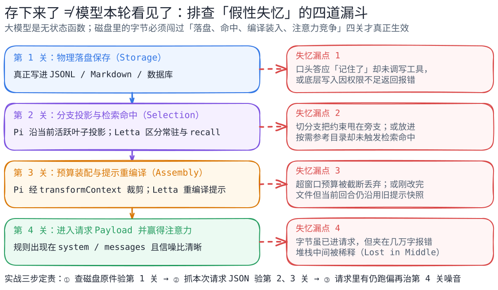

# 存下来了，下一轮就一定能看见吗？

# 存下来了，下一轮就一定能看见吗？

[返回横向对照](README.md) · [概念图：上下文与记忆](../concepts/context-vs-memory.md)

几乎每个深度使用过 Agent 的开发者，都经历过这种抓狂时刻：你在会话开头千叮万嘱“所有数据库建索引必须加 `CONCURRENTLY`，绝不允许锁表”，或者让助手把“回答一律只给结论和命令，不要寒暄”写进了它的记忆文件。你甚至专门打开本地的 `.jsonl` 会话文件或 `.md` 记忆目录看了一眼——那行字千真万确地躺在磁盘上。可偏偏到了下一轮（或者聊到第 30 轮），Agent 还是像失忆了一样，面不改色地给你生成了一条裸 `CREATE INDEX`。

**明明已经存下来了，为什么下一轮回答还是像失忆一样**？

根源在于一个极易被界面掩盖的事实：**大语言模型本身没有任何记忆，它只是一个无状态函数——你以为它“记得”某件事，唯一的前提是这件事对应的字节，在本次 HTTP 请求发出去的那一刻，真真切切地装进了 `system` 或 `messages` 载荷里**。

“持久保存（Persisted on Disk）”只保证了应用以后**有机会**把数据找回来；“本轮可见（Visible in Context）”才决定模型这一次**到底看见了什么**。两者之间隔着一整条筛选、投影与编译流水线，任何一环掉链子，表现出来都是同一种症状——“失忆”。



[可编辑图源](../../figures/persisted-vs-visible/scene.excalidraw) · [PNG 预览](../../figures/persisted-vs-visible/preview.png) · [图的文字版](../../figures/persisted-vs-visible/README.md)

## 排查“假性失忆”的四道漏斗

当你发现一条本该生效的规则或上下文在回答里消失时，不要盲目去调提示词措辞，按下面四道漏斗从底向上逐关排查，几分钟就能抓出真凶：

```text
[第 1 关：落盘保存]  写进持久存储了吗？（还是只留在内存缓冲 / 写入工具其实报错了？）
        ↓
[第 2 关：分支与命中] 切对当前会话分支了吗？落在常驻区还是按需检索区？检索查中了吗？
        ↓
[第 3 关：装配与编译] 塞进本次 Token 预算了吗？系统提示重编译了吗（还是仍在用旧快照）？
        ↓
[第 4 关：注意力竞争] 字节确实进了本次请求，但被几万字工具日志淹没或被新指令覆盖了吗？
```

1. **第一关：真落盘保存了吗**？（Storage）
   模型口头答应“好的，我记住了”，不代表底层真的发起了文件写入或追加了持久化事件；即使发起了写入，也可能因权限不足或校验失败返回了错误观察。排查第一步永远是看磁盘原件，而不是听模型表态。
2. **第二关：切对分支／检索命中了吗**？（Projection & Selection）
   存进文件不等于进入候选池。在支持回退分叉的会话树里，如果你切回了早期节点重开一条分支，写在旁支上的约束会被整枝剪掉；在分层记忆架构里，如果把规则写进了“按需查阅的参考文件”而非“常驻系统目录”，本轮只要没触发读取或历史查找（`recall`）没命中关键词，它就一直躺在冷宫里。
3. **第三关：装进本次请求窗口了吗，还是卡在旧快照里没重编译**？（Assembly & Recompilation Timing）
   这是工程上最隐蔽的高发区！哪怕信息已经被选中，在真正发往模型前还要过两道坎：一是**窗口裁剪与格式转换**（超长历史被截断或摘要折叠，或者非标准内部事件在转成 LLM 接口格式时被过滤）；二是**系统提示的编译时序差**——如果记忆是通过改写本地文件再编译进 System Prompt 的，文件改完后只要系统提示还没重编译，当前正在跑的回合拿到的就依然是旧快照！
4. **第四关：放进去了，但被长上下文噪音淹没了吗**？（Attention & Adherence）
   如果抓包确认那行规则一字不差地出现在本次请求载荷里，模型却依然违背，那才真正属于模型侧的注意力稀释（Lost in the Middle）或指令冲突——例如中间夹了 4 万 Token 的测试报错堆栈，或者用户最新一句急促的“快直接修好它”压过了早期的安全约束。

## 两条源码路径对比：Pi 与 Letta Code 怎样跨越这道鸿沟？

把 [Pi](../systems/pi/README.md) 的会话树路径与 [Letta Code](../systems/letta/README.md) 的本地文件记忆（local MemFS v1）路径放在一起对比，能极其鲜明地看出第 2 关和第 3 关的机制差异：

| 对照维度 | Pi（会话树投影 + 调用前转换） | Letta Code（local MemFS v1 分层文件 + 提示重编译） |
| --- | --- | --- |
| **第 1 关：物理存在哪** | 聊天消息与分支事件以追加方式存为 JSONL 文件（每行一条带节点关系的 JSON 记录）。 | 本地记忆目录按职责分层：核心高频信息存放在 `system/` 目录下的 Markdown 文件中；其余参考文件、Skills 与历史对话分开存放。 |
| **第 2 关：怎样筛出候选** | `SessionManager` 从完整 JSONL 树中，只沿**当前活跃分支**投影出一条线性消息链；旁支记录虽在文件里，但本轮不入选。 | **分流处理**：`system/` 目录下的文件默认入选常驻提示；非 `system/` 参考文件需模型按需读取正文；更早的对话历史需调用 `recall` 工具检索补查。 |
| **第 3 关：何时真正进请求** | 每次发起模型调用前，实时跑完 `transformContext`（上下文整理／裁剪）→ `convertToLlm`（转换为模型接口消息结构）两步流水线。 | **有严格先后时序**：修改记忆文件 → 提交同步 → 重编译系统提示（System Prompt）。**当前正在执行的回合继续使用已编译的旧提示快照**，重编译完成后后续请求才看见新内容。 |
| **最典型的“失忆”踩坑点** | 切了会话分支导致某次约定留在旧叉上；或长对话经过 `transformContext` 整理时早期细节被裁剪折叠。 | 把本该常驻的铁律放进了非 `system/` 目录却没触发读取；或刚在回合内改完记忆文件，误以为同一回合紧接着的下一步就能读到新系统提示。 |

### 在数据层面看清两个关键现场

先看 **Pi** 为什么“文件里有，请求里却未必有”。假设 JSONL 会话文件里按时间顺序追加了 4 条记录，但用户在 `m2` 处回退重开了一条新分支 `m4`：

```json
{"id": "m1", "parentId": null, "role": "user", "content": "帮我排查慢查询"}
{"id": "m2", "parentId": "m1", "role": "assistant", "content": "先看索引结构"}
{"id": "m3", "parentId": "m2", "role": "user", "content": "记住：建索引一律加 CONCURRENTLY"}
{"id": "m4", "parentId": "m2", "role": "user", "content": "换个思路，直接给迁移脚本"}
```

打开磁盘上的 `.jsonl` 文件，你明明能搜到 `m3` 里的 `CONCURRENTLY`；但当活跃叶子切到 `m4` 时，`SessionManager` 投影出来的当前分支路径只有 `m1 → m2 → m4`。接着这条路径再经过 `transformContext → convertToLlm` 发给模型，`m3` 从头到尾根本没进本次请求数组。

再看 **Letta Code**（local MemFS v1）为什么会出现“改了文件，当前回合却没反应”的时序差：

```text
Turn N 开始 ──► 模型拿到 System Prompt（编译自旧版 system/preferences.md）
  │
  ├─► 触发记忆更新：编辑 system/preferences.md 写入「只输出精简结论」
  ├─► memory-worker 执行文件同步与系统提示重编译（Recompile）
  └─► Turn N 剩余步骤收尾（注意：本回合内仍沿用开头那份已编译提示！）

Turn N+1 开始 ──► 模型拿到重编译后的新版 System Prompt（「只输出精简结论」正式可见）
```

看懂这张时序图，你就不会在调试时误判“记忆写入坏了”——文件早落盘了，只是它通往模型眼睛的那座桥（系统提示重编译），要到下一个编译周期生效点才切换过去。

## 三步实战自检法

无论你手头用的是自研框架还是开源产品，下次遇到“上下文或记忆不生效”，拿同一条测试规则按下面三处抓现场即可精准定责：

1. **查磁盘原件**：打开底层 JSONL、SQLite 或 Markdown 文件搜原文——确认过没过**第 1 关**。
2. **抓模型请求 Payload**：直接看发往 LLM 接口的原始 JSON（重点看 `system` 字段和 `messages` 数组末尾）——如果磁盘有而 Payload 里没有，100% 卡在**第 2 关**（分支投影／检索未命中）或**第 3 关**（预算裁剪／提示尚未重编译）。
3. **对比 Payload 与输出**：如果 Payload 里明明白白带着那句话，输出还是跑偏，再去治**第 4 关**（精简工具噪音、把硬性红线从提示词抽出来改成宿主代码层的权限拦截）。

## 来源与边界

本文对照的固定源码依据如下：

- **Pi** · `earendil-works/pi@898ab804050730e9dcefb4443875d5a932aa6a32`：[会话树当前分支投影](https://github.com/earendil-works/pi/blob/898ab804050730e9dcefb4443875d5a932aa6a32/packages/coding-agent/src/core/session-manager.ts#L543-L582)、[调用前 `transformContext → convertToLlm` 上下文转换](https://github.com/earendil-works/pi/blob/898ab804050730e9dcefb4443875d5a932aa6a32/packages/agent/src/agent-loop.ts#L380-L406)。完整系统边界见 [Pi 章节](../systems/pi/README.md)。
- **Letta Code** · `letta-ai/letta-code@1f55d3dc66e238d203757fae288bb53f3adc7cd3`：[local MemFS 目录与提示说明](https://github.com/letta-ai/letta-code/blob/1f55d3dc66e238d203757fae288bb53f3adc7cd3/src/agent/prompts/letta_local_memfs.md#L8-L55)、[记忆格式判定](https://github.com/letta-ai/letta-code/blob/1f55d3dc66e238d203757fae288bb53f3adc7cd3/src/agent/memory-format.ts#L6-L29)、[`memory-worker` 同步与提示重编译路径](https://github.com/letta-ai/letta-code/blob/1f55d3dc66e238d203757fae288bb53f3adc7cd3/src/agent/subagents/memory-worker.ts#L95-L139)。完整系统边界见 [Letta Code 章节](../systems/letta/README.md)。

本文于 2026-09-23 基于上述固定提交做静态源码核对，聚焦本地当前分支投影与 local MemFS v1 路径；跨端云同步、历史 `recall` 检索召回率及不同模型在长窗口下的指令遵循表现需结合具体环境实测。
