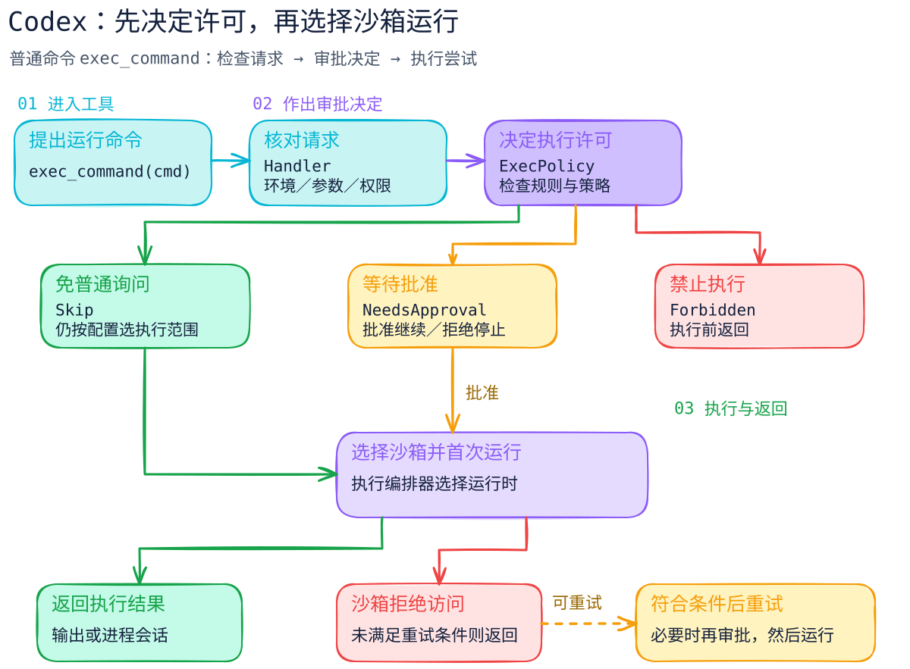

# 审批、沙箱与工作目录：管住意图，更要锁住爆炸半径

# 审批、沙箱与工作目录：管住意图，更要锁住爆炸半径

[返回机制目录](README.md) · [Codex 决策图](../systems/codex/README.md) · [OpenHands 事件图](../systems/openhands/README.md)

你在 `/workspace/billing-service` 目录下让编码 Agent 修复一个单元测试。终端弹出提示：“是否允许运行 `npm test`？”这看起来再正常不过了，你随手点了批准。两秒钟后，`package.json` 里一段被污染的 `pretest` 脚本顺着路径读走了 `~/.ssh/id_rsa`，还顺手改坏了隔壁目录 `../shared-proto` 里的接口定义。你明明指定了工作目录，也亲自点了人工审批，防线是怎么被击穿的？

根源在于把三件完全正交的机制当成了同一道墙：**工作目录**只决定相对路径从哪里算起，根本不是访问边界；**审批**（Approval）只管“这次意图允不允许发车”；而真正决定“万一脚本失控或遭遇提示注入，爆炸半径锁死在哪里”的，是**沙箱**（Sandbox）。哪怕用户当场点了批准，甚至策略配置为免询问直接放行，执行现场依然需要沙箱兜底。



## 三道机制各守哪条边界

把一次工具调用拆开看，宿主运行器（Harness）在真正拉起子进程前，实际上要回答三个彼此独立的问题：

| 机制 | 回答的核心工程问题 | 常见认知误区 |
| --- | --- | --- |
| **工作目录**（Working Directory） | 相对路径 `./` 默认以哪个目录为坐标原点？ | 误把 `cwd` 当隔离墙——进程依然能用 `../` 或绝对路径读写宿主任意可读文件 |
| **审批**（Approval） | 这次提议的动作意图，是否获得策略或人工放行？ | 误以为“人眼看过命令字符串就安全”——看不见子进程级联调用与依赖脚本内容 |
| **沙箱**（Sandbox） | 进程跑起来后，内核与环境究竟只允许它碰哪些文件与网络？ | 误以为“既然已经批准执行，就可以在宿主裸奔”——一旦脚本被注入将毫无遮拦 |

为什么审批永远替代不了沙箱？因为审批发生在**进程启动前**，审查对象只是一条静态的命令行文本（例如 `pytest tests/`）；而风险爆发在**进程运行中**。测试代码可能读取被篡改的夹具文件、解析包含间接提示注入的数据，或者触发深层依赖里的网络请求。反过来，沙箱也替代不了审批：如果你允许 Agent 访问生产工单接口或执行 `git push`，沙箱无法替你判断“现在是不是发版窗口”——这种业务意图层面的拍板，必须靠审批卡住。

两者叠加工作目录，才构成完整的执行契约：**工作目录定坐标，审批管发车许可，沙箱锁死运行期爆炸半径**。

## Codex 源码拆解：免审批绝不等于免沙箱

如果你去读 OpenAI Codex Rust 核心库，会发现它把“要不要问人”和“套什么沙箱”拆成了前后衔接但职责分明的两步，绝不混用同一个布尔开关。

第一步在执行策略模块中评估命令的审批要求（`ExecApprovalRequirement`），输出只有三种离散状态：

- `Skip`：命中预置白名单或低风险规则，跳过人工弹窗，直接进入后续执行编排。
- `NeedsApproval`：挂起当前工具调用，向客户端请求用户确认。
- `Forbidden`：命中硬性禁令，直接拒绝执行，连请求批准的机会都不给。

关键设计就在 `Skip` 之后发生了什么。很多初学者看到 `Skip` 会以为命令直接交给操作系统的裸 `sh -c` 运行了；实际上，`Skip` 只代表**跳过审批询问**，命令紧接着就会进入沙箱管理器（`SandboxManager`），按当前会话策略套上对应的平台沙箱（例如在 macOS 套上 Seatbelt 策略、在 Linux 套上 Landlock/seccomp，将写入范围死死限制在工作区目录内并切断外网）：

```text
模型提议命令: cargo test --package billing
  │
  ├─ 1. 审批策略评估 (exec_policy.rs)
  │     ├─ Forbidden      ──► 直接拦截返回错误，不弹窗、不执行
  │     ├─ NeedsApproval  ──► 暂停并请求人工确认 ──(批准)──┐
  │     └─ Skip           ──► 免打扰通过 ──────────────────┤
  │                                                        ▼
  └─ 2. 沙箱包装与执行 (sandboxing.rs) ◄───────────────────┘
        └─ 注入 cwd + 套用文件系统只读/工作区可写与禁网沙箱策略启动子进程
```

只有当一条命令在沙箱内因为合理的环境限制（比如确实需要拉取外部包或写特定系统路径）执行失败，且配置允许升级时，Codex 才会带着明确的越界风险提示再次向用户发起提权审批。日常高频跑单测之所以既流畅又安全，正是因为“审批层走 `Skip` 保效率，执行层靠沙箱保底线”。

源码参考：[执行策略源码](https://github.com/openai/codex/blob/c44deff7b1083e9660ac55d02122481f1cdf139b/codex-rs/core/src/exec_policy.rs#L337-L458) · [沙箱选择源码](https://github.com/openai/codex/blob/c44deff7b1083e9660ac55d02122481f1cdf139b/codex-rs/core/src/tools/sandboxing.rs#L239-L279)

## OpenHands 源码拆解：用显式状态机卡住待确认动作

在带图形界面或异步服务端的 Agent 系统里，审批还有一个极易踩坑的工程细节：**在等待用户点按钮的那几分钟里，Agent 循环必须彻底停住，绝不能因为前端轮询或重连而意外溜车**。

OpenHands SDK 采用事件溯源与显式运行状态机来解决这个同步难题。当模型输出工具调用请求时，调度器先把这次意图持久化为一条 `ActionEvent` 事件，但并不立刻执行；一旦安全策略判定该动作需要人工确认，会话状态立刻切入 `WAITING_FOR_CONFIRMATION` 并主动退出本轮推进循环：

```text
模型返回工具调用
  ──► 写入 ActionEvent（仅记录意图，尚未执行副作用）
  ──► 命中确认策略：状态置为 WAITING_FOR_CONFIRMATION，循环挂起返回
  ──► 前端展示待审命令，等待人工点击“批准”或“拒绝”
  ──► 收到明确批准信号后，宿主再次调用 run() 消费该挂起事件并真正执行
```

这种把“记录动作意图”与“真正执行动作”拆成两个状态跃迁的做法，给上层应用划出了一条硬红线：**宿主界面只有在收到明确的用户批准操作后，才能重新触发 `run()` 推进该挂起动作**；在 `WAITING_FOR_CONFIRMATION` 期间盲目自动重调 `run()`，就等于把审批门禁直接短路。

当动作获准进入终端工具 `TerminalTool` 执行时，工具会从当前工作空间（Workspace）读取 `working_dir` 作为命令起点。这也印证了前面的分层原则：`working_dir` 仅负责把命令锚定到项目路径，而进程能不能逃出该目录、能不能连公网，完全取决于底层挂载的是本地进程工作空间还是隔离的容器/远端运行时。

源码参考：[等待确认的代码](https://github.com/OpenHands/software-agent-sdk/blob/6ebd820d10794f1b52bb06ef6c19512888a1401b/openhands-sdk/openhands/sdk/agent/response_dispatch.py#L163-L190) · [TerminalTool 的工作目录](https://github.com/OpenHands/software-agent-sdk/blob/6ebd820d10794f1b52bb06ef6c19512888a1401b/openhands-tools/openhands/tools/terminal/definition.py#L294-L330)

## 工程落地：按风险水位组合三道开关

设计或配置一套 Agent 运行环境时，可以按以下四步核对防线是否闭合：

1. **高频开发内循环采用免审批与严沙箱组合**：读代码、全文检索、在工作区内跑单测这类高频可逆动作，审批设为自动放行以免产生“弹窗疲劳”（用户一旦习惯连点确认，真遇到高危命令也会机械放过），但底层沙箱必须锁死工作区外只读/不可见且默认禁网。
2. **不可逆外部副作用强制进审批**：发送邮件、合并分支、修改生产配置、删除核心数据等跨出本地沙箱边界的动作，沙箱拦不住业务语义对错，必须由策略强制打入人工确认队列。
3. **绝不用工作目录充当权限边界**：检查挂载配置时，永远假设被执行的脚本会尝试读取 `../`、`~/.ssh`、`~/.aws` 与环境变量。凡是不希望 Agent 碰到的凭据和目录，必须在沙箱挂载层彻底剥离。
4. **动作跑完还要验产物**：进程退出码为 `0` 只代表命令没崩溃，交付前仍需核对文件差异（Diff）是否越出了允许修改的文件范围。

## 来源与边界

本章基于固定提交的静态源码审读编写：OpenAI Codex 核心仓库固定在 [`c44deff7`](https://github.com/openai/codex/blob/c44deff7b1083e9660ac55d02122481f1cdf139b/codex-rs/core/src/exec_policy.rs#L337-L458)，OpenHands SDK 仓库固定在 [`6ebd820d`](https://github.com/OpenHands/software-agent-sdk/blob/6ebd820d10794f1b52bb06ef6c19512888a1401b/openhands-sdk/openhands/sdk/agent/response_dispatch.py#L163-L190)。文中命令流转框图为提炼源码分支后的示意流程，未对各平台底层内核沙箱做逃逸渗透测试。
