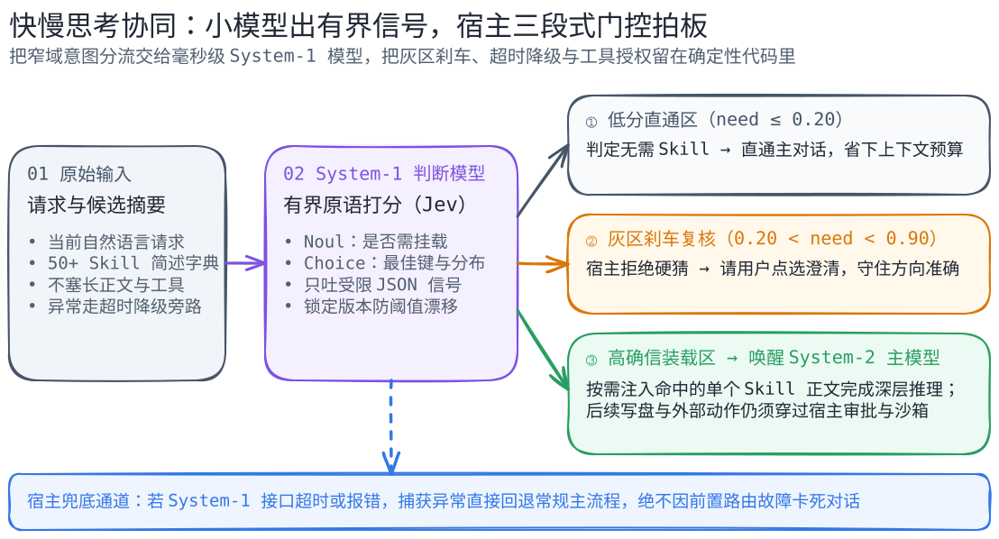

# 快思考路由与 System-1 模型：小模型做有界判断，宿主握最终执行权

# 快思考路由与 System-1 模型：小模型做有界判断，宿主握最终执行权

[返回机制目录](README.md) · [模型、Harness、CLI、Skill、MCP 的分工](model-harness-cli-mcp-skill.md) · [来源记录](../../sources/jev.md)

当工作区里的 Skill 攒到五六十个、工具列表越挂越长时，请求路由就会卡进两难死角：如果每轮对话都把几十份候选说明全量塞给重型推理大模型，首字延迟被拖慢，Token 账单成倍上涨；如果退回手写正则和关键词匹配，用户只要随口说一句“把昨天那份架构汇报最后两页砍掉”，没出现“修改幻灯片”这几个字，规则就当场漏判。

认知心理学把人的思维拆成直觉迅速的“快思考”（System 1）与审慎推演的“慢思考”（System 2）。TypeSafe 提出的 **Jev** 模型正是把这一分工搬进了 Agent 架构：在昂贵的主推理模型（System 2）启动前，先让一个轻快、输出严格受限的 **System-1 小模型**做有界分类或是非打分；而**走哪条分支、挂不挂 Skill、要不要转人工、允不允许执行工具，最终拍板权始终握在确定性的宿主代码（Harness）手里**。



[可编辑图源](../../figures/system-one-routing/scene.excalidraw) · [PNG 预览](../../figures/system-one-routing/preview.png) · [图的文字版](../../figures/system-one-routing/README.md) · 背景参考：[发布介绍](https://typesafe.ai/blog/introducing-system-one-models-and-jev) · [架构说明](https://docs.typesafe.ai/concepts/how-to-build-with-system-one)

## 三方分工：为什么不让同一个模型包办所有事

在复杂的 Agent 流水线里，把“窄域意图分流”和“长程复杂推理”拆给不同角色，本质上是在延迟、成本与可控性之间做工程解耦：

| 角色 | 核心职责 | 明确不做的事 |
| --- | --- | --- |
| **System-1 判断模型**（如 Jev） | 接收当前状态与封闭式问题，在毫秒/次秒级输出结构化选项与概率信号 | 不生成自由长文本，不规划多步任务，不直接调用任何外部工具 |
| **宿主运行器**（Harness） | 消费概率与置信度数值，执行阈值门控、异常降级、权限审批与沙箱隔离 | 不把原始概率当成绝对真理，不在高风险灰区盲目自动放行 |
| **System-2 主模型**（Agent） | 接收筛出的高相关 Skill 与上下文，完成复杂代码编写、多步推理与内容生成 | 不必每轮背负全量无关候选目录，也不能绕过宿主门禁直接落盘动作 |

TypeSafe 的 [Skill 推荐案例](https://docs.typesafe.ai/cookbooks/skill_suggestion)展示了这种串接方式：先由 Jev 在两轮轻量判断中筛出最匹配的候选 Skill，再由宿主程序把这份推荐递给主 Agent，由主 Agent 结合真实任务上下文决定是否采纳。哪怕推荐命中了某个包含写文件步骤的 Skill，后续真正改文件或调外部接口时，依然要过宿主原有的审批与沙箱防线——**路由推荐层只负责递说明书，绝不顺带批条子放权**。

## 有界输入与两类判断原语：Noul 与 Choice

为了让小模型的输出彻底告别自由文本解析失败的顽疾，Jev 把每次请求锁死在两部分结构里：`state`（客观输入材料，如用户当前请求与候选 Skill 简介字典）和 `questions`（限定返回格式的问题原语）。最常用的两类原语各司其职：

- **Noul**（是非判断原语）：回答封闭的二元问题（例如“这轮请求是否需要挂载给定列表中的任一 Skill？”），直接返回命题为“是”的概率值。
- **Choice**（有限多选原语）：从给定的 `criteria` 候选集中挑出最贴合的一项，同时返回获选键名、各候选项的概率分布以及 `confidence` 指标。

一次典型的路由判断请求与返回数据结构如下：

```json
// 输入给 System-1 模型的结构化上下文 (state)
{
  "request": "把昨天那份架构汇报最后两页砍掉，精简一下收尾结论",
  "skills": {
    "slides-author": "从零构思并生成全新的演示文稿",
    "slides-edit": "读取并修改已有的演示文稿内容与页数"
  }
}

// 模型返回的有界判断结果 (answers)
{
  "needs_skill": { "noul": 0.94 },
  "which": {
    "choice": "slides-edit",
    "confidence": 0.87
  }
}
```

使用这两个数值时，有一个极易踩坑的统计学细节必须分清：`Noul` 给出的数值代表模型倾向于“是”的程度；而 `Choice` 返回的 `confidence` **衡量的是各候选概率分布的集中程度（即榜首选项与其余选项拉开了多大差距），并不直接等于这次选对的客观真实概率**。

举个例子，当用户说“参考旧版幻灯片的风格，重新做一份下周路演的新稿”时，模型可能以很高的分布集中度误选进 `slides-edit`——返回 JSON 格式完全合法、`confidence` 数字也很漂亮，但业务方向却偏了。因此线上调优时，既要验结构合法性，更要持续抽检高分误判样本。

原语与指标参考：[快速入门](https://docs.typesafe.ai/introduction/quickstart) · [Noul](https://docs.typesafe.ai/primitives/noul) · [Choice](https://docs.typesafe.ai/primitives/choice) · [置信度说明](https://docs.typesafe.ai/confidence)

## 宿主门控代码：用三段式阈值管住灰色地带

拿到概率信号后，宿主代码不应只写非黑即白的 `if/else` 二分法，而应划出**明确跳过、灰区复核、高置信推荐**三个区间，并为网络超时与异常留好退路：

```python
from typesafe_sdk import Choice, Noul, TypeSafeClient

def route_skill_for_turn(user_request: str):
    state = {
        "request": user_request,
        "skills": {
            "slides-author": "从需求制作新的演示文稿",
            "slides-edit": "修改已有演示文稿",
        },
    }
    try:
        with TypeSafeClient() as client:
            answers = client.system_one(
                model="jev-1.13.0",
                state=state,
                questions={
                    "needs_skill": Noul(
                        instructions="这轮请求是否需要给定的任一 Skill？"
                    ),
                    "which": Choice(
                        instructions="若需要，哪项最贴合这轮请求？",
                        criteria=state["skills"],
                    ),
                },
            ).answers
    except Exception:
        # 路由服务超时或异常时安全降级，不阻塞主对话流程
        return fallback_without_recommendation(user_request)

    need = answers["needs_skill"].noul
    choice = answers["which"]

    if need <= 0.20:
        return None                         # 低分直通：无需额外 Skill，节省主模型上下文
    if need < 0.90 or choice.confidence < 0.80:
        return ask_user_to_clarify(choice)  # 灰区刹车：意图含糊时请用户点选，不硬猜
    return inject_skill_hint(choice.choice) # 高确信区：将候选 Skill 按需装载给主 Agent
```

这段控制逻辑体现了“模型出判断信号、代码握方向盘”的核心优势：阈值切在哪里、灰区是弹窗问用户还是回退全量列表、远端接口抖动时怎样降级，全部是可单测、可审计的确定性代码，不会因为模型某次自由发挥而脱轨。

## 认清能力锯齿与版本漂移边界

System-1 小模型之所以快而准，前提是把问题严格限制在它的舒适区里。一旦越界当成通用大脑使唤，就会迎头撞上**能力锯齿**（Model Jaggedness）：

1. **严禁交办计算与深层推理**：TypeSafe 在 [jev-1.13 已知问题](https://docs.typesafe.ai/model-jaggedness/jev-1.13)中明确列出了短板边界——精确计数、日期先后比较、多跳逻辑推导、混入大量无关长文本以及对抗性提示注入，都会导致判断失准。计数和日期比较本来就该交给三行普通代码，长程推理则该留给主模型。
2. **不同题型与语种不可混用同一套阈值**：不同问题的概率分布形态天然不同，不能拿一处调通的 `0.80` 到处硬套；同时官方 [模型文档](https://docs.typesafe.ai/models)指出该系列模型在英文语料上表现最佳，用于中文业务路由前，必须用真实中文标注集单独测算校准曲线与误判率。
3. **生产环境死锁精确模型版本号**：注意上面代码中显式写死了 `model="jev-1.13.0"` 而非浮动别名。只要你的宿主代码里写了概率阈值，模型小版本升级带来的分布微移就可能让大批原本通过的请求集体跌入人工复核区；每次切换模型版本，都必须重跑离线评测集重新标定门槛。

## 来源与边界

本章基于 TypeSafe 公开的 System-1 与 `jev-1.13` 系列官方文档整理，完整查阅链接与版本见[来源记录](../../sources/jev.md)。文中架构定位与能力边界引自厂商技术文档，代码示例用于展示宿主三段式门控模式；本书未接入其线上 API 对中文业务数据集做独立延迟与准确率基准评测。
