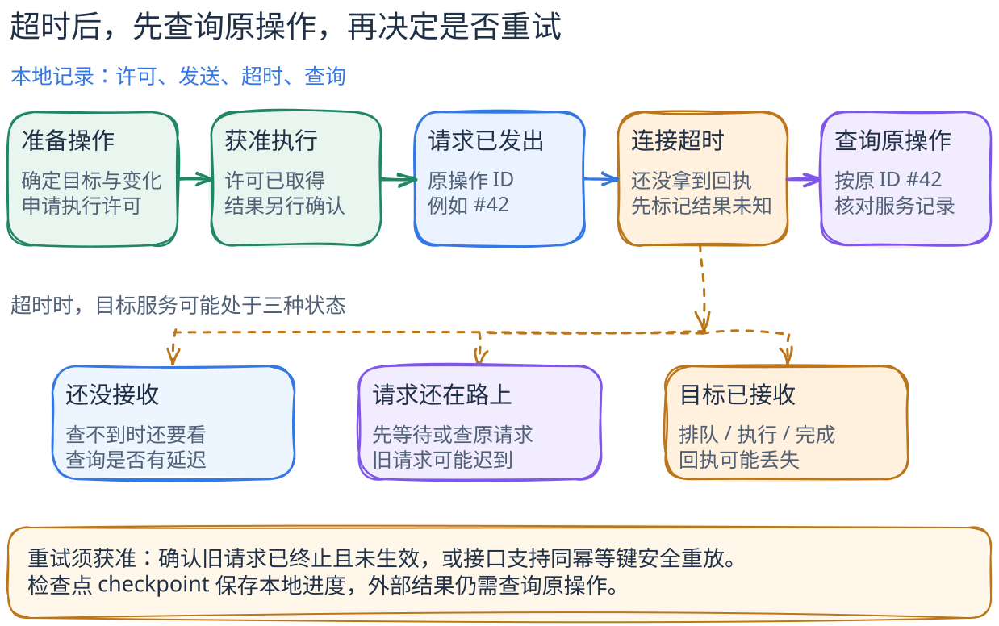

# 批准过了，超时后能重试吗？

# 批准过了，超时后能重试吗？

[返回横向对照](README.md) · [批准与沙箱](../concepts/approval-vs-sandbox.md) · [四种状态](four-kinds-of-state.md)

设想这样一个让人后背发凉的线上瞬间：Agent 准备好了一次生产补丁发布请求，终端弹出确认框，你仔细核对参数后按下了“批准”。请求发出去 15 秒后，网络抖了一下，工具调用抛出一行 `TimeoutError`。紧接着，急于完成任务的 Agent 捕获异常准备“自动重试”——顺手生成了一个新的请求编号再发一次。三分钟后监控报警炸响：生产集群同时拉起了两套发布任务，把数据库迁移锁死。

很多人在做 Agent 权限设计时，只盯着前半场——“高危动作执行前一定要让人点批准”。却忽略了分布式系统里最凶险的后半场：**一旦写操作跨出本机网络遇到超时，“已经批准过”不仅不是无脑重发的通行证，反而是最容易酿成重复执行事故的陷阱**。

本篇把 Codex、OpenHands、OpenCode 和 LangGraph 四套源码摆在一起，拆解一个核心工程问题：**当外部动作中断或超时后，本地 Agent 框架究竟帮我们记住了什么，又有哪些生死攸关的对账步骤必须由应用与目标服务联手兜底**？



[图的文字说明](../../figures/permission-and-recovery/README.md) · [单独打开 SVG 放大阅读](../../figures/permission-and-recovery/diagram.svg)

想在终端花 3 分钟亲手体验这种“回执丢了但远端其实已经生效”的现场，可以先跑一遍[不联网的回执查询练习](../labs/remote-effect.md)，再回来对照下面的四套源码切面。

## 为什么收到 Timeout 时，绝不能直接换号重发？

在本地调一个纯内存函数，抛异常通常意味着没执行成；但跨网络调用部署、发信、扣款等外部服务时，**客户端收到 `Timeout` 本质上不是操作失败通知，而是观测链路失联**。在超时发生的那一秒，远端服务其实正处于三种你暂时分不清的状态之一：

1. **根本没收到**：报文断在去程半路，远端风平浪静。
2. **还在路上或排队中**：请求正卡在网关队列或慢事务里，你前脚刚判定超时，它后脚就落盘生效（迟到提交）。
3. **早已执行成功，只是回执丢在回程**：服务已经建好发布单甚至跑完了，唯独返回给 Agent 的 `200 OK` 断在了半路。

看一眼本地账本与远端状态在超时瞬间的真实错位：

```json
{
  "local_agent_record": {
    "operation_id": "deploy-2026-patch-09",
    "approval": "granted_by_operator",
    "transport_result": "ReadTimeout after 15s",
    "known_remote_outcome": "UNKNOWN"
  },
  "possible_remote_truths": [
    "never_received",
    "in_flight_or_queued",
    "already_executed_receipt_lost"
  ]
}
```

如果在发送前没有先把稳定的 `operation_id` 持久化记在本地，或者远端服务压根不支持按原 ID 查询与幂等重放，那么超时之后盲目换一个新 ID 再发一次，在第 2 和第 3 种情况下就会百分之百制造**双倍外部副作用**。如果某些外部接口只在成功回执里才生成任务单号，一旦回执丢失且没有业务侧幂等键可查，唯一诚实安全的动作就是标为「**结果未知，暂停等待人工对账**」。

## 四套源码分别守住了哪一段本地账本？

Agent 框架并不能替远端部署系统实现幂等接口，但它们各自在**动作前放行**与**中断后本地进度记录**上提供了关键抓手：

| 追踪的源码切面 | 动作前的控制闸口 | 中断或异常后的本地记录 | 接外部写操作时必须补齐什么 |
| --- | --- | --- | --- |
| [Codex：普通 `exec_command`](../systems/codex/README.md) | 策略判出 `Forbidden`（禁行）、`NeedsApproval`（求批）或 `Skip`（免普通询问）；获批后再选执行沙箱 | 首次因沙箱受限失败后，按严格条件决定停下、请求确认或二次尝试 | 本地命令外的远端结果查询；牢记 `Skip` 只跳过常规询问，不跳过沙箱选择 |
| [OpenHands：本地会话](../systems/openhands/README.md) | 先写下 `ActionEvent`；需人工确认时挂起在 `WAITING_FOR_CONFIRMATION`，被拒则配对写入 `UserRejectObservation` | 下次 `Agent.step()` 会扫描当前分支**尚无对应观察结果的待办动作**并执行；正常或报错观察与原动作严格配对 | 宿主侧明确的确认收集入口与恢复前远端对账——**注意再次调用 `run()` 本身会被 SDK 视为隐式批准**！ |
| [OpenCode：会话处理器](../systems/opencode/README.md) | 该路径内可见针对重复死循环调用的 `doom_loop` 许可拦截点 | `ToolPart` 按 `callID` 追踪等待、运行、完成与错误；会话中断清理时将未收束调用统一标为 `interrupted` | 严格区分“模型流网络退避重试”与“工具动作重试”；遇到 `interrupted` 先按操作 ID 查外部结果 |
| [LangGraph：Python 图与 checkpointer](../systems/langgraph/README.md) | 图引擎在超步边界保存状态快照（人工审批可借中断节点挂起） | 按 `thread` / `namespace` / `checkpoint` 恢复进度或从旧快照分叉；实际落盘时机受 Saver 与 `durability` 模式约束 | **图状态回滚绝不等于远端撤销**！切分支重跑前必须先核对原请求是否已在外部生效 |

## 沿着三道生死分岔读懂源码细节

### 分岔一：动作在执行前就被拦下——状态干净，绝无外部残留

最理想的中断发生在刀落下之前。Codex 的 `Forbidden` 与未获批的 `NeedsApproval` 都在拉起子进程前直接收口；OpenHands 在用户明确拒绝时，会往事件流里补一条 `UserRejectObservation` 与先前的 `ActionEvent` 完成配对，工具函数一行都不会跑。

但读 OpenHands 源码时有一个极易踩坑的细节：**当会话停在 `WAITING_FOR_CONFIRMATION` 等待人工拍板时，一旦宿主代码再次调用 `run()`，SDK 会直接清除等待标志并捞起那条挂起的动作去执行**（相当于隐式批准）！因此宿主界面必须先拿到人类明确的“同意 / 拒绝”指令，拒绝时显式走拒绝逻辑，绝不能在崩溃重启后闭着眼睛自动调 `run()`。[Codex 策略与审批](https://github.com/openai/codex/blob/c44deff7b1083e9660ac55d02122481f1cdf139b/codex-rs/core/src/tools/orchestrator.rs#L151-L220) · [OpenHands 确认挂起分支](https://github.com/OpenHands/software-agent-sdk/blob/6ebd820d10794f1b52bb06ef6c19512888a1401b/openhands-sdk/openhands/sdk/agent/response_dispatch.py#L163-L190) · [OpenHands 拒绝事件配对](https://github.com/OpenHands/software-agent-sdk/blob/6ebd820d10794f1b52bb06ef6c19512888a1401b/openhands-sdk/openhands/sdk/conversation/impl/local_conversation.py#L2610-L2648) · [OpenHands 再次 `run()` 隐式放行](https://github.com/OpenHands/software-agent-sdk/blob/6ebd820d10794f1b52bb06ef6c19512888a1401b/openhands-sdk/openhands/sdk/conversation/impl/local_conversation.py#L1977-L1995)

### 分岔二：调用明确报错返回——保留原始错误类别，分清“重试模型”还是“重试工具”

不是所有报错都能混为一谈：单元测试断言失败有明确输出，本地沙箱越界有权限拒绝码，而远端接口超时则意味着结果未知。

在 OpenCode 的 `processor.ts` 里，你会看到非常清晰的层次隔离：如果只是请求大模型流式接口时遇到速率限制或网络闪断，处理器在内部按退避策略自动重连模型；但如果是一个正在运行的 `ToolPart` 收到 `tool-error`，它只会如实更新该 `callID` 对应的部件状态交给下一轮判断，**绝不会在底层自作主张把带副作用的工具偷偷重跑三遍**。同理，Codex 也只在满足特定沙箱受限条件时才进入受控的二次尝试。[Codex 条件性重试](https://github.com/openai/codex/blob/c44deff7b1083e9660ac55d02122481f1cdf139b/codex-rs/core/src/tools/orchestrator.rs#L310-L506) · [OpenCode `ToolPart` 结果更新](https://github.com/anomalyco/opencode/blob/18ef3cc7c5a25b82114c953a80ccc09f4988f74e/packages/opencode/src/session/processor.ts#L383-L420) · [OpenCode 模型流退避重试](https://github.com/anomalyco/opencode/blob/18ef3cc7c5a25b82114c953a80ccc09f4988f74e/packages/opencode/src/session/processor.ts#L641-L695)

### 分岔三：中途断电或超时失联——先靠本地进度找现场，再靠原 ID 向远端对账

当进程意外中断或请求超时未归时，四套系统会用各自的方式把“停在哪儿了”暴露出来：OpenHands 通过比对动作与观察的配对缺口找出悬空动作；OpenCode 在清理阶段把还没收尾的 `ToolPart` 统一标成 `interrupted`；LangGraph 则允许你从最近的 `checkpoint` 捞回图状态。

但这里藏着两重必须警惕的工程边界：

1. **先查你的本地账本是不是真落盘了**：OpenHands 状态存储支持内存回退；LangGraph 的 `InMemorySaver` 只适合本地调试，且 `sync`（每步同步落库）、`async`（异步刷盘）和 `exit`（退出时才写）三种 `durability` 模式在进程硬崩溃时能保住的进度截然不同。[OpenHands 查找未配对动作](https://github.com/OpenHands/software-agent-sdk/blob/6ebd820d10794f1b52bb06ef6c19512888a1401b/openhands-sdk/openhands/sdk/conversation/state.py#L677-L716) · [OpenHands 存储回退](https://github.com/OpenHands/software-agent-sdk/blob/6ebd820d10794f1b52bb06ef6c19512888a1401b/openhands-sdk/openhands/sdk/conversation/state.py#L506-L541) · [OpenCode 未收束调用中断清理](https://github.com/anomalyco/opencode/blob/18ef3cc7c5a25b82114c953a80ccc09f4988f74e/packages/opencode/src/session/processor.ts#L585-L610) · [LangGraph 持久化模式](https://github.com/langchain-ai/langgraph/blob/bdb85b5aa87a21de68371d2e534b81aeed398f57/libs/langgraph/langgraph/pregel/main.py#L2705-L2711)
2. **切回旧快照不等于时光倒流**：在 LangGraph 里从某个旧 `checkpoint` 派生新分支，只会改写图引擎接下来读取的本地状态；如果旧分支在崩溃前已经把部署请求发了出去，远端集群根本不知道你在本地“读档重来”了！[LangGraph 快照字段](https://github.com/langchain-ai/langgraph/blob/bdb85b5aa87a21de68371d2e534b81aeed398f57/libs/langgraph/langgraph/types.py#L711-L733) · [LangGraph 从旧状态保存新版本](https://github.com/langchain-ai/langgraph/blob/bdb85b5aa87a21de68371d2e534b81aeed398f57/libs/langgraph/langgraph/pregel/main.py#L1640-L1676)

## 给高危外部工具配一张“四步恢复铁律”

只要你的 Agent 需要触碰发邮件、改数据库、提工单、发版本这类不可逆外部副作用，请直接在工具封装层焊死这四步流程：

1. **发前落号**：在真正发起网络调用前，先按业务任务生成确定性的 `operation_id`（幂等键）并写入本地持久日志。
2. **超时先查**：遇到连接断开或读超时，**第一步永远是拿着原 `operation_id` 调查询接口对账**，而不是重调写入接口。
3. **警惕假 404**：即使查询返回“未找到”，也要考虑读写分离延迟与旧请求仍在途的可能——只有当目标服务明确支持**同 `operation_id` 幂等重放**（重复收到同一键只返回首次结果，不重复执行），或者能确证旧请求已彻底失效时，才允许携带**原 ID** 重试。
4. **未知即停**：既查不到确切终态、目标接口又不保证同键幂等时，唯一正确的出口是停在 `unknown` 状态，把原操作 ID、发生时间与查询入口交接给人类核实。

## 来源与边界

本文于 2026-09-24 基于以下四个项目的固定提交做静态源码路径与上游测试断言核对：

- **Codex**：[`openai/codex@c44deff7b1083e9660ac55d02122481f1cdf139b`](https://github.com/openai/codex/tree/c44deff7b1083e9660ac55d02122481f1cdf139b)（聚焦普通 `exec_command` 策略、审批与编排路径）
- **OpenHands SDK**：[`OpenHands/software-agent-sdk@6ebd820d10794f1b52bb06ef6c19512888a1401b`](https://github.com/OpenHands/software-agent-sdk/tree/6ebd820d10794f1b52bb06ef6c19512888a1401b)（聚焦本地会话 `ActionEvent` 确认与动作—观察配对恢复）
- **OpenCode**：[`anomalyco/opencode@18ef3cc7c5a25b82114c953a80ccc09f4988f74e`](https://github.com/anomalyco/opencode/tree/18ef3cc7c5a25b82114c953a80ccc09f4988f74e)（聚焦 `session` 处理器中 `ToolPart` 状态流转与中断清理）
- **LangGraph**：[`langchain-ai/langgraph@bdb85b5aa87a21de68371d2e534b81aeed398f57`](https://github.com/langchain-ai/langgraph/tree/bdb85b5aa87a21de68371d2e534b81aeed398f57)（聚焦 Python `Pregel` 的 `checkpointer` 快照与持久化模式）

文中的线上部署超时用于串联跨系统恢复决策逻辑，并非四套框架内置同款部署插件或同环境故障注入实测；端到端的“恰好生效一次”能力始终取决于目标外部服务的幂等协议实现与独立集成测试。
